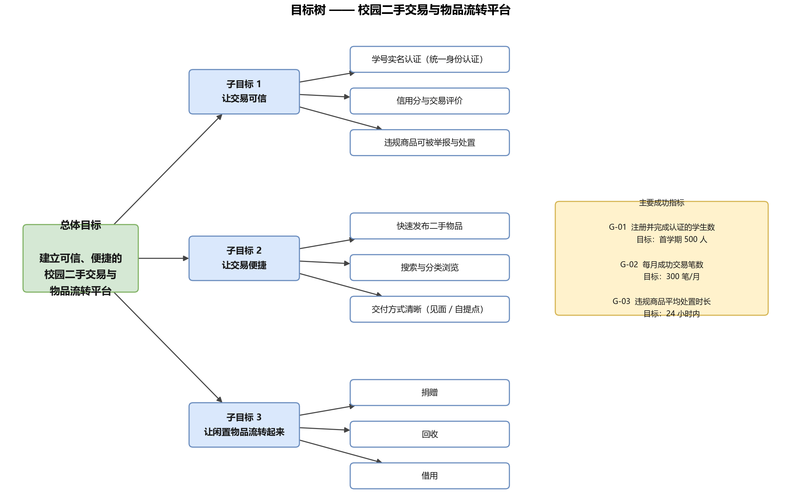
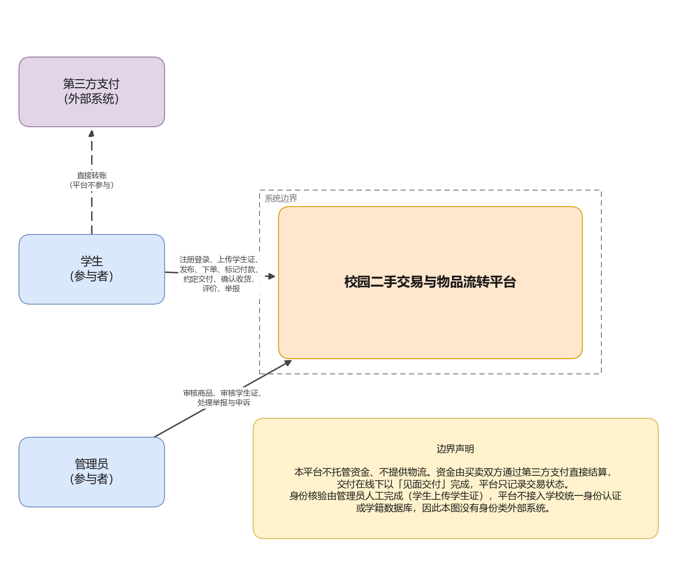
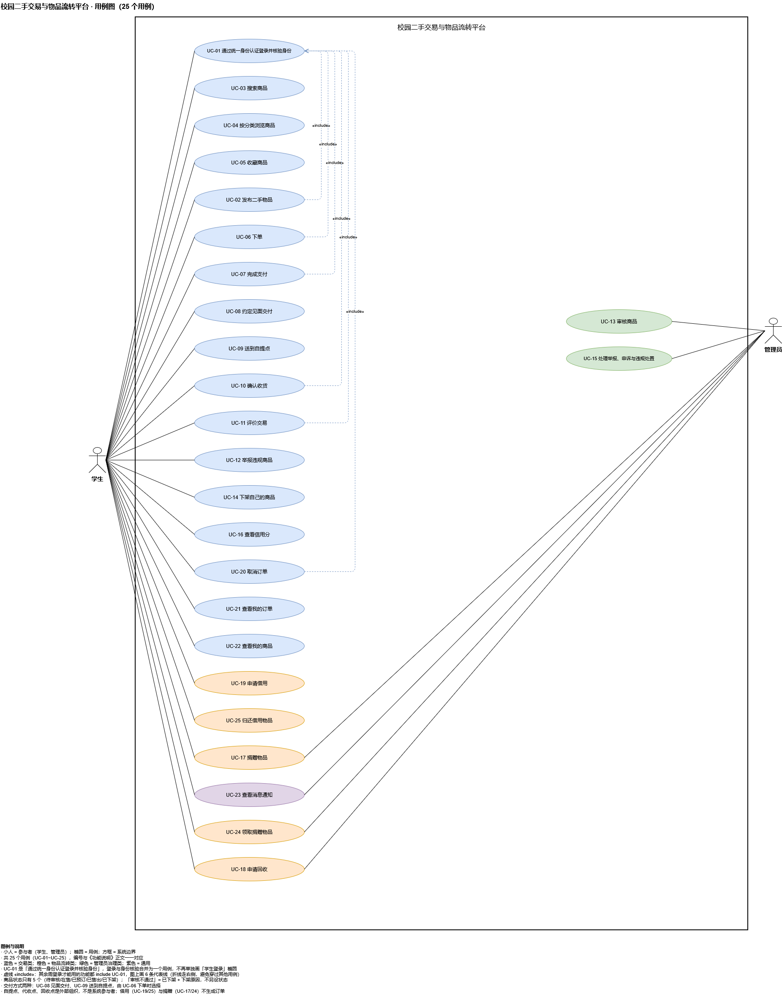
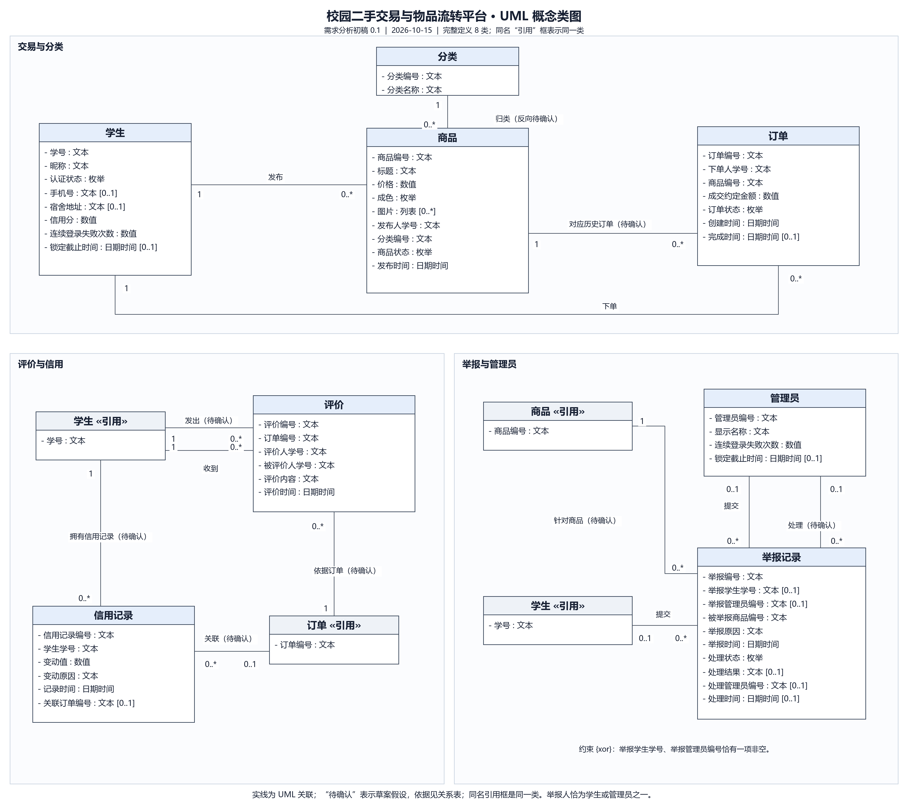
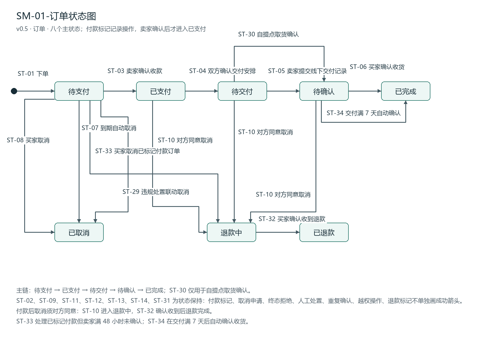
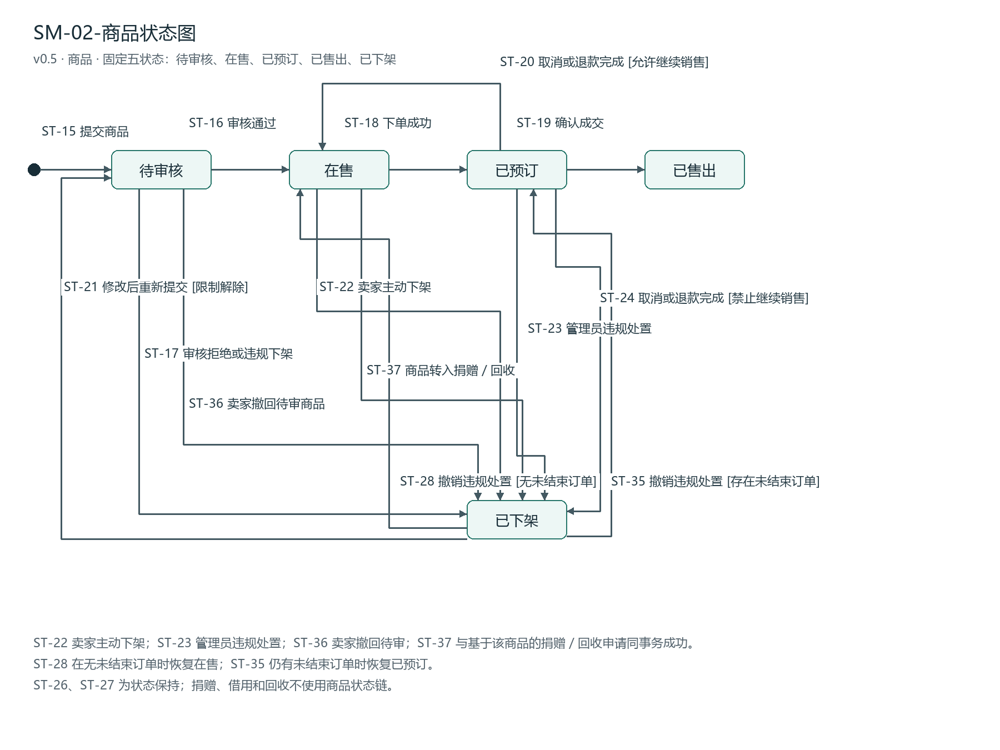
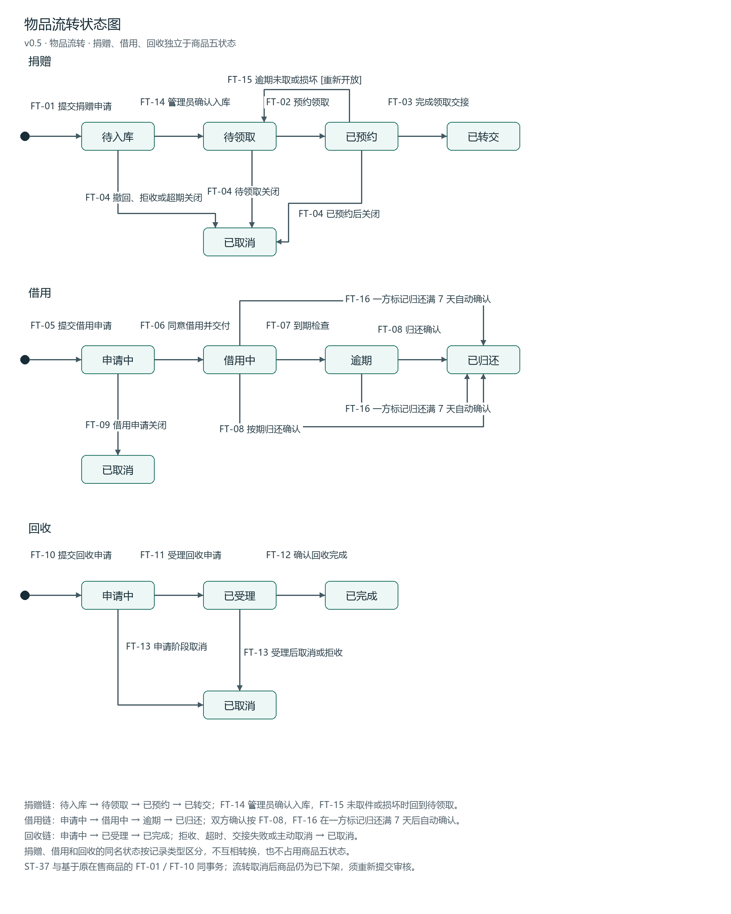
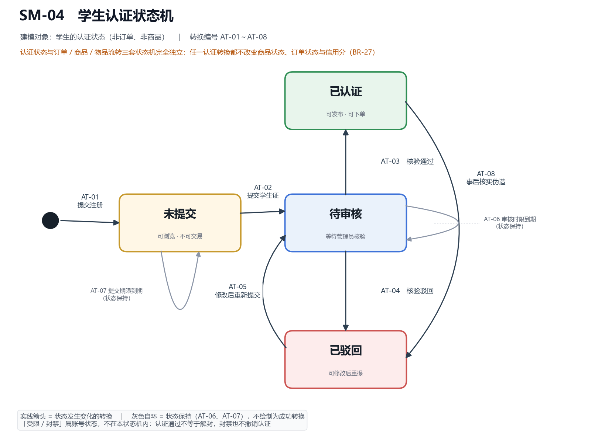

# A. 需求分析质量验证报告

> 依据：`学生需求分析与AI智能体使用验证报告.md` §A（老师原文）
> 汇总：林初仁（组长）　日期：2026-11-01

---

## A.1 提交信息

- 小组编号：【组长填】
- 项目名称：校园二手交易与物品流转平台（拾光二手）
- 成员名单：林初仁（组长）、赵俊豪、吕锦浩、马歆远、过振宇

### 使用工具与 AI

| 工具 / AI 名称 | 使用用途 |
|---|---|
| DeepSeek Harness（DSH）+ DeepSeek 模型 | 需求材料整理与要点提取；用例与业务规则的一致性检查；合稿、排版与图件渲染脚本编写；本报告与需求规格说明书生成 |
| 墨刀 AI | 可点击原型 4 页初稿生成（首页 / 商品详情 / 下单 / 后台审核） |
| draw.io | 用例图、UML 概念类图、目标树、系统上下文图、SM-01／SM-02／SM-03 状态机 |
| Python（python-docx / matplotlib / Pillow） | Markdown 转 Word；图件渲染与白底化处理 |
| Markdown + Git | 文档主格式与版本管理 |

### 文档版本说明

- 最终版本：Markdown 主报告
- **提交版本号：V1.2.1**
- **提交日期：2026-11-01**
- 配套文件：
  - 《**需求规格说明书 V1.2.1**》`.md`（GitHub 仓库 `需求文档/需求规格说明书_V1.2.1.md`）
  - 修改说明：`需求文档/需求文档_V1.2.1_修改说明.md`
  - v1.1、v1.2 作为历史版本留档于同目录，正文未改动；旧 v1.3 已从仓库删除（commit `9dcfdba`），未留归档件
  - 图模型可编辑源文件 `.drawio` 与导出件 `.png`，清单见 A.3
  - 原型：**Figma 设计稿** `https://www.figma.com/design/rNTOce1U11rqw7t8Q1ztlO/Untitled?node-id=0-1`（**7 个画板**：首页／商品详情／确认订单／订单结果与状态展示／发布商品／审核工作台／发布前检查与身份认证说明）——**本报告 A.6 一律以此设计稿为交付原型基准**。走查期间另使用过静态 HTML 导出件（在作者本地，**不入仓库**），其与设计稿的版本差异见 A.6 与 V-28
  - 走查记录与证据 `走查记录/`

> **版本口径声明（两轮两版）**
>
> - **第一轮走查（2026-10-28／29）依据 v1.1**：赵俊豪、吕锦浩、马歆远按当时下发的分工文件（其中指定 `需求规格说明书 v1.1`）执行。**本报告 A.5 记录的就是这一轮的推演过程。**
> - **v1.2（2026-10-26）** 是组长对身份方案与交付方式的返工版。因分工文件未同步更新，**组员未切换到该版**，故 v1.2 **未作为任何走查的依据**。它修正了两项 v1.1 缺陷（统一身份认证不可实现、自提点取货码无核验方），同时自己引入两项新问题（找回密码无用例、重提次数记错实体）。
> - **第二轮复核（2026-11-01）依据 V1.2.1**：V1.2.1 合入初稿 v0.5 的完整转换体系，并把认证转换由 `ST-29～ST-36` 改为 `AT-01～AT-08`，避开与交易 ST 的编号冲突。**本报告 A.7 记录问题在 v1.1 → v1.2 → V1.2.1 三版中的处理结果。**
> - 结论：A.5 的依据栏写 **v1.1**（当时事实），A.4／A.7 的依据写 **V1.2.1**（复核事实）。不改写历史版本，也不声称组员走过 V1.2.1。

---

## A.2 关键事实与业务规则确认

| 需求或规则编号 | 内容及来源性质 | 依据或确认记录编号 | 确认人员、角色与状态 | 未确认时的处理 |
|---|---|---|---|---|
| §2.1 资金边界 | 平台不托管资金；买卖双方经微信／支付宝直接结算；平台只记录订单状态与参考信息，禁止存储支付密码、卡号、验证码。来源性质：分析推导 | `目标树、术语表、架构上下文/05_边界问题决议.md` | 林初仁；模拟教师；团队已复核（**教学模拟**） | 已定案，不再作为候选值 |
| §2.1 身份边界 | **平台自建账号体系**：学生以学号 + 密码注册登录；首次登录后须上传学生证，由管理员人工核验学籍；核验通过才取得交易资格。平台**不接入**学校统一身份认证或学籍数据库接口。来源性质：分析推导 | `目标树、术语表、架构上下文/05_边界问题决议.md` 第六节补正 3；`目标树、术语表、架构上下文/03_术语表.md` v1.2 §二 | 林初仁；模拟教师；团队已复核（**教学模拟**） | 已定案。原「调用学校统一身份认证」的裁定已于 v1.2 撤销，理由与核验过程见 A.7 **V-01** |
| §2.1 交付边界 | 平台不提供物流；交付全部线下完成，方式**固定为 `见面交付`**，无第二种交付方式。来源性质：分析推导 | `目标树、术语表、架构上下文/05_边界问题决议.md` 第六节补正 4；`目标树、术语表、架构上下文/03_术语表.md` v1.2 §六 | 林初仁；模拟教师；团队已复核（**教学模拟**） | 已定案。原「自提点」交付方式已于 v1.2 整体移除，见 A.7 **V-02** |
| §2.1 退款边界 | 退款不是平台功能，只是订单状态变化；平台仅记录 `退款中` → `已退款`。来源性质：分析推导 | `目标树、术语表、架构上下文/05_边界问题决议.md` | 林初仁；模拟教师；团队已复核（**教学模拟**） | 已定案 |
| §7.1 订单状态集 | 订单主状态 8 个：`待支付`／`已支付`／`待交付`／`待确认`／`已完成`／`已取消`／`退款中`／`已退款`；不设「待完成」「待卖家确认收款」。来源性质：分析推导 | `目标树、术语表、架构上下文/05_边界问题决议.md`、`目标树、术语表、架构上下文/03_术语表.md` v1.2 | 林初仁；模拟教师；团队已复核（**教学模拟**） | 已定案；原型仅列 5 个，属实现缺口，**不倒改需求**（见 A.6 PV-01-6、PV-03-1） |
| §7.1 商品状态集 | 商品状态 5 个：`待审核`／`在售`／`已预订`／`已售出`／`已下架`；创建时恒为 `待审核`；不设「未通过」「强制下架」。来源性质：分析推导 | `目标树、术语表、架构上下文/05_边界问题决议.md`、`目标树、术语表、架构上下文/03_术语表.md` v1.2 | 林初仁；模拟教师；团队已复核（**教学模拟**） | 已定案；原型已符合（PV-03-3 通过） |
| §7.1 学生认证状态集 | 认证状态 4 个：`未提交`／`待审核`／`已认证`／`已驳回`；「受限／封禁」是**独立账号状态**，与认证状态分开记录。来源性质：分析推导 | `目标树、术语表、架构上下文/05_边界问题决议.md` 补正 3；SRS V1.2.1 §7.1、SM-04（AT-01～AT-08） | 林初仁；模拟教师；团队已复核（**教学模拟**） | 已定案；原型尚未实现，见 A.6、A.7 V-31 |
| BR-01 | 学生完成**学生证人工核验**且账号未封禁才可发布、购买；不能购买本人商品。来源性质：AI 候选 | SRS V1.2.1 §4.1；`目标树、术语表、架构上下文/05_边界问题决议.md` 补正 3 | 尚无模拟确认记录；**待确认** | 保持候选值；走查按该条件推演并在记录中注明 |
| BR-02 | 同一学号最多同时发布 5 件在售商品；预订中的商品不计入上限。来源性质：分析推导 | `目标树、术语表、架构上下文/05_边界问题决议.md`（v1.1 补正） | 林初仁；模拟教师；团队已复核（**教学模拟**） | 已定案；「5」为组内定案值 |
| BR-03 | 订单创建后 24 小时仍**未标记付款**，系统自动取消并释放商品。来源性质：AI 候选 | `规则与状态\吕锦浩-业务规则与状态-初稿.md` | 尚无模拟确认记录；**待确认** | 24 小时为候选值；走查按候选值推演 |
| BR-05／BR-21 | 信用分初始 100、范围 0～150；交易完成互评双方各 +2／单；超时未付自动取消买家 −2；举报成立强制下架卖家 −10；确认收货后 7 天未评价 −1；低于 60 禁发布、低于 40 禁下单；每次变动须留信用记录；按事件计次不按金额；权限／状态拒绝一律不扣分。来源性质：分析推导 | `目标树、术语表、架构上下文/05_边界问题决议.md`（v1.2 拍板） | 林初仁；模拟教师；团队已复核（**教学模拟**） | 已定案；BR-05 与 BR-21 内容重叠，加减分细则以 BR-21 为准。**缺借用逾期扣分事件**，见 A.7 V-24 |
| BR-07 | 举报须核实后再处罚；下架与封禁须记录原因、操作者和证据；管理员可直接封禁，解封须人工复核留痕；不设累计封禁次数阈值。来源性质：分析推导 | `目标树、术语表、架构上下文/05_边界问题决议.md` | 林初仁；模拟教师；团队已复核（**教学模拟**） | 已定案 |
| BR-10 | 平台不核验付款凭据；买家标记已付款后通知卖家；只有卖家在系统内确认收款才进入 `已支付`；重复标记或确认不得重复转换。来源性质：分析推导 | `目标树、术语表、架构上下文/05_边界问题决议.md`、`规则与状态\吕锦浩-业务规则与状态-初稿.md` | 林初仁；模拟教师；团队已复核（**教学模拟**） | 已定案；该条为 §7 状态机的前提 |
| BR-12 | 待支付订单允许买家取消；已支付后取消进入 `退款中`，线下退款完成后记录 `已退款`。来源性质：AI 候选 | `规则与状态\吕锦浩-业务规则与状态-初稿.md` | 尚无模拟确认记录；**待确认** | 保持候选值。**该条与 ST-08 的「未标记付款」守卫冲突**，见 A.7 V-05 |
| BR-16 | 卖家仅可主动下架自己的「在售」商品；管理员可下架「待审核／在售／已预订」商品；预订中订单按付款状态处置。来源性质：AI 候选 | `规则与状态\吕锦浩-业务规则与状态-初稿.md` | 尚无模拟确认记录；**待确认** | 保持候选值 |
| BR-23 | 「人工处置」不是订单状态，只是订单的附属业务标记；标记期间阻止交付与完成；管理员撤销后商品可由 `已下架` 恢复 `在售`，须留痕。来源性质：分析推导 | `目标树、术语表、架构上下文/05_边界问题决议.md`（v1.1 补正） | 林初仁；模拟教师；团队已复核（**教学模拟**） | 已定案。**「人工处置」在 §6 无实体承载**，见 A.7 V-10 |
| BR-15 | 举报对象仅限商品；举报须关联对象和原因，处理结果可追溯；管理员不走举报入口，直接处置；处置手段为驳回举报／强制下架／扣信用分；处理状态仅「待处理／已处理」。来源性质：分析推导 | `目标树、术语表、架构上下文/05_边界问题决议.md` | 林初仁；模拟教师；团队已复核（**教学模拟**） | 已定案。**处理状态缺「不成立」终态**，见 A.7 V-18 |
| BR-24～BR-27（v1.2 新增） | 注册后 7 天内须提交学生证核验；管理员 24 小时内出结论且**不得自动通过**；驳回后最多重提 3 次；伪造证件按违规处置；**认证状态独立于商品／订单／信用分与账号状态**。来源性质：分析推导 | `目标树、术语表、架构上下文/05_边界问题决议.md` 补正 3；SRS V1.2.1 §4.1 | 林初仁；模拟教师；团队已复核（**教学模拟**） | 已定案；时限值（7 天／24 小时／3 次）为组内定案值，业务方未确认 |
| NFR-09（v1.2 新增） | 学生证图片仅审核职责内管理员可读；不进入公开页面、消息、导出、日志与审计正文；存储须加密；登录密码只存不可逆哈希。来源性质：**分析推导，待确认** | SRS V1.2.1 §8.10 | 尚无模拟确认记录；**待确认** | 保持候选；留存期限与删除规则未定，只能判「范围已覆盖、期限待确认」 |

---

## A.3 图模型的提交

| 图号 | 图名 | 建模对象 | 可编辑源文件 | 导出件 | 关联需求／用例 | v1.2 状态 |
|---|---|---|---|---|---|---|
| 图 1-1 | 目标树 | 业务目标与子目标层级 | `目标树、术语表、架构上下文\01_目标树.drawio` | `.png`、`.svg` | §1.3、§1.4 | 已符合 |
| 图 2-1 | 系统上下文图 | 系统边界、外部角色与外部系统 | `目标树、术语表、架构上下文\02_系统上下文图-v1.2.1.drawio`（原稿保留） | `.png` | §2.1 | ✅ **已按 V1.2.1 重出**：删除「学校统一身份认证」外部系统框及其连线、删除「校内自提点」框，边界声明改写为「身份核验由管理员人工完成」 |
| 图 3-1 | 用例图 | 参与者与用例及其关系 | `功能 第一次修改版\用例图\用例图.drawio` | `.png` | §3.2 UC-01～UC-28 | ⚠️ 仍为 UC-01～UC-25 旧版，缺 UC-26～UC-28、未反映 UC-09 取消；**本次不重出，见 V-39** |
| 图 6-1 | UML 概念类图 | 10 个业务实体及其关联与多重性 | `数据与权限_需求分析成果 第二次修改版\01_UML类图\校园二手交易平台_UML类图.drawio` | `.png` | §6.2、§6.3 | ⚠️ 仍为 9 实体旧版，缺「认证申请」、缺登录密码字段、订单仍含「交付方式」；**本次不重出，见 V-39** |
| 图 7-1 | SM-01 订单状态机 | 订单，8 个主状态 | `规则与状态\SM-01-订单状态图.drawio` | `.png` | §7.2、§7.5.1 ST-01～ST-14、ST-29、ST-31～ST-34 | ⚠️ 已含 ST-29～ST-34，但**图中仍画有已停用的 ST-30 自提支线**，与 V1.2.1「ST-30 停用」不符，见 **V-40** |
| 图 7-2 | SM-02 商品状态机 | 商品，5 个状态 | `规则与状态\SM-02-商品状态图.drawio` | `.png` | §7.3、§7.5.2 ST-15～ST-28 | 已符合 |
| 图 7-3 | SM-03 物品流转状态机 | 捐赠／借用／回收记录 | `规则与状态\物品流转状态图.drawio` | `.png` | §7.4、§7.5.3 FT-01～FT-08 | 已符合 |
| **图 7-4** | **SM-04 学生认证状态机** | 学生的认证状态，4 个状态 | `规则与状态\SM-04-学生认证状态图.drawio` | `规则与状态\SM-04-学生认证状态图.png` | §7.1、§7.5.4 **AT-01～AT-08** | ✅ **已按 V1.2.1 出图**（组长绘制，几何自检 0 问题） |

**图 1-1　目标树**

**图 2-1　系统上下文图（⚠️ v1.2 待重出）**

**图 3-1　用例图（⚠️ v1.2 待重出）**

**图 6-1　UML 概念类图（⚠️ v1.2 待重出）**

**图 7-1　SM-01 订单状态机**

**图 7-2　SM-02 商品状态机**

**图 7-3　SM-03 物品流转状态机**

**图 7-4　SM-04 学生认证状态机（V1.2.1 新增，本次新出）**

> 以上为各图的导出件（`.png`，已统一转为白底 RGB），可编辑源文件 `.drawio` 位于同目录。
> **图 7-1～图 7-3 为状态图负责人 2026-10-29 的最新版本**（含 ST-29～ST-37、FT-01～FT-16）。
> **图 7-4 为本次按 V1.2.1 新绘的 SM-04**（AT-01～AT-08），源文件为 `规则与状态\SM-04-学生认证状态图.drawio`。
> **图 2-1 为本次按 V1.2.1 重出版本**；原稿 `目标树、术语表、架构上下文\02_系统上下文图.drawio` 保留未动，可与历史版比对。
> **仍有三处未与 V1.2.1 同步**：图 3-1 用例图缺 UC-26～UC-28（**V-39**）、图 6-1 类图缺「认证申请」与登录密码字段（**V-39**）、图 7-1 图中仍画有已停用的 ST-30 自提支线（**V-40**）。三处均**如实标注，不声明为已同步**。

---

## A.4 状态转换说明表

- 关联状态图编号：SM-01、SM-02、SM-03、**SM-04**
- 建模对象：订单；商品；捐赠／借用／回收记录；**学生认证状态**

完整状态转换说明表见《**需求规格说明书 V1.2.1**》§7.5.1～§7.5.4：

| 表 | 范围 | 条数 |
|---|---|---|
| §7.5.1 订单状态转换表（SM-01） | ST-01～ST-14、**ST-29**、**ST-31～ST-34** | 19 |
| §7.5.2 商品状态转换表（SM-02） | ST-15～ST-28、**ST-35～ST-37** | 17 |
| §7.5.3 物品流转状态转换表（SM-03） | **FT-01～FT-16** | 16 |
| **§7.5.4 学生认证状态转换表（SM-04）** | **AT-01～AT-08** | **8** |

> **编号说明（V1.2.1 起）**
> - **ST-30 已停用且不重用**：它原指「自提点取货确认」，自提点交付方式取消后不再有效。
> - 学生认证转换**改用 `AT-` 前缀**（AT-01～AT-08），避开与交易 ST 的编号冲突。历史记录中的 `ST-29～ST-36` 按下表映射：
>
>   | 旧 | ST-29 | ST-30 | ST-31 | ST-32 | ST-33 | ST-34 | ST-35 | ST-36 |
>   |---|---|---|---|---|---|---|---|---|
>   | 新 | AT-01 | AT-02 | AT-03 | AT-04 | AT-05 | AT-06 | AT-07 | AT-08 |
>
> - 组员初稿 v0.5 的 `ST-29～ST-37`、`FT-09～FT-16` 已在 V1.2.1 中合入（A.7 **V-26** 已修复）。
> 本报告按需求文档的编号引用，不重复抄写转换内容。

---

## A.5 场景走查

### 目的与走查方式

业务场景走查用于检查需求能否支撑完整业务流程，重点核对角色权限、业务规则、数据变化、状态转换和异常处理是否完整、合理且一致。本轮为**文档推演**，不打开原型；原型侧见 A.6。

| 走查方式 | 本轮是否开展 | 说明 |
|---|---|---|
| **本组自走查** | **已开展** | 2026-10-28／29 首轮；2026-10-31 吕锦浩补做卖家行 |
| 交叉走查 | **未开展** | 未邀请其他组同学参与，如实记录为未开展，不编造 |
| AI 反向走查 | **未开展** | 未让 AI 扮演测试工程师做反向走查 |

### 本节的形成方式（必须说明）

> **基准**：本节场景划分、九项元信息、步骤号与行内容，**一律照 `走查记录/过振宇走查/A.5场景走查记录-合并稿.md` 原版**，未重排步骤号、未改写措辞。
>
> **合并**：把 `走查记录/吕锦浩走查/场景走查/09_吕锦浩-卖家视角.md`（2026-11-01 12:45 版，17 行卖家行）的发现，按操作内容**逐行并入**对应行，并以〔吕锦浩 2026-10-31 卖家行〕标注来源；原版没有对应行的，作为「补充」行追加。
>
> **排除**：`走查记录/吕锦浩走查/场景走查/A.5场景走查记录.md`（2026-10-28，一人依次扮演全部角色，依据 v1.1 + 个人初稿 v0.5）**已作废**，不作为本节依据。**SC-04、SC-05、SC-07 三个场景的内容仅存于该已作废记录中**，故这三个场景一并标注为「来源已作废、本轮不作为已走查证据」。
>
> **未走查**：**SC-11（学生证核验）**为 v1.2 新增场景，三人记录均未覆盖。本节 SC-11 为组长按 V1.2.1 §7.5.4 与 §6.2 推演的**预期待核项**，不是走查产出。

### 走查依据

- 需求规格说明书 **v1.1** —— 首轮走查的实际依据（2026-10-28／29）。见 A.1「版本口径声明」
- 术语表 **v1.2**（`目标树、术语表、架构上下文/03_术语表.md`）
- 状态转换说明表：v1.1 §7.5.1～§7.5.3（ST-01～ST-28、FT-01～FT-08）
- 边界问题决议（`目标树、术语表、架构上下文/05_边界问题决议.md`，含第六节补正）
- **不包含**：原型（属 A.6）；已作废的《A.5场景走查记录》

### 场景类型

| 场景类型 | 承担场景编号 |
|---|---|
| 正常主流程 | SC-01、SC-08、SC-09、SC-10 |
| 权限流程 | SC-02 |
| 状态转换流程 | SC-03、SC-05、SC-06、SC-07 |
| 异常流程 | SC-03、SC-04、SC-05、SC-06、SC-07、SC-08 |

### 走查分工（实际执行情况）

| 走查人员 | 实际做法 | 覆盖场景 | 日期 |
|---|---|---|---|
| **吕锦浩** | 首轮**一人依次扮演全部业务角色**逐场景推演（该记录**已作废**）；后**改扮卖家**补做卖家行 17 行 | 首轮 SC-01～SC-10（作废）；补做 SC-01、02、06、08、09、10 的卖家行 | 10-28／10-31 |
| **赵俊豪** | 扮买家与越权学生、游客 | SC-01、02、03、06、08、09、10 | 10-29 |
| **马歆远** | 扮管理员，另做权限六问 | SC-01、02、06、08、10 | 10-29 |
| **过振宇** | **汇总三人记录、编制合并稿**，未独立走查 | — | 10-31 |
| **林初仁** | 2026-11-01 回原文核对（文档核对，非走查） | — | 11-01 |

> **未开展**：SC-04、SC-05、SC-07 仅存于已作废记录；**SC-11 无人走查**；交叉走查与 AI 反向走查未开展。

---

### SC-01 发布、审核、下单、支付与交付

- 走查编号：SC-01
- 场景名称及类型：发布、审核、下单、支付与交付；正常主流程
- 任务目标与情境：卖家发布一件二手商品，管理员审核通过后，买家完成下单、付款标记、卖家确认收款和线下交付，最终完成交易。
- 初始数据与状态：卖家已认证且可发布；买家已认证且不是卖家；管理员具有审核权限；商品尚无发布记录。
- 走查方式：本组自走查（实际实人执行，按业务角色进行文档走查）
- 走查依据及版本：SRS v1.1 §7；规则稿 v0.5；SM-01、SM-02；BR-08～BR-14
- 参与者姓名、走查分工及日期：吕锦浩、赵俊豪、马歆远；依次扮演卖家、买家和管理员，并承担记录与状态核对；2026-10-28
- 关联需求、用例和规则编号：UC-02、UC-06～UC-10、UC-13；BR-08～BR-14
- 关联状态图及转换编号：SM-01、SM-02；ST-15、ST-16、ST-01、ST-18、ST-02、ST-03、ST-04、ST-05、ST-30、ST-06、ST-19

| 步骤 | 角色 | 操作 | 预期系统响应 | 涉及数据、状态及转换编号 | 发现的问题 |
|---|---|---|---|---|---|
| 1 | 学生（卖家） | 填写并提交商品信息 | 创建发布记录，商品进入 `待审核` | 商品：无记录 → `待审核`；ST-15 | 〔吕锦浩 2026-10-31 卖家行〕BR-02的在售上限应明确在哪个业务节点校验，不应擅自断言一提交就超限。 |
| 2 | 管理员 | 审核通过该商品 | 商品进入 `在售`，记录审核结果 | 商品：`待审核` → `在售`；ST-16 | 无 |
| 3 | 管理员 | 在后台审核队列中通过该商品 | 审核通过，通知卖家，商品可被浏览 | 数据：商品.商品状态、审核结果；状态：商品 `待审核 → 在售`；编号：ST-16；依据 BR-04、BR-08 | 无 |
| 4 | 学生（买家） | 在商品详情页点「立即购买」并提交订单 | 系统校验商品在售、买家已认证、非本人商品，锁定商品并生成订单 | 数据：订单（新增，成交约定金额）、商品.商品状态；状态：商品 `在售 → 已预订`，订单 `— → 待支付`；编号：ST-01、ST-18；依据 BR-09 | ①§7.5.1 ST-01 目标列写「待支付；同时 **ST-13** 锁定商品并保存成交价」；ST-13 是「已完成 → 重复确认收货」，锁定商品只有 ST-18（`在售 → 已预订`）。本步「锁定商品并生成订单」在 ST 表中无对应转换，建议 ST-01 改引 ST-18。 ②UC-06 主事件流第 3 步「选择交付方式（见面交付／送到自提点）」、§2.1 边界、§6.2 订单.交付方式（取值 `见面交付`、`自提点`）、§2.3 的 UC-09 都还是 v1.1 口径；术语表 v1.2 §六 已删除「自提点」与「交付方式」，固定 `见面交付`（UC-09 编号保留不复用）。本步下单必须选定交付方式，取值在两份依据间矛盾。建议全文删「自提点」及 UC-09，订单.交付方式 统一为单一 `见面交付`，附录 B 换成 v1.2 正本。 |
| 5 | 学生（买家） | 通过微信／支付宝向卖家直接转账后，在平台点「我已付款」 | 记录付款标记时间并通知卖家；**订单仍为「待支付」**，不产生付款事实 | 数据：订单.付款标记时间；状态：订单 `待支付 → 保持「待支付」`；编号：ST-02；依据 BR-10 | ①UC-07 主事件流第 2 步要「展示卖家的收款方式（微信／支付宝收款码）」，但 §6.2 学生 无收款方式/收款码字段、§6.1 九个实体也无承载处；本步「向卖家直接转账」缺收款信息来源，付款链第一步就断。建议 §6.2 学生 补收款方式字段（注明不存敏感支付信息）。 ②标记已付款后订单停在 `待支付`，而 ST-08 只允许「未标记付款」时取消、ST-09 只从 `已支付` 起、ST-07 又写「已标记付款则不取消」→ 卖家不确认收款时该订单无任何出口（UC-07 辅流 D 却允许买家按 UC-20 取消），商品永久 `已预订`，SC-01 自第 6 步中断，SC-03 的「待支付到期」也被这条守卫挡住。建议为「`待支付` + 已标记付款」补一条取消/退款转换：或去掉 ST-08 的「未标记付款」，并把 `待支付` 加入 ST-09 起始状态。 |
| 6 | 学生（买家、卖家） | 双方确认交付安排 | 订单进入 `待交付`，记录交付安排并通知双方 | 订单：`已支付` → `待交付`；ST-04 | 分工摘要曾把“提交交付记录”写成 `已支付 → 待交付`，应按 ST-04、ST-05 拆分〔注：该表述引自已作废记录，存疑〕 〔吕锦浩 2026-10-31 卖家行〕本步符合§7.5.1旧ST-04“卖家已确认收款且可安排线下交付”，但§3.2 UC-08主流4～5要求双方先对时间地点达成一致，再进入待交付；附录B亦将待交付定义为双方已约定安排。建议统一ST-04与用例，补齐安排及双方确认；未达成保持已支付。不能称本步违反v1.1 ST-04，其缺陷是依据内部矛盾。 |
| 7A | 学生（卖家） | 见面交付后提交线下交付记录 | 订单进入 `待确认`，保存唯一交付记录 | 订单：`待交付` → `待确认`；ST-05 | 〔吕锦浩 2026-10-31 卖家行〕§4 BR-11写仅卖家可在已支付时提交，§7.5.1 ST-05与本步却规定待交付→待确认，提交时点矛盾。建议统一为安排达成、线下交接完成、无人工处置时，由本人卖家从待交付提交；交付记录保存与状态变化同时成功，生成后按BR-11不可自行修改。 |
| 7B | 学生（卖家、买家） | 卖家送到自提点；买家凭平台取货码确认取货 | 记录送达与取货，订单进入 `待确认` | 订单：`待交付` → `待确认`；ST-30；自提点为外部组织 | **本行即 V-02 的现场**：该流程要求「买家凭平台取货码取件」，但自提点值守人不是平台角色、不登录、无账号，**取货码没有核验方**，其约束力不成立；辅流还允许「码丢了自己再生一个」，进一步说明该码不具约束意义。 **原版此处记为「无」，属首轮漏判**；由赵俊豪（SC-01 第 4 步问题②：交付方式在 v1.1 与术语表 v1.2 之间矛盾）与组长复核共同发现，见 **V-02**。 **处置**：v1.2 已整体移除自提点交付方式，UC-09 作废（编号保留不复用）。本行仅存于 v1.1 走查记录，**不代表交付版（V1.2.1）仍有该分支** |
| 8 | 学生（买家） | 确认收货 | 订单进入 `已完成`，商品同时进入 `已售出`，成交只统计一次 | 订单：`待确认` → `已完成`；商品：`已预订` → `已售出`；ST-06、ST-19 | 无 |
| 9 | 学生（买家） | 在订单页点「确认收货」 | 订单完成，商品售出；成交只统计一次 | 数据：订单.订单状态、商品.商品状态、成交统计；状态：订单 `待确认 → 已完成`，商品 `已预订 → 已售出`；编号：ST-06、ST-19；依据 BR-14 | ①§7.5.1 ST-06 目标列写「已完成；同时 **ST-14**」，ST-14 是「非订单当事人操作 → 保持」，应为 ST-19（`已预订 → 已售出`）；本步「商品 `已预订 → 已售出`」在 ST-06 中引用错位。 ②BR-14 要求确认收货「须有交付记录」，BR-11 要求交付记录含订单、时间、约定地点与说明且「生成后不可修改」，ST-05 要求「保存交付记录」，但 §6.1 只有 9 个实体（无交付记录）、§6.2 订单 也无该字段 → 本步前置判据无处落地，SC-02 第 1 步「提交线下交付记录」同样无实体可写。建议 §6 补「交付记录」实体（订单编号、时间、约定地点、说明、不可修改）并修正 ST-06 引用。 |

### SC-02 第三名学生越权操作他人订单

- 走查编号：SC-02
- 场景名称及类型：第三名学生越权操作他人订单；权限流程
- 任务目标与情境：第三名学生尝试对不属于自己的 `待交付` 订单提交交付记录或确认收货，检查系统是否拒绝且不改变状态。
- 初始数据与状态：订单属于买卖双方且处于 `待交付`；关联商品为 `已预订`；第三名学生已认证但非订单当事人。
- 走查方式：本组自走查（实际实人执行，按业务角色进行文档走查）
- 走查依据及版本：SRS v1.1 §7；规则稿 v0.5；SM-01、SM-02；BR-11
- 参与者姓名、走查分工及日期：吕锦浩、赵俊豪、马歆远；依次扮演第三名学生、订单买家和卖家，并承担记录与状态核对；2026-10-28
- 关联需求、用例和规则编号：UC-08～UC-10；BR-11、BR-14
- 关联状态图及转换编号：SM-01、SM-02；ST-14、ST-19

| 步骤 | 角色 | 操作 | 预期系统响应 | 涉及数据、状态及转换编号 | 发现的问题 |
|---|---|---|---|---|---|
| 1 | 其他学生（第三人） | 对他人「待交付」订单提交线下交付记录 | 明确拒绝并提示无权限，不泄露订单敏感内容；不新增交付记录 | 数据：不新增交付记录；状态：订单 `待交付 → 保持「待交付」`，商品 `已预订 → 保持「已预订」`；编号：ST-14；依据 BR-11、§5 权限矩阵 | ①本行依据写「§5 权限矩阵」，但 §5.2 矩阵没有「提交线下交付记录」一行（也没有「标记已付款」「确认收款」「确认收货」），§5.6 典型输入也未覆盖 → 本步的越权拒绝无矩阵依据。建议 §5.2 补交易执行类操作行。 ②BR-11 写「仅订单卖家可在**已支付**时提交交付记录」，ST-05 的当前状态却是 `待交付`（`已支付 → 待交付` 已由 ST-04 完成）；若按 BR-11 字面执行，`待交付 → 待确认` 永不触发，订单卡在确认收货之前，SC-01 第 8 步也跑不通。建议 BR-11 改为「在 `待交付` 时提交交付记录」。 |
| 2 | 游客／未认证学生 | 尝试发布商品或下单 | 拒绝，提示「请先登录并通过身份核验」；不生成商品或订单，账号保持「未认证」 | 数据：无新增；编号：ST-14；依据 BR-01、UC-01 辅流 C | ①UC-01 前置与主事件流仍写「学校统一身份认证／首次登录自动建档／账号状态标记为「已认证」」，附录 B（自称 v1.2、日期 2026-10-22）也仍是统一身份认证与「未认证／已认证／受限／封禁」；术语表 v1.2 正本 §二 已整体替换为「平台自建账号 + 学生证人工核验」，认证状态为 `未提交`／`待审核`／`已认证`／`已驳回` 四态（SM-04）→ 本行「账号保持「未认证」」不是合法取值，正文亦无「注册」。建议 UC-01、§2.3、附录 B 按 v1.2 正本重写。 ②提示语两套：本行沿用 UC-01 辅流 C「请先登录并通过身份核验」，§5.2 对游客写「请先登录并完成学生认证」、对未认证写「请先完成学生认证」。建议统一取 §5.2。 ③ST-14 是「非订单当事人操作 → 各自状态保持」，发布被拒（尚无商品，属 ST-15 失败分支）、下单被拒（尚无订单，属 ST-01 失败分支）都不落在 ST-14 上，§5.5 第 3 条还要求权限拒绝与状态拒绝分开记。建议本行改为「§5.2 权限拒绝，无状态转换」。 |
| 3 | 管理员 | 尝试通过举报入口举报商品 | 系统无该入口；管理员直接走违规处置流程，不作为举报人 | 依据 §5 权限矩阵、BR-15、BR-23 | 无 |

### SC-03 待支付超时取消与终态拒绝

- 走查编号：SC-03
- 场景名称及类型：待支付超时取消与终态拒绝；状态转换、异常流程
- 任务目标与情境：订单到达付款截止时间仍未被买家标记付款，系统自动取消；买家随后再次尝试标记付款，检查终态是否保持。
- 初始数据与状态：订单为 `待支付` 且未标记付款；商品为 `已预订`；当前时间达到 24 小时截止点。
- 走查方式：本组自走查（实际实人执行，按业务角色进行文档走查）
- 走查依据及版本：SRS v1.1 §7；规则稿 v0.5；SM-01、SM-02；BR-03、BR-10、BR-13、BR-21
- 参与者姓名、走查分工及日期：吕锦浩、赵俊豪；依次扮演系统检查员和买家，并承担记录与状态核对；2026-10-28
- 关联需求、用例和规则编号：BR-03、BR-10、BR-13；UC-07 辅事件流 C、UC-20 辅事件流 F
- 关联状态图及转换编号：SM-01、SM-02；ST-07、ST-20、ST-24、ST-11

| 步骤 | 角色 | 操作 | 预期系统响应 | 涉及数据、状态及转换编号 | 发现的问题 |
|---|---|---|---|---|---|
| 1 | 系统 | 在截止时刻执行到期检查 | 订单进入 `已取消`，记录自动取消及通知 | 订单：`待支付` → `已取消`；ST-07 | 无 |
| 2 | 系统 | 处理关联商品 | 商品可售时恢复 `在售`；受限时保持或进入 `已下架` | 商品：`已预订` → `在售`，或按 ST-24 处理；ST-20 | 无 |
| 3 | 系统 | 记录买家超时未付款 | 买家信用分 -2，并生成一条信用记录 | BR-21；订单关联信用记录 | 无 |
| 4 | 学生（买家） | 再次尝试标记已付款 | 系统拒绝，不改变订单和商品 | 订单保持 `已取消`；ST-11 | 无 |
| 5 | 学生（买家） | 对已取消订单再点「我已付款」 | 系统拒绝并返回既有终态；订单保持「已取消」，不重新预订商品 | 数据：无变化，不产生付款事实；状态：订单 `已取消 → 保持「已取消」`；编号：ST-11；依据 BR-10 | ST-07 目标列写「已取消；按 **ST-15、ST-18 或 ST-23** 处理商品」：ST-15 是「提交商品 → `待审核`」、ST-18 是「`在售 → 已预订`」、ST-23 是「违规处置 → `已下架`」，没有一条是取消后释放商品；释放商品的是 ST-20（`已预订 → 在售`）、ST-24、ST-27。本行「不重新预订商品」以「取消时商品已按 ST-20 回到 `在售`」为前提，而该前提在 ST 表中无对应转换 → 商品侧结果不可判定，SC-03 到「商品恢复在售」即断。建议 ST-07（及 ST-08）目标列改为 ST-20／ST-24／ST-27。 |

### SC-04 两名买家同时下单

> ⚠️ **本场景内容来源已作废**：其记录仅存于吕锦浩《A.5场景走查记录.md》（2026-10-28，一人扮全部角色，依据 v1.1 + 个人初稿 v0.5），该文件已作废。下表**保留过振宇合并稿原版文字仅供追溯，不作为「已走查且无问题」的证据**。如需该场景的有效记录，须重新走查。

- 走查编号：SC-04
- 场景名称及类型：两名买家同时下单；异常流程、并发边界
- 任务目标与情境：两名买家同时购买同一件在售商品，检查系统是否只允许一笔有效订单并保持商品唯一占用。
- 初始数据与状态：商品为 `在售`；两名买家均已认证且均非卖家。
- 走查方式：本组自走查（实际实人执行，按业务角色进行文档走查）
- 走查依据及版本：SRS v1.1 §7；规则稿 v0.5；SM-01、SM-02；BR-01、BR-09
- 参与者姓名、走查分工及日期：吕锦浩；依次扮演买家 A 和买家 B，并承担记录与状态核对；2026-10-28
- 关联需求、用例和规则编号：UC-06；BR-01、BR-09
- 关联状态图及转换编号：SM-01、SM-02；ST-01、ST-18、ST-25

| 步骤 | 角色 | 操作 | 预期系统响应 | 涉及数据、状态及转换编号 | 发现的问题 |
|---|---|---|---|---|---|
| 1 | 学生（买家 A、买家 B） | 同时提交同一商品的订单 | 系统按服务端最新状态仅接受一笔请求 | 一笔订单：无 → `待支付`；ST-01 | 无 |
| 2 | 系统 | 为成功订单锁定商品 | 商品进入 `已预订` 并绑定唯一未结束订单 | 商品：`在售` → `已预订`；ST-18 | 无 |
| 3 | 系统 | 处理竞争失败请求 | 另一请求被拒绝，不生成第二笔订单 | 商品保持 `已预订`；订单无新增；ST-25 | 无 |
| 4 | 学生（买家 A、买家 B） | 重复提交同一订单请求 | 返回既有结果，不重复创建订单 | 仅保留一笔未结束订单；BR-09 | 无 |

### SC-05 管理员违规下架待支付订单

> ⚠️ **本场景内容来源已作废**：其记录仅存于吕锦浩《A.5场景走查记录.md》（2026-10-28，一人扮全部角色，依据 v1.1 + 个人初稿 v0.5），该文件已作废。下表**保留过振宇合并稿原版文字仅供追溯，不作为「已走查且无问题」的证据**。如需该场景的有效记录，须重新走查。

- 走查编号：SC-05
- 场景名称及类型：管理员违规下架待支付订单；异常流程、状态转换
- 任务目标与情境：管理员核实商品违规后下架商品，关联订单仍为 `待支付`，检查订单取消、商品下架和信用分处理。
- 初始数据与状态：商品为 `已预订`；关联订单为 `待支付`；管理员具有处置权限且违规成立。
- 走查方式：本组自走查（实际实人执行，按业务角色进行文档走查）
- 走查依据及版本：SRS v1.1 §7；规则稿 v0.5；SM-01、SM-02；BR-13、BR-16、BR-21
- 参与者姓名、走查分工及日期：吕锦浩；依次扮演管理员、卖家和买家，并承担记录与状态核对；2026-10-28
- 关联需求、用例和规则编号：UC-15；BR-07、BR-13、BR-16、BR-21
- 关联状态图及转换编号：SM-01、SM-02；ST-23、ST-29、ST-27、ST-11

| 步骤 | 角色 | 操作 | 预期系统响应 | 涉及数据、状态及转换编号 | 发现的问题 |
|---|---|---|---|---|---|
| 1 | 管理员 | 核实违规后下架商品 | 商品进入 `已下架`，记录原因、操作者和证据 | 商品：`已预订` → `已下架`；ST-23 | 无 |
| 2 | 系统 | 联动处理关联 `待支付` 订单 | 订单进入 `已取消`，商品解除占用但仍 `已下架` | 订单：`待支付` → `已取消`；商品保持 `已下架`；ST-07、ST-12 | 无 |
| 3 | 系统 | 结算违规处置 | 卖家信用分 -10 且只扣一次；不扣买家超时信用 | BR-21；ST-23 同一处置事件 | 无 |
| 4 | 学生（买家） | 再次尝试为已取消订单付款 | 系统拒绝，商品不得恢复 `在售` | 订单保持 `已取消`；商品保持 `已下架`；ST-11、ST-27 | 无 |

### SC-06 已付款订单的商品被违规下架及退款

- 走查编号：SC-06
- 场景名称及类型：已付款订单的商品被违规下架及退款；异常流程、状态转换
- 任务目标与情境：已支付、待交付或待确认订单的商品被管理员违规下架，订单先保持原状态并标记人工处置；双方同意取消后完成线下退款记录链。
- 初始数据与状态：订单处于 `已支付`、`待交付` 或 `待确认`；商品为 `已预订`；管理员具有处置权限。
- 走查方式：本组自走查（实际实人执行，按业务角色进行文档走查）
- 走查依据及版本：SRS v1.1 §7；规则稿 v0.5；SM-01、SM-02；BR-12、BR-16、BR-23
- 参与者姓名、走查分工及日期：马歆远、赵俊豪、吕锦浩；依次扮演管理员、买家和卖家，并承担记录与状态核对；2026-10-28
- 关联需求、用例和规则编号：UC-15、UC-20；BR-12、BR-16、BR-23
- 关联状态图及转换编号：SM-01、SM-02；ST-23、ST-12、ST-09、ST-10、ST-31、ST-32、ST-35、ST-28、ST-05、ST-30、ST-06、ST-20、ST-24、ST-27

| 步骤 | 角色 | 操作 | 预期系统响应 | 涉及数据、状态及转换编号 | 发现的问题 |
|---|---|---|---|---|---|
| 1 | 管理员 | 巡查认定该商品违规，执行强制下架并填写处置理由 | 商品转为「已下架」，记录原因并通知卖家；卖家信用分 −10 并生成信用记录 | 数据：商品.商品状态、处置原因、学生.信用分、信用记录（新增）；状态：商品 `已预订 → 已下架`；编号：ST-23；依据 BR-07、BR-16、BR-21 | 无 |
| 2 | 系统 | 阻止继续交付或确认收货 | 相关操作被拒绝，订单和商品状态保持 | 阻止 ST-05／ST-30／ST-06；ST-12 | 〔吕锦浩 2026-10-31 卖家行〕§7.5.1 ST-05只允许待交付提交，本步却在已支付提交，同时命中状态不符及人工处置，不能独立证明人工处置阻断有效。建议另设待交付且有人工处置的样本，并与无处置样本对照；拒绝不新增交付记录、不改变订单及商品、不扣信用分。当前行的拒绝结果本身有ST-12和BR-23依据。 |
| 3 | 学生（买家或卖家） | 发起取消申请并填写理由 | 订单保持原状态，记录申请并通知对方 | 订单状态保持；ST-09 | 无 |
| 4 | 学生（买家） | 尝试确认收货 | 系统阻止，订单保持原状态，不新增成交 | 数据：成交统计不变；状态：订单 `待确认 → 保持「待确认」`；编号：ST-12；依据 BR-14、BR-23 | ①ST-12 触发事件含「争议申请」、§7.6 SC-06 要求「标记人工处置」，但 §3 没有承载它的用例：UC-10 辅流 A/D、UC-20 辅流 A/B 只写「上报管理员（UC-15）」，而 UC-15 参与者只有管理员、由管理员进入队列 → 买卖双方没有发起入口，本步「阻止确认收货」的触发条件无处产生。建议新增「上报交易争议」用例（或在 UC-15 中专列并加发起角色）。 ②「人工处置」在 §6 无实体、无字段（§6.2 订单 只有状态与各时间字段），ST-12「标记人工处置」与 BR-23「标记期间阻止交付与完成」都无法落库 → 本步「阻止」缺判据。建议订单 增「处置标记／处置原因／标记时间」或新增「交易争议」实体。 |
| 5 | 学生（买家） | 人工发起取消并进入退款 | 订单进入「退款中」，记录退款申请；资金由双方线下处理，平台不参与 | 数据：订单.订单状态、退款申请记录；状态：订单 `已支付／待确认 → 退款中`；编号：ST-09；依据 BR-12 | ①ST-09 的条件（BR-12「卖家已确认收款，取消理由有效」）没有排除「人工处置」标记，而 ST-12 写「各自状态保持」、BR-23 只声明阻止「交付与完成」，未说明是否阻止取消与退款；本行要从 `待确认` 进 `退款中`，若处置标记同样冻结订单，则第 4 步被阻止、第 5 步也被阻止，SC-06 无法脱困。建议 BR-23 明确列出被阻止操作（交付、确认收货），ST-09 条件补「不受人工处置标记限制」。 ②本行数据写「退款申请记录」，§6.1 无该实体、§6.2 订单 无退款申请原因/发起人/时间字段 → 记录无处落地。建议 §6 补退款申请字段或实体。 |
| 6A | 学生（卖家） | 线下退回款项后标记“已退回” | 订单保持 `退款中`，记录退回时间和退款参考号 | 订单保持 `退款中`；ST-31 | 无 |
| 7A | 学生（买家） | 确认收到退款 | 订单进入 `已退款`；商品无其他限制时恢复 `在售` | 订单：`退款中` → `已退款`；商品：`已预订` → `在售`；ST-32、ST-20 | 无 |
| 5B | 学生（卖家） | 管理员尚未撤销违规处置时，线下退回款项并标记“已退回” | 订单保持 `退款中`，记录退回时间和退款参考号 | 订单保持 `退款中`；ST-31 | 无 |
| 6B | 学生（买家） | 确认收到退款 | 订单进入 `已退款`；违规限制尚未撤销，商品保持 `已下架` | 订单：`退款中` → `已退款`；商品保持 `已下架`并解除原订单占用；ST-32、ST-24／ST-27 | 无 |
| 7B | 管理员 | 订单已结束且无其他未结束订单后，撤销违规处置 | 商品恢复 `在售` | 商品：`已下架` → `在售`；ST-28 | 无 |

### SC-07 重复操作与成交写入失败

> ⚠️ **本场景内容来源已作废**：其记录仅存于吕锦浩《A.5场景走查记录.md》（2026-10-28，一人扮全部角色，依据 v1.1 + 个人初稿 v0.5），该文件已作废。下表**保留过振宇合并稿原版文字仅供追溯，不作为「已走查且无问题」的证据**。如需该场景的有效记录，须重新走查。

- 走查编号：SC-07
- 场景名称及类型：重复操作与成交写入失败；异常流程、重复与失败
- 任务目标与情境：重复标记付款、重复确认收款、重复确认收货，并模拟成交写入失败，检查系统是否只记录一次且订单与商品保持原子一致。
- 初始数据与状态：订单处于 `待支付`，商品为 `已预订`，买家与卖家身份有效。
- 走查方式：本组自走查（实际实人执行，按业务角色进行文档走查）
- 走查依据及版本：SRS v1.1 §7；规则稿 v0.5；SM-01、SM-02；BR-09、BR-10、BR-14、BR-19
- 参与者姓名、走查分工及日期：吕锦浩；依次扮演买家和卖家，并承担记录与状态核对；2026-10-28
- 关联需求、用例和规则编号：UC-07～UC-10；BR-09、BR-10、BR-14、BR-19
- 关联状态图及转换编号：SM-01、SM-02；ST-02、ST-03、ST-04、ST-05、ST-06、ST-13、ST-19

| 步骤 | 角色 | 操作 | 预期系统响应 | 涉及数据、状态及转换编号 | 发现的问题 |
|---|---|---|---|---|---|
| 1 | 学生（买家） | 重复点击“我已付款” | 只保留一次付款标记，订单保持 `待支付` | 订单保持 `待支付`；ST-02 | 无 |
| 2 | 学生（卖家） | 重复点击“确认收款” | 首次进入 `已支付`，重复请求保持 `已支付` | 订单：`待支付` → `已支付`；重复请求状态保持；ST-03 | 无 |
| 3 | 学生（买家、卖家） | 确认交付安排并提交交付记录 | 订单依次进入 `待交付`、`待确认` | `已支付` → `待交付` → `待确认`；ST-04、ST-05 | 无 |
| 4 | 学生（买家） | 重复确认收货 | 订单只完成一次，商品只售出一次，成交只统计一次 | 订单 → `已完成`；商品 → `已售出`；ST-06、ST-19；重复请求 ST-13 | 无 |
| 5 | 系统 | 模拟成交写入失败 | 订单和商品均保持操作前状态，不产生半笔成交 | 订单状态保持；商品状态保持；ST-06、ST-19 整体不执行 | 无 |

### SC-08 捐赠、借用与回收物品流转

- 走查编号：SC-08
- 场景名称及类型：捐赠、借用与回收物品流转；正常主流程、异常流程
- 任务目标与情境：分别走通捐赠、借用和回收三条独立流转链，并检查超期、撤回、拒收、损坏或归还超时分支。
- 初始数据与状态：捐赠者、领取者、借用者、出借者、申请人和管理员身份有效；物品分别处于可捐赠、可借用或可回收状态；涉及在售商品时无未结束订单。
- 走查方式：本组自走查（实际实人执行，按业务角色进行文档走查）
- 走查依据及版本：SRS v1.1 §7.4、§7.6；规则稿 v0.5；SM-03；FT 表；BR-20
- 参与者姓名、走查分工及日期：吕锦浩、赵俊豪、马歆远；依次扮演捐赠者、领取者、借用者、出借者、申请人和管理员，并承担记录与状态核对；2026-10-28
- 关联需求、用例和规则编号：UC-17～UC-19、UC-24、UC-25；BR-20
- 关联状态图及转换编号：SM-03；FT-01～FT-16；涉及在售商品时 ST-37

| 步骤 | 角色 | 操作 | 预期系统响应 | 涉及数据、状态及转换编号 | 发现的问题 |
|---|---|---|---|---|---|
| 1 | 学生（捐赠者） | 提交捐赠申请 | 捐赠记录进入 `待入库`；原在售商品同时进入 `已下架` | 捐赠：无记录 → `待入库`；FT-01 | 〔吕锦浩 2026-10-31 卖家行〕§7.5.3 FT-01及本步直接进入待领取，但§3.2 UC-17主流3～5要求提交后先完成管理员实物入库，未入库不能进入捐赠池。建议增加待入库和管理员确认入库转换；若来自在售商品，同时检查无未结束订单及商品下架。规则稿v0.5和SRS v1.3已补FT-14，不应误写成旧稿已有该转换。 |
| 2 | 学生（领取人） | 预约领取捐赠物品 | 状态转「已预约」，锁定领取名额 | 数据：捐赠记录.状态、预约信息；状态：`待领取 → 已预约`；编号：FT-02；依据 UC-24 | ①UC-24 辅流 C「领取人超过规定时间未领取 → 物品回到「待领取」，重新开放」与 FT-04「`待领取`／`已预约` 超期无人领取 → `已取消`（释放预约）」结论相反；本步已把物品锁成 `已预约`，超期后回 `待领取`（可被他人再领）还是 `已取消`（退出捐赠池）无法判定，SC-08 后续「交接」能否发生取决于这条口径。建议统一：`已预约` 超期回 `待领取`，仅「长期无人领取」才 `已取消`，并同步 FT-04。 ②本行数据「捐赠记录.状态、预约信息」在 §6.1 九个实体中不存在，§6.2 也无捐赠记录与预约字段 → FT-01～FT-04 的状态无处存放。建议 §6 补「捐赠记录」（状态、预约人学号、预约时间）与「领取记录」。 |
| 3 | 学生（领取者） | 预约领取 | 捐赠记录进入 `已预约`，锁定领取名额 | 捐赠：`待领取` → `已预约`；FT-02 | 无 |
| 4 | 学生（借用人） | 提交借用申请 | 生成借用记录，状态为「申请中」 | 数据：借用记录（新增）；状态：`— → 申请中`；编号：FT-05；依据 UC-19 | ①借用支线没有入口：UC-19 前置要求出借物品「由出借人通过 UC-02（发布类型选「出借」）发布」，UC-02 主事件流第 6 步却生成为 `待审核` 商品，UC-03／UC-04 只检索 `在售` 商品，BR-20 又说借用使用独立流转状态、不占用商品五状态；UC-19 触发条件里的「借用列表」全文无定义、无用例承载 → 借用人找不到可借物品，本步无法发起，SC-08 借用支线跑不通。建议明确出借物品的载体（借用期间商品状态取什么值，或新增「出借物品」实体）并补「浏览可借物品」用例。 ②FT-05 的 `申请中` 挂在「借用记录」，§6 无此实体。 ③UC-19 主事件流第 5 步仍写「送到自提点」，与术语表 v1.2 删除自提点冲突（同 SC-01 第 4 步）。 |
| 5 | 系统或管理员 | 超期未取、损坏或撤回 | 回到 `待领取` 或进入 `已取消`，记录原因 | `已预约` → `待领取`；FT-15；或原状态 → `已取消`；FT-04 | 无 |
| 6 | 学生（借用者） | 提交借用申请 | 借用记录进入 `申请中` | 借用：无记录 → `申请中`；FT-05 | 无 |
| 7 | 学生（借用人） | 归还物品后，在系统内确认归还 | 状态转「已归还」，记录归还时间 | 数据：借用记录.状态、归还时间；状态：`逾期 → 已归还`；编号：FT-08；依据 UC-25 | ①FT-08 条件是「双方确认物品已归还」才转 `已归还`，UC-25 辅流 E 却规定「一方标记、另一方长期不确认 → 超时限后系统按 `已归还` 处理」；本行只写借用人单方「确认归还」，按 FT-08 不足以转 `已归还`，按 UC-25 E 又要先有超时 → 归还能否完成无唯一口径。建议 FT-08 写成「借用人标记 + 出借人确认，或标记后超时限系统自动确认」。 ②UC-25 主事件流第 5 步「物品回到可出借状态」没有对应商品状态取值（借用期间出借物品的商品状态全文未定义），本行记录归还时间后物品能否再被借/被买无法判定。 ③UC-25 辅流 B、UC-16 称逾期「按 BR 扣信用分」，但 BR-21 的扣分事件只有互评 +2、超时未付 -2、举报成立/强制下架 -10、7 天未评价 -1，没有借用逾期 → 逾期处置无规则，建议写入 BR-21。 |
| 8 | 系统 | 到达约定归还时间仍未归还 | 借用记录进入 `逾期` 并通知双方 | 借用：`借用中` → `逾期`；FT-07 | 无 |
| 9 | 学生（借用者、出借者） | 双方确认归还 | 借用记录进入 `已归还` | 借用：`借用中／逾期` → `已归还`；FT-08 | 〔吕锦浩 2026-10-31 卖家行〕§3.2 UC-25主流3～5及§7.5.3 FT-08要求双方确认后，从借用中/逾期转已归还。本步却写保持已归还：若前一步只是借用人标记归还，此时终态提前；若前一步已双方确认，本步又是重复操作。建议明确前置状态与双方确认标记：最后一方确认执行FT-08并记录归还时间；终态重试仅返回已有结果，不重复结束或记信用。 |
| 10 | 管理员 | 受理回收申请并完成回收 | 状态依次转「已受理」「已完成」 | 数据：回收记录.状态；状态：`申请中 → 已受理 → 已完成`；依据 UC-18 | §7.5.3 的 FT-01～FT-08 仅列出捐赠与借用的状态转换，未见回收流程对应的状态转换编号；§3 的 UC-18 虽列出管理员确认回收完成及“超时未受理”分支，但主事件流未明确管理员将申请从“申请中”变为“已受理”的具体操作和触发条件。建议补充回收流程的状态转换表，明确受理动作、执行条件、失败/超时处理及相关通知规则。 |
| 11 | 学生（申请人） | 提交回收申请 | 回收记录进入 `申请中`；原在售商品同时进入 `已下架` | 回收：无记录 → `申请中`；FT-10；原商品：`在售` → `已下架`；ST-37 | 无 |
| 12 | 管理员 | 核对后受理回收申请 | 回收记录进入 `已受理` | 回收：`申请中` → `已受理`；FT-11 | 无 |
| 13 | 管理员 | 线下交接完成并核实 | 回收记录进入 `已完成` | 回收：`已受理` → `已完成`；FT-12 | 无 |
| 14 | 申请人或管理员 | 撤回、拒收或交接失败 | 回收记录进入 `已取消`并记录原因 | `申请中／已受理` → `已取消`；FT-13 | 无 |
| 补充3 | 学生（卖家） | 与领取人完成线下交接并确认 | （吕锦浩 10-31 卖家行记录，原版无此行） | — | 〔吕锦浩 2026-10-31 卖家行〕§7.5.3 FT-03采用捐赠者/领取者双方确认，当前行据此填写；但§3.2 UC-24主流5～6要求领取人标记已领取并由管理员确认发放，发放责任与确认权限不同。建议明确物品由谁保管、谁有最终发放权限，统一UC-24与FT-03，并明确确认不齐时保持已预约。 |

### SC-09 浏览、收藏与自助管理

- 走查编号：SC-09
- 场景名称及类型：浏览、收藏与自助管理；正常主流程
- 任务目标与情境：已认证学生搜索、筛选和收藏商品，查看商品当前状态，并完成卖家主动下架和买家取消待支付订单。
- 初始数据与状态：学生已认证；商品为 `在售`；另一商品为 `已预订`；存在一笔 `待支付` 订单。
- 走查方式：本组自走查（实际实人执行，按业务角色进行文档走查）
- 走查依据及版本：SRS v1.1 §7；规则稿 v0.5；SM-02；BR-02、BR-12、BR-13、BR-16、BR-18、BR-22
- 参与者姓名、走查分工及日期：赵俊豪、吕锦浩；依次扮演学生买家和学生卖家，并承担记录与状态核对；2026-10-28
- 关联需求、用例和规则编号：UC-03～UC-05、UC-14、UC-20～UC-23；BR-02、BR-12、BR-13、BR-16、BR-18、BR-22
- 关联状态图及转换编号：SM-01、SM-02；ST-08、ST-20、ST-22、ST-26

| 步骤 | 角色 | 操作 | 预期系统响应 | 涉及数据、状态及转换编号 | 发现的问题 |
|---|---|---|---|---|---|
| 1 | 学生（买家） | 搜索关键词、按分类筛选、收藏商品后到收藏页查看 | 只返回「在售」商品；收藏不锁定商品；商品状态变更后收藏页显示实际状态 | 数据：商品列表（过滤 商品状态=在售）、收藏记录（新增）、商品.商品状态不变；依据 BR-18 | ①分类层级矛盾：术语表 v1.2 §三 明确「分类不分层」，UC-04 主事件流第 1、4 步却写「一级分类列表」「下钻子分类」，§6.2 分类 仍写「正式名称及层级待术语表确认」→ 本步「按分类筛选」的筛选项与结果不可判定。建议统一为单层，删「一级」「子分类」。 ②BR-18 要求「收藏不锁定商品」「状态变更后收藏页显示实际状态」，本行数据写「收藏记录（新增）」，但 §6.1 九个实体无收藏、§6.2 无收藏字段 → UC-05 的「已收藏」「已失效」标记无落点。建议 §6 补「收藏」实体（学生学号、商品编号、收藏时间）。 |
| 2 | 学生 | 按分类筛选结果 | 列表按筛选条件更新，不改变商品状态 | 商品状态不变 | 无 |
| 3 | 学生 | 收藏商品并在收藏页查看 | 生成收藏记录，不锁定商品；状态变化后显示实际状态 | 收藏记录新增；商品状态不变 | 无 |
| 4 | 学生（买家） | 在「我的订单」取消一笔「待支付」订单 | 订单取消，商品恢复「在售」，通知双方 | 数据：订单.订单状态、商品.商品状态；状态：订单 `待支付 → 已取消`，商品 `已预订 → 在售`；编号：ST-08、ST-20；依据 BR-12、BR-13 | ①ST-08 目标列同样写「按 ST-15、ST-18 或 ST-23 处理商品」，与本行「商品 `已预订 → 在售`」不符（应为 ST-20／ST-24／ST-27），商品恢复 `在售` 在 ST 表无对应转换（同 SC-03 第 5 步）。 ②BR-13 的恢复条件是「商品仍已预订且无违规限制、卖家可交易」，但「卖家可交易」全文无判定口径：BR-05 的信用分阈值只管发布与下单，BR-17 只管封禁后禁新增，账号 `受限` 与「人工处置」标记如何组合未定 → 本行「商品恢复在售」不可判定。建议 BR-13 写明「卖家可交易」的判定字段与优先级。 |
| 5 | 学生（买家） | 查看消息通知 | 站内通知按 BR-22 规则生成，本人可查看 | 数据：消息通知；依据 BR-22、UC-23 | ①§6.2 消息通知.接收人学号 只关联 学生（§6.3 学生—消息通知 1:0..*），而 UC-23 参与者含管理员、UC-13 要求向管理员发「新发布提醒」、UC-24 第 4 步要求「通知管理员与捐赠者」、BR-22 含审核与处置结果 → 管理员既收不到也存不下通知。建议消息通知 增「接收人类型（学生／管理员）」或管理员编号。 ②§6.2 消息类型「具体枚举集合待功能说明确认」，BR-22 已列 18 类触发事件 → 通知无法按类型落库，本行「按 BR-22 规则生成」不可验证。建议按 BR-22 建消息类型枚举。 |
| 6 | 学生（买家） | 取消本人未标记付款的 `待支付` 订单 | 订单进入 `已取消`，商品恢复 `在售` | 订单：`待支付` → `已取消`；商品：`已预订` → `在售`；ST-08、ST-20 | 无 |
| 7 | 学生 | 查看消息通知 | 显示商品下架、订单取消等已触发事件 | BR-22；通知记录 | 无 |

### SC-10 举报、处置、评价与信用分

- 走查编号：SC-10
- 场景名称及类型：举报、处置、评价与信用分；正常主流程、异常流程
- 任务目标与情境：买家举报违规商品，管理员核实后处置；分别核对待支付与已付款订单的差异；另一笔已完成订单完成互评并查看信用记录。
- 初始数据与状态：商品 P1 关联 `待支付` 订单 O1；另一商品 P2 关联已付款订单 O2；两笔交易互斥独立；另有一笔已完成订单 O3 用于评价。
- 走查方式：本组自走查（实际实人执行，按业务角色进行文档走查）
- 走查依据及版本：SRS v1.1 §7；规则稿 v0.5；SM-01、SM-02；BR-05、BR-07、BR-15、BR-21、BR-23
- 参与者姓名、走查分工及日期：吕锦浩、马歆远、赵俊豪；依次扮演举报人、管理员、买家和卖家，并承担记录与状态核对；2026-10-28
- 关联需求、用例和规则编号：UC-11、UC-12、UC-15、UC-16；BR-05、BR-07、BR-15、BR-19、BR-21、BR-23
- 关联状态图及转换编号：SM-01、SM-02；ST-12、ST-23、ST-29、ST-27

| 步骤 | 角色 | 操作 | 预期系统响应 | 涉及数据、状态及转换编号 | 发现的问题 |
|---|---|---|---|---|---|
| 1 | 学生（买家） | 对一件「在售」商品提交举报，填写举报原因 | 生成举报记录，处理状态「待处理」；举报对象仅限商品；被举报商品状态不变 | 数据：举报记录（新增，待处理、原因、举报人学号）；状态：商品保持原状态；依据 BR-15 | ①§6.2 举报记录.处理状态 只有建议值「待处理、已处理」，并注「驳回状态的具体枚举表达待对齐」，而 UC-15 主事件流第 3 步要判「成立／不成立」、辅流 A 要标记「不成立」，§7.6 SC-10 要求「处理结果可追溯」→ 本行生成的 `待处理` 没有合法终态，举报无法闭环。建议补 `不成立`（或 `已驳回`）。 ②UC-12 主事件流第 4 步「提示处理时限」，但举报记录无「处理时限／应处理时间」字段，BR 侧也无时限值 → 提示无来源。建议补字段或在 BR-07 给出时限。 |
| 2 | 管理员 | 核实举报成立，执行强制下架并填写处置理由 | 商品转为「已下架」，记录理由并通知卖家；卖家信用分 −10 并生成信用记录 | 数据：商品.商品状态、处置原因、学生.信用分、信用记录（新增）；状态：商品 `在售 → 已下架`；编号：ST-23；依据 BR-07、BR-16、BR-21 | 无 |
| 3 | 管理员 | 处置该商品关联的订单 | 关联「待支付」订单按 ST-07 处理；已付款订单按 ST-12 保持原状态并标记人工处置 | 数据：订单（人工处置标记，非订单状态）；状态：订单 `待支付 → 已取消`／`已支付、待交付、待确认 → 保持原状态`；编号：ST-07、ST-12；依据 BR-23 | 无 |
| 4 | 学生（买家） | 对另一笔「已完成」订单提交评价 | 评价保存；每方每单仅可评价一次；双方均评价后各 +2 并各生成信用记录 | 数据：评价（新增）、学生.信用分、信用记录（新增）；依据 BR-15、BR-21 | ①UC-11 主事件流第 1 步「评价页（星级 + 文字评价）」与 §6.2 评价内容「不额外引入星级评分」、评价实体无评分字段冲突，本行「评价保存」无法实现；术语表 v1.2 §七 也只规定「双向、每方每单 1 次、不可修改」，未提星级。建议二选一：删 UC-11 星级，或给评价补「评分」字段。 ②UC-11 主事件流第 4 步「双方均提交后（或超时）才展示」、辅流 B「评价暂不展示」需展示/审核状态，§6.2 评价 无此字段 → 展示规则无法落地，建议补「展示状态」。 ③BR-21「7 天未评价买家 -1」只罚买家，UC-11 辅流 A 却是任一方失去评价资格，卖家未评价无规则。 |
| 5 | 系统 | 处理已付款样本 P2/O2 | 订单状态保持并标记人工处置，阻止继续交付或完成 | 订单状态保持；ST-12 | 无 |
| 6 | 学生（买家、卖家） | 对已完成订单 O3 互评 | 双方各完成一次评价，各 +2 分并各生成一条信用记录 | 每订单每人一次；BR-15、BR-21 | 无 |
| 7 | 学生和管理员 | 查看信用分与变动明细 | 学生可看本人分数；明细仅本人和管理员可见 | BR-05；信用记录 | 〔吕锦浩 2026-10-31 卖家行〕§5.2拒绝游客查看他人分数，§6.5却合并“其他学生/游客”并写可查看分数，范围冲突。 |
| 8 | 系统 | 判断信用分下限 | 低于 60 禁止发布新商品；低于 40 禁止下单；既有订单不受影响 | BR-05；权限与资格校验 | 无 |

### SC-11 学生证核验

> ⚠️ **本场景为 v1.2 新增，本轮无人实际走查。** 下列步骤与问题是组长 2026-11-01 按
> 《需求规格说明书 V1.2.1》§3.2 UC-01／UC-26／UC-27、§4.1 BR-24～BR-27、§7.5.4 与 §6.2 推演的
> **预期待核项**，**不是走查产出**；其中 V-36、V-37 由组长在推演中发现，未经第二人复核。

- 走查编号：SC-11
- 场景名称及类型：学生证核验；正常主流程、权限流程、异常流程
- 任务目标与情境：新学生注册后处于「未提交」，未通过核验前不能交易；上传学生证进入「待审核」；管理员核验通过后取得交易资格；另一名学生因证件模糊被驳回，修改后重提。
- 初始数据与状态：新学生已注册但未提交学生证；管理员已登录且存在待审核申请
- 走查方式：**组长文档推演（非走查）**
- 走查依据及版本：V1.2.1 §3.2、§4.1、§5、§6.2、§7.5.4；术语表 v1.2
- 参与者姓名、走查分工及日期：**无**（未开展）；推演人 林初仁，2026-11-01
- 关联需求、用例和规则编号：UC-01、UC-02、UC-06、UC-26、UC-27、UC-28、UC-15；BR-01、BR-24、BR-25、BR-26、BR-27；NFR-09
- 关联状态图及转换编号：SM-04；AT-01～AT-08

| 步骤 | 角色 | 操作 | 预期系统响应 | 涉及数据、状态及转换编号 | 发现的问题 |
|---|---|---|---|---|---|
| 1 | 学生 | 填写学号、昵称、手机号并设置密码，提交注册 | 校验学号未被占用、密码符合强度，创建账号，认证状态置 `未提交` | 学生（新增）；认证状态：无账号 → `未提交`；AT-01；BR-01 | **UC-01 辅流 B 写「学号已被注册 → 引导找回密码」，但 §3.2 与 §2.3 全文没有「找回密码」用例或流程**，也无对应业务规则 → 该引导指向不存在的功能（**V-36**，组长推演发现） |
| 2 | 学生 | 以 `未提交` 状态登录并尝试发布商品 | 拦截并提示「请先上传学生证」，不生成商品 | 无新增；认证状态保持 `未提交`；§5.2、BR-01、BR-27 | 无 |
| 3 | 学生 | 上传含姓名、学号、照片的学生证页面，提交核验申请 | 生成一条「待审核」认证申请，认证状态转为 `待审核`，通知管理员 | 认证申请（新增）；认证状态：`未提交` → `待审核`；AT-02；NFR-09 | 无 |
| 4 | 学生 | 在 `待审核` 状态下尝试下单 | 拦截并提示「核验审核中，请等待」，不生成订单 | 无新增；认证状态保持 `待审核`；§5.2 | 无 |
| 5 | 管理员 | 在「学生证审核」队列核对证件姓名、学号与账号所填学号一致后通过 | 认证状态转为 `已认证`，记录审核人与审核时间，通知学生 | 认证状态：`待审核` → `已认证`；AT-03；BR-24 | 无 |
| 6 | 学生 | 以 `已认证` 状态发布商品 | 生成 `待审核` 商品 | 商品：无记录 → `待审核`；ST-15 | 无（认证转换未改变商品或订单状态，符合 BR-27） |
| 7 | 学生（另一名） | 上传模糊、遮挡、信息不全的学生证 | 管理员驳回并填写原因；认证状态转为 `已驳回`，重提次数 +1，通知学生 | 认证状态：`待审核` → `已驳回`；AT-04；BR-24、BR-26 | **BR-25「最多重新提交 3 次」是学生级累计上限，而「重提次数」字段记在「认证申请」实体上**（每次申请一条记录）→ 学生累计重提次数无承载字段，上限判定无处落地（**V-37**，组长推演发现） |
| 8 | 学生 | 修改后重新提交 | 生成新一条「待审核」认证申请，认证状态回到 `待审核` | 认证状态：`已驳回` → `待审核`；新认证申请；AT-05；BR-25 | 无 |
| 9 | 管理员 | 超过 24 小时仍未作出结论 | 状态保持 `待审核`，系统提醒管理员并计入超时统计，**不得自动通过** | 认证状态保持 `待审核`；AT-06；BR-24 | 无 |
| 10 | 管理员 | 事后核实已认证学生的证件系伪造 | 认证状态改回 `已驳回` 并留痕，转 UC-15 处置，按 BR-21 扣分 | 认证状态：`已认证` → `已驳回`；AT-08；BR-26、BR-27 | 无 |

---

### A.5 汇总

| 场景 | 步骤数 | 有效记录来源 | 关联 V 编号 |
|---|---|---|---|
| SC-01 发布、审核、下单、支付与交付 | 10 | 赵俊豪（买家行）、马歆远（管理员行）、吕锦浩（10-31 卖家行） | V-04、V-05、V-06、V-08、V-09、**V-41**、**V-42** |
| SC-02 第三名学生越权操作他人订单 | 4（含 1 补充行） | 赵俊豪、马歆远、吕锦浩（10-31 卖家行补充） | V-11、**V-43** |
| SC-03 待支付超时取消与终态拒绝 | 5 | 赵俊豪（买家行） | V-07 |
| SC-04 两名买家同时下单 | 4 | **来源已作废，本轮无有效记录** | — |
| SC-05 管理员违规下架待支付订单 | 4 | **来源已作废，本轮无有效记录** | — |
| SC-06 已付款订单的商品被违规下架及退款 | 10 | 赵俊豪、马歆远、吕锦浩（10-31 卖家行） | V-10、V-12 |
| SC-07 重复操作与成交写入失败 | 5 | **来源已作废，本轮无有效记录** | — |
| SC-08 捐赠、借用与回收物品流转 | 14（含 1 补充行） | 赵俊豪、马歆远、吕锦浩（10-31 卖家行） | V-15、V-16、V-20、V-21、V-22、V-24、**V-44** |
| SC-09 浏览、收藏与自助管理 | 7 | 赵俊豪、吕锦浩（10-31 卖家行） | V-07、V-15、V-17、V-23、V-25 |
| SC-10 举报、处置、评价与信用分 | 8 | 赵俊豪、马歆远、吕锦浩（10-31 卖家行） | V-10、V-18、V-19、**V-45** |
| SC-11 学生证核验 | 10 | **无人走查**；组长按 V1.2.1 文档推演 | V-36、V-37 |

> **四类场景覆盖情况**：正常主流程（SC-01／08／09／10）、权限流程（SC-02）、状态转换流程（SC-03／05／06／07）、异常流程（SC-03／04／05／06／07／08）。
> **未有效覆盖**：SC-04、SC-05、SC-07（原记录已作废）、SC-11（无人走查）。
> **未开展**：交叉走查、AI 反向走查。
> **V-13、V-14 已随《A.5场景走查记录》作废**，不再引用；编号保留不复用。

---

---

## A.6 原型走查与验证结果

### 本节的形成方式（必须说明）

**本节直接采用 `走查记录/过振宇走查/A.6原型走查记录汇总.md`（过振宇整理，2026-10-31）的原始记录与判定，不另行改写。** 该汇总稿由三部分组成，各自的走查人与依据载体不同：

| 部分 | 走查人 | 依据载体 | 日期 | 证据 |
|---|---|---|---|---|
| PV-01 正常主流程 | 组内走查，过振宇整理 | **静态 HTML 导出件**（`home.html`／`detail.html`／`checkout.html`），静态核对页面源码与可见文案 | 2026-10-29 | **无截图**（原稿证据栏留空） |
| PV-02 管理员权限与审核工作台 | 马歆远走查，过振宇整理 | **墨刀在线原型** | 2026-10-29 | **7 张截图**，见 `走查记录/马歆远走查/原型走查/` |
| PV-03 状态流转与异常 | 吕锦浩走查，过振宇合并 | **Figma 设计稿** | 2026-10-31 | **8 张截图**，见 `规则与状态/PV-03证据/figma/`；另有 `pv03-5.png`、`pv03-6.png` |

**口径提示**：交付原型基准现已统一为 Figma 设计稿（`https://www.figma.com/design/rNTOce1U11rqw7t8Q1ztlO/Untitled?node-id=0-1`，7 个画板），但 **PV-01、PV-02 两份记录形成于统一之前，依据的是旧版载体**。本节照搬其原始判定与证据，**不篡改组员的结论**；两份记录与 Figma 版不一致之处，集中登记在下一小节与 A.7（**V-28**、**V-31**）。

### 三份记录之间的口径差异（必须先看）

同一页面在两份记录中得出相反结论，原因是**看的不是同一份原型**。如实并列，不擅自调和：

| 事项 | PV-01 记录（静态 HTML 导出件） | PV-03 记录（Figma 设计稿） | 差异原因 |
|---|---|---|---|
| 订单结果页的状态个数 | **失败**：状态流转只 4 段、另有文案提「已取消」，实际 **5 个** | **通过**：页面标注「八种主状态 · 非同时生效」，确认订单页逐条列出 **8 个** | 导出件的流转条是四段 `grid-cols-4`；Figma 版改为「阶段条 5 个节点 + 状态说明逐条 8 个」 |
| 审核工作台是否有举报处置 | **无**（原稿「顺手记」第 7 条：后台只有审核页，无举报处置） | **有**（Figma 版「举报处理 2」页签） | PV-01 记录顺带观察的是旧版 `admin.html`；PV-02 记录基于墨刀版，已见举报处理模块 |
| 商品详情页是否有成色字段 | **无**：成色只出现在卖家描述正文 | 未涉及（PV-03 不查成色） | 旧版 `detail.html` 信息栅格无成色格；Figma 版有独立字段格「成色 9成新」 |
| 是否有发布商品页 | 原稿未列为已实现 | 未涉及 | Figma 版有完整发布表单 |

**本报告的处理**：A.6 各节**照原稿判定**（不做二次改判），差异并入 A.7 登记；`A.6 汇总`的结论按原稿口径给出，并注明依据载体。若老师追问「到底哪个对」，答案只能是：**以 Figma 设计稿为准时，PV-03 的结论成立；PV-01 的三条失败项属旧版导出件的问题，在 Figma 版已不存在或需重核**。

### 原型基本信息

| 项目 | 内容 |
|---|---|
| 原型名称、类型与版本 | 校园二手交易与物品流转平台 · 可点击原型 · **交付基准为 Figma 设计稿（教学模拟 · 静态展示，7 个画板）**；另有墨刀在线版与静态 HTML 导出件两个历史载体 |
| 原型入口、打开或启动方法及必要环境 | Figma 设计稿 `https://www.figma.com/design/rNTOce1U11rqw7t8Q1ztlO/Untitled?node-id=0-1`；墨刀在线版 `https://modao.cc/ai/share/project/6ad8788f75d0275ef61e8106`（PV-02 走查所用）；静态 HTML 导出件 4 页（作者本地，**不入仓库**） |
| 本次可走查的页面或可执行的核心功能 | Figma 版 7 个画板：首页、商品详情、确认订单、订单结果与状态展示、发布商品、审核工作台、发布前检查与身份认证说明；导出件 4 页：`home.html`／`detail.html`／`checkout.html`／`admin.html` |
| 使用的模拟数据或模拟接口及其范围 | 全部为界面内静态示例数据；**无接口、无后端**。导出件无本地存储（`localStorage`／`sessionStorage` 出现次数均为 0，订单号由 `Math.random()` 生成），画板之间不传递状态 |
| 尚未实现或未验证的功能与限制 | 见下方「未实现功能清单」 |
| 复用的场景走查编号 | PV-01↔SC-01、PV-02↔SC-02、PV-03↔SC-03／SC-06 |
| AI 参与原型或测试的任务记录编号 | `AI-05`（见 B 报告）；**AI 未参与本次走查判定** |
| 人工走查或执行验证者及日期 | PV-01 组内走查（2026-10-29，过振宇整理）；PV-02 马歆远（2026-10-29，过振宇整理）；PV-03 吕锦浩（2026-10-31，过振宇合并） |
| AI 生成原型痕迹与人工修改说明 | 先在墨刀中用 AI 生成 4 页初稿；因墨刀动态导出额度不足，导出静态 HTML 供离线走查（手工把 CDN 引用改为公共 CDN、把 `modao.cc` 资源链接改为本地相对路径、去掉 `?render_html=true`）；后转至 Figma 重建并扩充为 7 个画板 |

**「实际结果」的三个层次（老师要求：可点击界面不等于后台业务已实现）**

| 层次 | 结果 |
|---|---|
| 界面层（页面能否打开、模块与入口是否清晰） | 可判**通过／失败** |
| 交互与状态展示层（操作后界面是否给出对应反馈） | 可判**通过／失败**，但只证明界面反应，不证明后台 |
| 业务层（状态真的变了、数据真的存了、权限真的拦了） | **一律「未验证」** |

### 未实现功能清单

取自过振宇汇总稿「顺手记：原型没做什么」7 条，另补 3 条本报告核对所得：

| # | 现象 | 位置 | 来源 |
|---|---|---|---|
| 1 | 无后端、无存储：提交订单只生成随机单号，商品状态不随订单变化，刷新即重置 | 订单页订单号生成处 | 原稿第 1 条 |
| 2 | 筛选区无常驻「重置」，「清除筛选」只在空态出现 | 首页空态按钮 | 原稿第 2 条 |
| 3 | 详情页无「成色」字段 | 详情页信息栅格 | 原稿第 3 条 |
| 4 | 订单结果页状态流转只 5 个（缺待交付／退款中／已退款） | 订单页流转区 | 原稿第 4 条 |
| 5 | 无登录／认证入口，无收藏页、无「我的订单」「我的商品」页、无消息通知页、无举报入口 | 四个页面均无 | 原稿第 5 条 |
| 6 | 「查看主页」「联系卖家」只弹提示，未实现 | 详情页两个按钮 | 原稿第 6 条 |
| 7 | 后台只有审核页，无举报处置／申诉／信用分管理 | `admin.html` | 原稿第 7 条 |
| 8 | 无物品流转（捐赠／借用／回收）相关页面 | 各版本均无 | 本报告补 |
| 9 | 无学生证上传与核验页；Figma 版「身份认证说明」写「学生认证通过**学校统一身份认证**完成，**不上传学生证**」，与 V1.2.1 方向相反 | Figma 发布页 | 本报告补（**V-46**、**V-47**） |
| 10 | Figma 版仍保留「自提点」交付方式（东区食堂一楼、图书馆东门），而 V1.2.1 已整体取消 | Figma 确认订单页、商品详情页 | 本报告补（**V-46**） |

> 第 4、7 条与 Figma 版不符（Figma 版 8 状态齐备、审核台有举报处理），差异见上「口径差异」；此处保留原稿记录以存真。

### 与场景走查的关联

- PV-01 沿用 SC-01 的任务情境（发布→审核→下单→支付→交付→确认），复用其前置条件与预期行为。
- PV-02 沿用 SC-02 的越权情境。
- PV-03 沿用 SC-03（超时取消与终态保持）与 SC-06（已处置订单的状态一致性）。
- **A.5 的推演结论不作为 A.6 的验证结果**；A.6 只记录页面实际可见内容与可观察交互。

---

### PV-01 正常主流程

> 照搬 `规则与状态/…`——原文见 `走查记录/过振宇走查/A.6原型走查记录汇总.md` 第 12～46 行。
> 走查路径：首页 → 商品详情 → 确认订单（3 个可点击页面，审核工作台不属 PV-01）。
> 填写方式：**静态核对页面源码与页面可见文案**（当时环境无法鼠标点击）；**原稿未留截图，证据栏如实留空**。凡依赖状态持久化的判定一律记「未验证」。

| 验证编号 | 测试条件与输入 | 预期结果 | 实际结果 | 发现的问题 | 证据位置 |
|---|---|---|---|---|---|
| **PV-01-1** | 打开首页，看商品卡片的状态标签 | 标签只取「待审核／在售／已预订／已售出／已下架」之一；不出现「未通过」「强制下架」 | **通过** —— 首页 10 张商品卡片的状态标签只有「在售」×9 与「已预订」×1，无「未通过」「强制下架」；详情页状态图例也是 5 个 | 无 | **无截图**（原记录为静态核对页面源码） |
| **PV-01-2** | 首页搜索关键词 → 点分类筛选 → 点重置 | 列表有响应，结果与关键词、分类相符 | **失败** —— 搜索与分类筛选均生效（结果计数与空态切换正常），但**页面上没有常驻的「重置」按钮**，仅在 0 结果空态里有「清除筛选」，正常列表态无重置入口 | 筛选区缺常驻「重置」入口；建议在筛选区常驻「重置」，或把走查步骤改为「搜索无结果 → 空态点清除筛选」（**V-29**） | **无截图**（同上） |
| **PV-01-3** | 点一张商品卡片进商品详情 | 显示卖家信息、成色、交付地点、商品状态 | **失败** —— 卖家（昵称／信用分／实名标）、交付地点、交付方式、商品状态与 5 状态图例都在，但**无「成色」字段**，成色只出现在卖家描述正文里 | 详情页信息区缺「成色」字段（信息栅格只有交付地点／发布时间／交付方式／商品编号）；§6.2.1 商品.成色为必填，建议补一格显示「成色」（**V-29**）。**注：Figma 版已有该字段，见口径差异** | **无截图**（同上） |
| **PV-01-4** | 详情页点「立即下单」 | 进入确认订单页 | **通过** —— 「立即下单」是链接 `href="checkout.html?item=…"`，并由 `handleBuy` 按当前商品替换参数 | 无 | **无截图**（同上） |
| **PV-01-5** | 下单页选交付方式 → 提交 | 页面切到订单结果视图（页面层）；商品是否真的变「已预订」属业务层，一律判未验证 | **通过（页面层）** —— 交付方式为必填（带 `*`），未勾「交易确认」点提交会提示「请先勾选交易确认，再提交订单」；勾选后切到「订单已提交」结果视图，状态徽标「待支付」 | **未验证** —— 订单号由 `Math.random()` 生成（`OD-20261021-XXXX`），无存储，刷新即丢；商品状态不会真的变更（**V-30**） | **无截图**（同上） |
| **PV-01-6** | 看订单结果页的状态流转说明 | 列出 **8 个**订单状态；只列 5 个 → 判**失败** | **失败** —— 「订单状态流转」只演示 `待支付 → 已支付 → 待确认 → 已完成` 四段，另以文字提到「已取消」，**实际共 5 个**；缺「待交付」「退款中」「已退款」 | 结果页状态流转缺 3 个状态，与 §7.1 定案的 8 状态不一致。**同一页面在 PV-03-1 中依 Figma 设计稿判为「通过」（8 个齐备），两记录依据载体不同，见「口径差异」**（**V-31**） | **无截图**（同上） |

**PV-01 结论（原稿）**：**失败**（内容层）。原因：状态流转只列 5 个状态（缺待交付／退款中／已退款）、详情页缺成色字段、筛选区无重置入口。
**范围说明（原稿）**：能点通「首页 → 详情 → 下单 → 订单结果视图」，页面流程成立；**业务层（商品变已预订、订单状态持久化）一律未验证**，不得据此判「下单功能通过」。

---

### PV-02 管理员权限与审核工作台

> 照搬 `走查记录/过振宇走查/A.6原型走查记录汇总.md` 第 51～248 行（马歆远走查，过振宇整理）。
> 走查环境：**墨刀在线原型**（`https://modao.cc/ai/share/project/6ad8788f75d0275ef61e8106`），走查日期 2026-10-29。
> 走查说明（原稿）：页面展示的状态变化只能证明原型表现出了相应效果，**不能单独证明真实后端、数据库或权限校验机制已经实现**。

| 验证编号 | 测试条件与输入 | 预期结果 | 实际结果 | 发现的问题 | 证据位置 |
|---|---|---|---|---|---|
| **PV-02-01** | 打开审核工作台，检查顶部导航、管理员身份标识及审核模块 | 页面正常展示，管理员身份与主要审核模块有明确视觉标识 | **通过（界面层面）** —— 页面正常显示「审核工作台」，顶部显示「管理员身份」「平台管理员」；工作台提供「订单审核」「商品审核」「举报处理」三个模块并显示待处理数量 | 无 | `走查记录/马歆远走查/原型走查/PV-02-01界面打开正常.png` |
| **PV-02-02** | 进入「订单审核」，查看异常订单列表与异常说明，执行审核，检查状态、待处理数量与结果提示 | 展示需人工判断的异常订单；审核后显示相应状态；订单审核不应自动修改付款和交付状态 | **通过（原型交互与状态展示层面）** —— 操作前展示两条待处理异常订单（买家反馈交付地点与约定不一致、卖家逾期未交付）；操作后待处理数变 0，两条分别显示「已通过」「已驳回」，并出现「已由平台管理员处理」提示 | 截图能证明原型展示了审核前后的状态差异，但**无法据此确认真实订单数据是否被持久化，也无法证明付款和交付状态在后台完全不受影响** | `走查记录/马歆远走查/原型走查/PV-02-02订单审核功能正常.png` |
| **PV-02-03** | 进入「商品审核」，查看待审商品编号、信息、卖家、分类、状态及操作按钮 | 列表信息必要充分，能区分待审核商品并找到审核操作 | **通过（界面层面）** —— 展示三条待审核商品（头戴式降噪耳机、考研英语真题与手写笔记套装、宿舍可折叠床上小桌），每条含编号、信息、卖家、分类、待审核状态与「通过」「驳回」按钮 | 无 | `走查记录/马歆远走查/原型走查/PV-02-03商品审核界面正常.png` |
| **PV-02-04** | 在商品审核列表执行审核通过或驳回，观察商品状态、待处理数量与提示 | 通过的商品进入在售；驳回的进入已下架，不应继续出现在正常商品列表 | **通过（原型交互与状态展示层面）** —— 待处理由 3 条变 0 条；两条显示「已通过·在售」，一条显示「已驳回·已下架」；提示「审核已通过，状态已更新」 | 原型体现了审核结果与商品状态的对应关系，但**商品列表是否真实同步更新、状态是否写入后端，仍需在实际系统中验证** | `走查记录/马歆远走查/原型走查/PV-02-04商品审核功能正常.png` |
| **PV-02-05** | 进入「举报处理」，查看举报编号、被举报商品、举报人、举报原因与状态，检查「驳回举报」「强制下架」入口 | 能查看待处理举报基本信息并选择相应处理方式 | **通过（界面层面）** —— 展示两条待处理举报（「虚假描述（成色不符）」「违禁品（含电池未说明）」），每条含完整举报信息与「驳回举报」「强制下架」入口 | 无（**注：旧版 `admin.html` 无举报处置模块，此为墨刀版；Figma 版亦有「举报处理 2」页签**） | `走查记录/马歆远走查/原型走查/PV-02-05举报处理功能正常.png` |
| **PV-02-06** | 对待处理举报执行处理，检查举报最终状态、待处理数量与反馈 | 驳回的显示处理结果；强制下架的体现商品已下架并给出明确反馈 | **通过（原型交互与状态展示层面）** —— 待处理举报由 2 条变 0 条；一条显示「已驳回举报」，一条显示「已强制下架」；提示「已强制下架，商品状态变为『已下架』」 | 页面体现了处理结果与强制下架反馈，但**实际商品数据是否同步更新、举报处理是否留下可追溯的审计记录，仍需进一步验证** | `走查记录/马歆远走查/原型走查/PV-02-06举报处理功能正常.png` |
| **PV-02-07** | 检查管理员角色是否与认证学生角色区分，管理员能否绕过限制执行下单 | 管理员不能借身份执行仅允许认证学生执行的下单操作；不允许的操作应被阻止且不产生订单等业务数据 | **未验证** —— 截图显示首页有「发布商品」「浏览商品」「审核工作台」入口，右上角显示「校内已认证」「林同学」；**未能证明当前实际使用的是管理员身份，也未展示管理员身份下尝试下单后的拦截结果** | 管理员身份下的下单权限尚未验证（**PV-02-I01**）；**不能仅根据页面入口的存在或缺失判断权限控制是否正确** | `走查记录/马歆远走查/原型走查/PV-02-07管理员身份不能下单 存疑.png` |

**权限六问核对（原稿表，照搬）**

| 核对维度 | 核对内容 | 当前结果 | 说明 |
|---|---|---|---|
| 角色 | 管理员与普通认证学生是否明确区分 | 部分通过 | 管理工作台显示管理员身份标识，但仍需验证身份切换及实际角色校验 |
| 操作 | 管理员是否具备必要的审核操作入口 | 通过 | 已观察到订单审核、商品审核和举报处理模块 |
| 对象 | 审核操作是否对应具体订单、商品或举报记录 | 通过（界面层面） | 列表展示了相应编号、对象信息及处理原因 |
| 条件 | 不同状态下是否允许执行相应操作 | 部分通过 | 原型展示待处理及处理后的状态，但尚未覆盖全部业务状态与边界条件 |
| 拒绝 | 越权操作是否会被阻止且不修改业务数据 | 未验证 | 尚无管理员身份下尝试下单、评价或提交举报的有效证据 |
| 反馈与审计 | 操作结果是否明确，是否具备可追溯记录 | 部分通过 | 页面提供状态变化和「已由平台管理员处理」等反馈，真实后台审计记录尚未验证 |

**问题与待验证事项（原稿表，照搬）**

| 编号 | 问题或待验证事项 | 影响 | 建议处理方式 |
|---|---|---|---|
| PV-02-I01 | 管理员身份下的下单权限尚未验证 | 无法确认角色权限边界是否得到落实 | 使用明确的管理员身份开展越权操作测试 |
| PV-02-I02 | 原型展示的审核状态变化尚不能证明真实数据已更新 | 无法确认后台业务逻辑和数据持久化情况 | 在实际系统或后端测试环境中进一步验证 |
| PV-02-I03 | 操作审计记录的真实存储与查询能力尚未验证 | 无法确认管理操作是否完整留痕 | 检查实际系统的操作日志或审计记录 |
| PV-02-I04 | 尚未覆盖所有角色、对象及异常状态组合 | 无法全面确认权限校验和业务状态约束 | 后续补充不同角色、不同对象及不同状态下的测试 |

**PV-02 总体结论（原稿）**：订单审核、商品审核和举报处理**在原型交互与状态展示层面基本符合预期**；但本次走查主要基于墨刀原型，**现有证据不能证明真实后台的权限校验、业务数据持久化和操作审计机制已经实现**；管理员身份下的下单权限仍缺乏有效验证证据，列为待验证事项。
**另需说明**：墨刀版审核工作台三个页签为「订单审核／商品审核／举报处理」，**无「学生证认证审核」**，与 V1.2.1 的 UC-27 不对应（**V-47**）。

---

### PV-03 状态流转与异常

> 照搬 `走查记录/过振宇走查/A.6原型走查记录汇总.md` 第 254～320 行（吕锦浩走查，过振宇合并）。
> 判定依据：SRS **v1.1** §7.1～§7.5；`规则与状态/吕锦浩-业务规则与状态-初稿.md` v0.5 的 SM-01、SM-02 与 ST 表。复核日期 2026-10-31。
> 判定范围：页面层只核对状态数量、名称、入口与可观察的页面反馈；状态是否真正持久化、跨页面同步属业务层，不在静态原型中推定通过。
> 证据：`规则与状态/PV-03证据/figma/` 下 8 张原始截图 + `pv03-5.png`、`pv03-6.png`，均为原始截图，未做拼贴或标注叠加。

| 验证编号 | 测试条件与输入 | 预期结果 | 实际结果 | 发现的问题 | 证据位置 |
|---|---|---|---|---|---|
| **PV-03-1** | 打开订单结果页，数状态个数 | **8 个** → 通过；**5 个** → 失败 | **通过** —— 订单结果页标注「八种主状态 · 非同时生效」，确认订单页「订单状态说明」逐条列出 8 个状态，商品详情页交易提示列出完整链路 | 无 | `规则与状态/PV-03证据/figma/屏幕截图 2026-10-31 014018.png`；`…013853.png`；`…013907.png` |
| **PV-03-2** | 逐个比对状态名与 SM-01 的 8 个名字 | 逐字一致；差一个字 → 失败 | **通过** —— 8 个名称逐字一致：待支付、已支付、待交付、待确认、已完成、已取消、退款中、已退款 | 无 | `…013853.png`；`…013907.png` |
| **PV-03-3** | 打开商品详情页，看「平台商品状态」标签 | 正好 5 个，且名称与 SM-02 一致 | **通过** —— 商品详情页展示待审核、在售、已预订、已售出、已下架 5 个名称，与 SM-02 逐字一致；首页、发布页、审核工作台也验证了状态出现位置 | 无 | `…013907.png`；`…014006.png`；`…014012.png`；`…013835.png` |
| **PV-03-4** | 检查有没有把「待卖家确认收款」当状态用 | 不应出现；出现 → 失败（它只该是转换条件） | **通过** —— 页面没有「待卖家确认收款」这个状态标签，只写成「卖家确认收款后订单变为已支付」的转换条件 | 无 | `…014018.png`；`…013853.png` |
| **PV-03-5** | 找「取消订单」入口 | 有则核对去向；没有 → 未验证 | **通过（页面层）** —— 点击「取消订单」并确认后，当前订单状态徽标变为「已取消」，并提示商品恢复「在售」 | 顶部标题仍写「订单已提交／待支付」，流程节点仍高亮「待支付」，商品信息仍显示「已预订」，**三处未随取消同步**（**V-34**） | `规则与状态/PV-03证据/pv03-5.png` |
| **PV-03-6** | 找「超时未支付自动取消」的演示 | 有则记录；没有 → 未验证；状态是否真的转过属业务层，一律判未验证 | **未验证** —— 只有「超时未支付或主动取消时，订单将进入已取消」的文字说明，没有倒计时或定时任务；等待 10 秒状态仍为待支付 | 缺少超时自动取消演示；状态未持久化，刷新后无法保留（**V-30**） | `规则与状态/PV-03证据/pv03-6.png` |

**PV-03 结论（原稿）**
- **状态展示与命名层面符合要求**：订单状态 8/8、商品状态 5/5，名称与 SM-01、SM-02 逐字一致（PV-03-1～PV-03-3 通过）。
- **商品状态范围：通过** —— 均未把「未通过」「强制下架」等审核结果或操作当作正式状态值。
- **状态名使用范围：通过** —— 未把「待卖家确认收款」当独立状态。
- **取消订单范围：页面层通过** —— 入口可用、确认后进入「已取消」，但标题／流程节点／商品状态未同步，属实现缺陷（ST-I-02 / V-34）。
- **超时自动取消范围：未验证**。
- **业务转换范围：未验证** —— 状态仅保存在页面变量中，没有持久化。

**状态相关问题清单（原稿 ST-I-01～05，照搬）**

| 编号 | 级别 | 问题 | 建议处理 |
|---|---|---|---|
| ST-I-01 | P2 | 订单结果页只呈现 5/8 订单状态，与确认订单页、商品详情页的 8 状态说明不一致 | 补齐订单结果页的状态节点与退款分支 |
| ST-I-02 | P1 | 取消订单后页面只有状态徽标变化，顶部标题、流程节点、商品状态未同步 | 取消成功后同步更新标题、流程高亮、商品状态和订单信息卡 |
| ST-I-03 | P2 | 没有超时未支付自动取消的演示 | 增加倒计时、到期检查或后端任务的可观察结果 |
| ST-I-04 | P1 | 状态只存在页面 JavaScript 变量中，`localStorage`／`sessionStorage` 均为 0 次 | 明确这是页面演示；若要验证转换，需增加持久化或接口层 |
| ST-I-05 | P2 | 任务文件把「提交交付记录」写成 `已支付 → 待交付` | 与正式 ST 表冲突，以需求文档和 ST 表为准 |

> **ST-I-01 与 PV-03-1 的张力（本报告如实指出）**：同一份记录里 PV-03-1 判「通过（标注八种主状态）」，而 ST-I-01 又写「订单结果页只呈现 5/8」。经核截图，订单结果页的**阶段流程条**确为 5 个节点，而**状态说明**部分完整列出 8 个——两种说法分别针对流程条与状态说明。报告照原稿把 PV-03-1 记为「通过」，并把流程条只画 5 个节点并入 **V-34**。

---

### A.6 汇总

| 原型项 | 验证编号 | 依据载体 | 结论 | 明细 |
|---|---|---|---|---|
| PV-01 正常主流程 | PV-01-1～6 | 静态 HTML 导出件（**已非交付基准**） | **失败**（内容层） | 通过 3（其中 1 项仅页面层）、失败 3 |
| PV-02 管理员权限与审核工作台 | PV-02-01～07 | 墨刀在线原型（**已非交付基准**） | **界面与交互层通过；越权与后台未验证** | 通过 6、未验证 1 |
| PV-03 状态流转与异常 | PV-03-1～6 | **Figma 设计稿（当前基准）** | **页面层基本通过；超时未验证** | 通过 5（其中 1 项仅页面层）、未验证 1 |

**共 19 个验证项：通过 14 项、失败 3 项、未验证 2 项。**（PV-01 六项、PV-02 七项、PV-03 六项）

> **结论的使用边界**：
> 1. 「通过」的最高含义只到**界面层或原型交互与状态展示层**。老师原文：可点击界面不等于后台业务已经实现；界面走查通过也不能直接作为业务功能验证通过的结论。本报告遵守该边界。
> 2. **不声称**「下单功能通过」「权限控制通过」「状态转换通过」。
> 3. **PV-01、PV-02 的依据载体已不是交付基准**（Figma）。这两节的判定照原稿保留，但**不能直接当作 Figma 版的结论**；差异见「三份记录之间的口径差异」与 A.7 的 V-28、V-31。
> 4. **证据归属如实交代**：PV-01 原稿无截图，本节不替它补图；PV-02 的证据是马歆远 2026-10-29 在墨刀版上拍的 7 张；PV-03 的证据是吕锦浩 2026-10-31 在 Figma 版上拍的 8 张。**三类证据互不替代。**

---

## A.7 问题处理与复核

- **检查范围及依据版本**：需求规格说明书 **v1.1**（2026-10-28／29 首轮走查依据）、**v1.2**（2026-10-26 组长返工版）、**V1.2.1**（2026-10-31 合稿，本次交付）三者对照；原型三载体并列——**Figma 设计稿 7 个画板（交付基准）**、墨刀在线原型（PV-02 走查所用）、静态 HTML 导出件 4 页（PV-01 走查所用、不入仓库），见 V-28；术语表 v1.2
- **检查人员及日期**：赵俊豪、吕锦浩、马歆远（2026-10-28／29 首轮）；过振宇（2026-10-31 汇总与复核）；林初仁（2026-11-01 验收、原型基准统一与仲裁）
- **检查结论**：共登记 **48 个编号**，其中 **V-13、V-14 已随《A.5场景走查记录》作废**（编号保留不复用，其处置结论已落入 V1.2.1），主表登记 **46 条**；版本链 `v1.1 → v1.2 → V1.2.1`。
  - **已在 v1.2 修复并复核：3 个**（V-01、V-02、V-27）
  - **已在 V1.2.1 修复：10 个**（V-05、V-06、V-07、V-08、V-13、V-14、V-16、V-21、V-22、V-26）
  - **本次已处理：3 个**（V-28 A.6 改为照搬过振宇汇总稿并登记三载体冲突、V-35 SM-04 出图、V-48 系统上下文图重出）
  - **依据载体不同造成的判定冲突：2 个**（V-31、V-33）——PV-01 依静态 HTML 导出件、PV-03 依 Figma 设计稿，同一页面判定相反；两份均为组员原始记录，**本报告并列保留、不擅自改判**
  - **仍未修、待后续版本：20 个**（V-04、V-09～V-12、V-15、V-17～V-20、V-23～V-25、V-36、V-37、V-41～V-45）——均已登记负责人与修改位置，但**尚未落入任何一版文档**
  - **原型与图件：暂缓／待改：7 个**（V-29、V-32、V-34、V-39、V-40、V-46、V-47）
  - **保留（能力边界或待确认）：3 个**（V-03、V-30、V-38）
  - 逐条对应关系见 **A.7.1**；处理决定汇总见本节末表。

### 问题处理与复核表

| 问题编号 | 问题及发现依据 | 影响需求 | 处理决定、理由及负责人 | 修改位置 | 复核结果、复核者及日期 |
|---|---|---|---|---|---|
| **V-01** | 身份方案采用「学校统一身份认证」，**需学校审批、注册应用、client_id 与密钥、备案回调域名，课程项目无接入入口**；且统一认证只核验学生身份，**管理员独立编号、非学生，认证系统内无其身份** → 平台无论如何都要自建账号体系，「省掉账号体系」的前提不成立；并使 NFR-06「连续登录失败 5 次锁定」失去可测对象。发现依据：组长回原文核对，`功能/赵俊豪-功能-初稿.md` 第 72–84 行（原文 UC-01 本为「学号实名认证」含注册与登录） | §2.1 身份边界、UC-01、UC-26～UC-28、BR-24～BR-27、SM-04、NFR-06、NFR-09、术语表 §二 | **修改**。撤销原裁定，改为「平台自建账号 + 学生证人工核验」。理由：三个候选中唯一不依赖学校接口，且恢复 NFR-06 的可测性。负责人：林初仁 | `需求文档/校园二手交易与物品流转平台-需求规格说明书-v1.2.md` §2.1／§3.2／§4.1／§5.1／§6.2／§7.1／§7.5.4／§7.6／§8.10／附录 B；`目标树、术语表、架构上下文/05_边界问题决议.md` 第六节补正 3；`目标树、术语表、架构上下文/03_术语表.md` §二 | **已复核通过**。「统一身份认证／实名／未认证（作为认证状态取值）」全文残留 **0** 处；编号连续 UC-01～28、BR-01～27、ST-01～36、NFR-01～09。复核者：林初仁，2026-10-26 |
| **V-02** | 「自提点值守人不是平台角色、不登录、无账号」与 UC-09「系统生成取货码 → 买家凭码取件 → 值守人核验后交付」不能同时成立。核验方被排除后，取货码变成买家自己生成、自己取、自己确认，辅流还允许「码丢了自己再生一个」→ **取货码不具任何约束力**。发现依据：组长裁定复核记录 | UC-09、UC-02/03/06/08/10/19/21/25、§2.1 交付边界、§6.2 订单交付方式字段、术语表 §六 | **修改**。整体移除自提点交付方式，不保留空壳；UC-09 编号保留不复用。理由：自相矛盾无法通过局部修补自洽。负责人：林初仁 | `需求文档/校园二手交易与物品流转平台-需求规格说明书-v1.2.md` 16 处（含 UC-09 整节标注取消、订单实体删除「交付方式」字段）；`目标树、术语表、架构上下文/05_边界问题决议.md` 补正 4；`目标树、术语表、架构上下文/03_术语表.md` §六 | **已复核通过**。「自提点／取货码／交付方式」全文残留 **0** 处；UC-10～UC-25 编号未变。复核者：林初仁，2026-10-26 |
| **V-03** | 原文 UC-01 为「系统与学校学籍数据比对」，该能力同样需学校学籍库授权，v1.2 已降级为「管理员人工核验」→ **这是与原始资料的一处偏离**。发现依据：组长回原文核对 | UC-01、UC-27 | **保留待确认**。不隐藏该偏离；理由：可实现性优先，且原文该能力同样不可得。负责人：林初仁。**需业务方或教师确认后方可作为定案** | `目标树、术语表、架构上下文/05_边界问题决议.md` 补正 3 第 2 条已如实登记 | **待复核**：尚无业务方或教师确认记录；已登记为待确认，未淡化为「优化」。复核者：林初仁，2026-11-01 |
| **V-04** | UC-07 主事件流第 2 步要求「系统展示卖家的收款方式（微信／支付宝收款码）」，但 **§6.1 十个实体与 §6.2 学生字段均无收款方式承载**，付款链第一步取不到收款信息。发现依据：SC-01 第 4 步 | UC-07、§6.2 学生 | **暂缓**。两种改法待定：甲＝学生实体增加「收款方式」字段（与「平台不接触资金」边界有张力）；乙＝删除该步、改为买卖双方平台外自行联系（改动最小、与边界一致）。**建议乙**。负责人：马歆远 | 待定 | **待复核**。尚未改动 |
| **V-05** | `待支付 + 已标记付款` 在 §7.5.1 中**无任何出口**：ST-08 限「未标记付款」、ST-09 起始状态不含 `待支付`、ST-07 失败栏写「已标记付款则不取消」；而 **UC-07 辅流 D 却允许买家按 UC-20 取消**，该出口无 ST 支撑，商品将永久停在 `已预订`。另 **BR-12「待支付订单允许买家取消」无「未标记付款」限定，是 ST-08 擅自加严上位规则**。发现依据：SC-01 第 4 步、SC-03 前提澄清 | UC-07、UC-20、BR-12、ST-07／08／09 | **修改**。不采纳「去掉 ST-08 守卫」（会使买家已转账后单方取消，资金风险错配）；改为新增一条转换：`待支付（已标记付款）` + 申请取消 → 须**卖家同意** → `退款中`；不同意或超时 → 上管理员。负责人：吕锦浩 | 待 v1.3：§4.1 新增 BR、§7.5.1 新增 ST（编号顺延）、UC-07 辅流 D 补「须卖家同意」、SC-03 前提加「尚未标记付款」 | **待复核**。尚未改动 |
| **V-06** | **ST-01 目标列写「同时 ST-13 锁定商品并保存成交价」**，ST-13 是「已完成→重复确认收货」；**ST-06 目标列写「同时 ST-14」**，ST-14 是「非订单当事人操作→保持」。锁定商品应为 ST-18，商品售出应为 ST-19（ST-19 自身标注「与 ST-06 同一业务操作」）。发现依据：SC-01 第 3、8 步 | ST-01、ST-06、ST-18、ST-19 | **修改**。纯编号错引，按语义订正。负责人：吕锦浩 | 待 v1.3：§7.5.1 ST-01 目标列改 ST-18、ST-06 目标列改 ST-19 | **待复核**。尚未改动 |
| **V-07** | **ST-07 与 ST-08 目标列均写「按 ST-15、ST-18 或 ST-23 处理商品」**，而 ST-15 是「提交商品→`待审核`」、ST-18 是「`在售→已预订`」、ST-23 是「违规处置→`已下架`」——**没有一条是取消后释放商品**；释放商品应为 ST-20／ST-24／ST-27。发现依据：SC-03 第 1、5 步、SC-09 第 5 步 | ST-07、ST-08、ST-20、ST-24、ST-27 | **修改**。按语义订正。负责人：吕锦浩 | 待 v1.3：§7.5.1 ST-07、ST-08 目标列改为 ST-20／ST-24／ST-27 | **待复核**。尚未改动 |
| **V-08** | **BR-11 写「仅订单卖家可在 `已支付` 时提交交付记录」，而 ST-05 的当前状态是 `待交付`**（`已支付→待交付` 已由 ST-04 完成）。按 BR-11 字面执行则 `待交付→待确认` 永不触发，订单卡在确认收货前。发现依据：SC-01 第 7 步、SC-02 第 1 步 | BR-11、ST-04、ST-05 | **修改**。BR-11 改为「在 `待交付` 时提交交付记录」。负责人：吕锦浩 | 待 v1.3：§4.1 BR-11 | **待复核**。尚未改动 |
| **V-09** | **「交付记录」在 §6 无实体、订单实体也无对应字段**，而 ST-05 要求「保存唯一交付记录」、BR-11 要求「生成后不可修改」、BR-14 要求确认收货「须有交付记录」→ 前置判据无处落地。发现依据：SC-01 第 7 步 | BR-11、BR-14、ST-05、§6 | **修改**。新增「交付记录」实体（订单编号、提交时间、约定地点、说明、不可修改）。负责人：马歆远 | 待 v1.3：§6.1、§6.2、§6.3 | **待复核**。尚未改动 |
| **V-10** | ①「人工处置」**在 §6 无实体、订单实体无对应字段**，ST-12「标记人工处置」与 BR-23「标记期间阻止交付与完成」无处落库。②ST-12 触发事件含「争议申请」，但 **UC-10 辅流 A/D、UC-20 辅流 A/B 只写「上报管理员（UC-15）」，而 UC-15 参与者只有管理员** → 买卖双方无发起入口。发现依据：SC-06 第 2 步、SC-10 第 5 步 | BR-23、ST-12、UC-10、UC-15、UC-20、§6 | **修改**。订单实体增「处置标记／处置原因／标记时间」；新增「上报交易争议」用例，或在 UC-15 中专列并加发起角色。负责人：马歆远（数据）、赵俊豪（用例） | 待 v1.3：§3.2、§6.2 | **待复核**。尚未改动 |
| **V-11** | **§5.2 权限矩阵没有「提交线下交付记录」一行**，同样缺「标记已付款」「确认收款」「确认收货」；§5.6 典型输入也未覆盖 → SC-02 第 1 步的越权拒绝无矩阵依据。发现依据：SC-02 第 1 步 | §5.2、§5.6、BR-11 | **修改**。§5.2 补交易执行类操作行。负责人：马歆远 | 待 v1.3：§5.2、§5.6 | **待复核**。尚未改动 |
| **V-12** | **§6 无「退款申请记录」实体，订单实体也无退款申请原因／发起人／时间字段**，SC-06 第 3、5 步的记录无处落地。发现依据：SC-06 第 5 步 | BR-12、ST-09、§6 | **修改**。新增退款申请字段或实体。负责人：马歆远 | 待 v1.3：§6.1、§6.2 | **待复核**。尚未改动 |
| ~~**V-13**~~ **（已作废）** | **ST-09 写「申请取消`并进入`退款中`」，而 UC-20 主事件流第 5～6 步是「已支付→通知对方确认→对方同意→进入 `退款中`」** → 把「发起申请」与「进入退款中」写成同一转换，与 UC-20 的双方确认前置矛盾。发现依据：SC-06 第 3 步 | ST-09、UC-20、BR-12 | **修改**。拆为「申请取消（状态保持）+ 对方同意（进入 `退款中`）」两条，或改写 ST-09 条件。负责人：吕锦浩 | 待 v1.3：§7.5.1 ST-09、§3.2 UC-20 | **待复核**。尚未改动 |
| ~~**V-14**~~ **（已作废）** | **UC-20 主事件流第 7～8 步是「收款方标记已退回 → 发起方确认收到 → `已退款`」两步，而 §7.5.1 只有 ST-10 一条「记录线下退款完成」** → 中间态无处表达。发现依据：SC-06 第 6 步 | ST-10、UC-20、BR-12 | **修改**。拆为两条转换（卖家标记已退回／买家确认收到）。负责人：吕锦浩 | 待 v1.3：§7.5.1 | **待复核**。尚未改动 |
| **V-15** | **§6 缺 5 个实体**：收藏、捐赠记录、借用记录、回收记录、领取记录 → UC-05「已收藏／已失效」、FT-01～FT-08 的全部状态、UC-24 的预约信息均无处存放。发现依据：SC-08 第 1、6、11 步、SC-09 第 2 步 | BR-18、BR-20、FT-01～FT-08、§6 | **修改**。补 5 个实体及关联关系。负责人：马歆远 | 待 v1.3：§6.2、§6.3 | **待复核**。尚未改动 |
| **V-16** | **§7.5.3 FT 表完全没有回收链的转换编号**（UC-18 有四步流程）；且缺「管理员确认入库」「`申请中`→`已取消`（借用申请关闭）」「`已预约`→`待领取`（逾期未取）」三条转换。发现依据：**马歆远 SC-08 第 10 步独立发现**、SC-08 第 2、5、8、11～14 步 | UC-17～UC-19、BR-20、§7.4、§7.5.3 | **修改**。补 FT-09 起的回收链与缺失分支编号。负责人：吕锦浩 | 待 v1.3：§7.4、§7.5.3 | **待复核**。尚未改动 |
| **V-17** | ①**消息通知的「接收人学号」只关联学生**（§6.3 学生—消息通知 1:0..*），而 UC-23 参与者含管理员、UC-13 要通知管理员、UC-24 要通知管理员与捐赠者、BR-22 含审核与处置结果 → **管理员既收不到也存不下通知**。②「消息类型」仍是「待功能说明确认」，而 BR-22 已列 18 类触发事件 → 无法按类型落库。发现依据：SC-09 第 6 步 | UC-13、UC-23、UC-24、BR-22、§6.2 | **修改**。消息通知增「接收人类型（学生／管理员）」或管理员编号；按 BR-22 建消息类型枚举。负责人：马歆远 | 待 v1.3：§6.2、§6.3 | **待复核**。尚未改动 |
| **V-18** | ①**举报记录「处理状态」只有「待处理／已处理」**，而 UC-15 要判「成立／不成立」、辅流 A 要标「不成立」→ `待处理` **无合法终态，举报无法闭环**。②UC-12 第 4 步「提示处理时限」，但举报记录**无时限字段**、BR 侧也无时限值。发现依据：SC-10 第 1 步 | UC-12、UC-15、BR-15、§6.2 | **修改**。处理状态补「不成立」；补处理时限字段或在 BR-07 给出时限。负责人：马歆远 | 待 v1.3：§6.2、§4.1 | **待复核**。尚未改动 |
| **V-19** | ①**UC-11 第 1 步写「评价页（星级 + 文字评价）」，而 §6.2 写「不额外引入星级评分」、评价实体无评分字段** → 直接冲突。②UC-11 第 4 步与辅流 B 所需的「展示／审核状态」在评价实体中无字段。③**BR-21「7 天未评价买家 −1」只罚买家**，而 UC-11 辅流 A 是任一方失去评价资格 → 卖家未评价无规则。发现依据：SC-10 第 6 步 | UC-11、BR-15、BR-21、§6.2 | **修改**。星级二选一（删 UC-11 星级或给评价补评分字段）；补展示状态；BR-21 补卖家侧规则。负责人：赵俊豪（用例）、吕锦浩（BR）、马歆远（字段） | 待 v1.3：§3.2、§6.2、§4.1 | **待复核**。尚未改动 |
| **V-20** | **借用支线无入口**：UC-19 前置要求出借物品「由出借人通过 UC-02（发布类型选『出借』）发布」，而 UC-02 生成的是 `待审核` 商品、UC-03／UC-04 只检索 `在售` 商品，BR-20 又说借用使用独立流转状态不占用商品五状态；**UC-19 触发条件里的「借用列表」全文无定义、无用例承载** → 借用人找不到可借物品。发现依据：SC-08 第 6 步 | UC-19、UC-02、BR-20 | **修改**。明确出借物品的载体（借用期间商品状态取值，或新增「出借物品」实体），并补「浏览可借物品」用例。负责人：赵俊豪 | 待 v1.3：§3.2、§6.2 | **待复核**。尚未改动 |
| **V-21** | **UC-24 辅流 C「领取人超期未领取 → 物品回到 `待领取`，重新开放」与 FT-04「`待领取`／`已预约` 超期无人领取 → `已取消`（释放预约、退出捐赠池）」结论相反** → 超期后物品是否可被他人再领无法判定。发现依据：SC-08 第 5 步 | UC-24、FT-04、§7.5.3 | **修改**。统一口径：`已预约` 超期回 `待领取`，仅「长期无人领取」才 `已取消`，并同步 FT-04。负责人：吕锦浩 | 待 v1.3：§3.2 UC-24、§7.5.3 FT-04 | **待复核**。尚未改动 |
| **V-22** | **FT-08 条件是「双方确认物品已归还」，而 UC-25 辅流 E 规定「一方标记后另一方长期不确认 → 超过时限系统按 `已归还` 处理」** → 单方标记能否完成归还没有唯一口径；另 UC-25 第 5 步「物品回到可出借状态」无对应商品状态取值。发现依据：SC-08 第 10 步 | UC-25、FT-08 | **修改**。FT-08 写成「借用人标记 + 出借人确认，或标记后超时限系统自动确认」。负责人：吕锦浩 | 待 v1.3：§7.5.3 FT-08、§3.2 UC-25 | **待复核**。尚未改动 |
| **V-23** | **BR-13 的恢复条件含「卖家可交易」，但全文无「卖家可交易」的判定口径**：BR-05 的信用分阈值只管发布与下单，BR-17 只管封禁后禁新增，账号 `受限` 与「人工处置」标记如何组合未定 → 「商品恢复在售」不可判定。发现依据：SC-09 第 5 步 | BR-13、BR-05、BR-17、BR-23 | **修改**。BR-13 写明「卖家可交易」的判定字段与优先级。负责人：吕锦浩 | 待 v1.3：§4.1 BR-13 | **待复核**。尚未改动 |
| **V-24** | **UC-25 辅流 B、UC-16 称借用逾期「按 BR 扣信用分」，但 BR-21 的扣分事件只有互评 +2、超时未付 −2、举报成立／强制下架 −10、7 天未评价 −1，没有借用逾期** → 逾期处置无规则。发现依据：SC-08 第 9 步 | BR-21、UC-25、UC-16 | **修改**。BR-21 补借用逾期扣分事件与幅度。负责人：吕锦浩 | 待 v1.3：§4.1 BR-21 | **待复核**。尚未改动 |
| **V-25** | **分类层级矛盾**：术语表 v1.2 §三 明确「分类**不分层**」，而 UC-04 主事件流第 1、4 步写「一级分类列表」「可继续下钻子分类」，§6.2 分类实体仍写「正式名称及层级待术语表确认」→ 按分类筛选的筛选项与结果不可判定。发现依据：SC-09 第 1 步 | UC-04、§6.2、术语表 §三 | **修改**。统一为单层，删「一级」「子分类」。负责人：赵俊豪 | 待 v1.3：§3.2 UC-04、§6.2 | **待复核**。尚未改动 |
| **V-26** | **组员初稿 v0.5 存在一套需求文档没有的编号**：`ST-29`～`ST-37`、`FT-09`～`FT-16` 共 17 条转换（含「待支付+已标记付款→退款中」「回收链」「捐赠入库」「借用超时自动归还」「撤销处置恢复已预订」等），**从未合入需求文档**；且 v1.2 新增的 SM-04 已占用 `ST-29`～`ST-36`，**两套编号撞车**。发现依据：组长比对 `规则与状态/吕锦浩-业务规则与状态-初稿.md` v0.5 与 SRS V1.2.1 §7.5 | §7.4、§7.5、§4.1 | **修改**。先保 SM-04 的 ST-29～ST-36（已发布并被 UC-01/26/27/28 引用），v0.5 的新转换**顺延至 ST-37 起**再合入；合入前不得作为走查依据。负责人：吕锦浩、林初仁 | 待 v1.3 | **待复核**。尚未合入；已在 A.4 与 A.5 依据栏声明「v0.5 不作为依据」 |
| **V-27** | **走查记录依据版本不一致**：赵俊豪、马歆远依据 SRS v1.1；吕锦浩依据 SRS v1.1 + 私稿 v0.5。三份记录依据三个版本，A.5 无法声明统一版本。发现依据：三份走查记录抬头 | A.5、A.6 | **修改**。统一到 v1.2 复核；受影响条目逐条核对，未受影响者沿用原结论。负责人：林初仁 | 本报告 A.1 已加版本口径声明；A.5 全部场景依据栏已统一为 v1.2 | **已复核通过**：A.5 各场景依据栏均为 v1.2，v0.5 已明确排除。复核者：林初仁，2026-11-01 |
| **V-28** | **原型存在三个版本，且此前未在 A.6 中统一，导致同一页面出现相反判定**：① **Figma 设计稿**（2026-10-31，**当前交付基准**，7 个画板）；② **墨刀在线原型**（PV-02 走查所用，7 张截图）；③ **静态 HTML 导出件**（PV-01 走查所用，4 页，作者本地不入仓库）。三份记录各依一个载体，故 PV-01-6 判「只 5 个状态」而 PV-03-1 判「8 个齐备」，PV-01 顺带记为「后台无举报处置」而 PV-02 记为「有举报处理并可操作」。发现依据：组长逐份比对三份记录的依据载体与其截图 | A.6 全节、V-29、V-31、V-33 | **修改（已完成）**。A.6 改为**直接照搬 `走查记录/过振宇走查/A.6原型走查记录汇总.md` 的三部分原始记录与判定**，不改写组员结论；新增「三份记录之间的口径差异」小节逐项并列冲突；A.6 汇总逐节标注依据载体；原型基准统一为 Figma 设计稿。负责人：林初仁 | 本报告 A.6 全节 | **已复核**：A.6 已按汇总稿结构重排，冲突项已并列登记。复核者：林初仁，2026-11-01 |
| **V-29** | **PV-01 记录的页面缺陷三项（依据静态 HTML 导出件）**：① 筛选区无常驻「重置」按钮（「清除筛选」仅出现在 0 结果空态，正常列表态无重置入口）；② 详情页无独立「成色」字段（成色仅出现在卖家描述正文，信息栅格只有交付地点／发布时间／交付方式／商品编号）；③ 订单结果页状态流转只 4 段 + 文案提「已取消」＝**5 个**，缺「待交付」「退款中」「已退款」。发现依据：PV-01-2、PV-01-3、PV-01-6（组内走查，过振宇整理，2026-10-29） | §6.2.1 商品.成色、§7.1 订单 8 状态、UC-03、UC-09 | **暂缓；其中②③需按 Figma 版关闭**。三项均属原型实现缺口，非需求缺陷，**不倒改需求**。经核对 Figma 设计稿：**② 已不存在**（详情页有独立字段格「成色 9成新」，见 `013907`）；**③ 已不存在**（订单结果页标注「八种状态 · 非同时生效」并逐条列出 8 个，见 `014018`）；**仅①仍然成立**（Figma 首页 `014006` 无常驻「重置」）。建议：① 由过振宇补「重置」入口；②③ 按 Figma 版关闭。负责人：过振宇 | 原型工程（不涉及需求文档） | **待复核**。A.6 照原稿保留三项失败，与 Figma 版的差异见「口径差异」小节 |
| **V-30** | **原型业务层不可验证**：Figma 设计稿标注为「教学模拟 · 静态展示」，画板之间不传递状态；下单后商品不会真的变 `已预订`；无登录态故越权无法被拦截；无倒计时故超时自动取消无法演示。旧版静态 HTML 导出件同样无持久化（`localStorage`／`sessionStorage` 出现次数均为 0，订单号由 `Math.random()` 生成）。发现依据：PV-01-5、PV-02-2／PV-02-5、PV-03-6 | A.6 全部业务层判定 | **保留**。理由：这是原型的既定能力边界（静态 HTML 导出），不是需求缺陷；如实写入「未实现功能清单」与 A.6 结论范围，**不声称业务功能通过**。负责人：过振宇 | A.6「未实现功能清单」与「两个层次」小节 | **已复核**：A.6 全部业务层判定均为「未验证」，无不实陈述。复核者：林初仁，2026-11-01 |
| **V-31** | **PV-01-6 与 PV-03-1 对同一页面（订单结果页的状态个数）判定相反**：PV-01-6 依据**静态 HTML 导出件**判「失败，实际 5 个」（流转条只有 `grid-cols-4` 四段，另以文字提「已取消」）；PV-03-1 依据 **Figma 设计稿**判「通过，8 个齐备」（页面标注「八种主状态 · 非同时生效」，确认订单页「订单状态说明」逐条列出 8 个）。**两份记录均为组员的原始判定，不是任一方的笔误**，根源是依据载体不同。发现依据：组长逐张核对 Figma 截图 `014018`／`013853` 与导出件源码 | A.6 PV-01-6、PV-03-1、PV-03-2、§7.1 | **保留分歧，不擅自改判**。A.6 照原稿保留两侧判定，并新增「三份记录之间的口径差异」逐项并列。**以 Figma 为交付基准时，PV-03-1 的「通过」成立；PV-01-6 的「失败」属旧版导出件的问题。** 是否把 PV-01 按 Figma 重判，需组长与走查人共同确认。负责人：林初仁、过振宇 | 本报告 A.6「口径差异」小节；本表本行 | **待复核**。尚未重判 PV-01 |
| **V-32** | **设计稿审核工作台有「订单审核」页签，但需求文档无对应用例**：§3.2 只有 UC-13 商品审核、UC-15 举报与申诉处置；设计稿的「订单审核」处理的是「异常订单复核（需人工判断）」，示例为「买家反馈交付地点与约定不一致，暂扣完成订单」「买家反馈卖家未按期交付，申请平台介入」，页面自注「订单审核：仅处理异常标记，不自动改写支付与交付状态」。发现依据：Figma 截图 `013835` | §3.2、UC-13、UC-15 | **保留待确认**。两种处置：甲＝在 §3.2 补「处理异常订单」用例（需明确业务含义与处置权限）；乙＝判定原型做多，记为实现缺口不补需求。**需业务方或教师确认「订单审核」是平台职责还是过度设计**。负责人：赵俊豪 | 待确认 | **待复核**。A.6 PV-02-1 已如实记录 |
| **V-33** | **PV-01 记录的顺带观察「后台只有审核页，无举报处置／申诉／信用分管理」与 PV-02 记录矛盾**：PV-01 侧所记为静态 HTML 导出件的 `admin.html`（三块为订单审核／商品审核／用户认证审核，源码中「举报」「申诉」「信用分」出现次数均为 0）；PV-02 侧基于墨刀在线原型，明确观察到「举报处理」模块并完成驳回举报／强制下架操作（PV-02-05、PV-02-06 均通过，有 2 张截图）；Figma 设计稿亦有「举报处理 2」页签。发现依据：组长比对两份记录及两侧截图 | UC-15、UC-16、§5.3、A.6 | **保留分歧，不删除任一侧记录**。**以墨刀版或 Figma 版为准时，UC-15 在原型中有落点**；「无举报处置」只是旧版导出件的状况。A.6 已把该条列入「未实现功能清单」第 7 条并注明差异。申诉与信用分管理仍未实现（Figma 版仅见「扣信用分」操作项，无独立申诉入口）。负责人：过振宇 | 本报告 A.6「口径差异」与「未实现功能清单」第 7、9 条 | **待复核** |
| **V-34** | **取消订单后页面状态自相矛盾，且流程条未体现分支状态**：① 状态徽标已变「已取消」，但顶部标题仍为「订单已提交／待支付」、流程节点仍高亮「待支付」并标「当前」、商品信息仍显示「已预订」，三处与徽标矛盾；② 订单结果页的**阶段流程条只画 5 个节点**（待支付→已支付→待交付→待确认→已完成），取消与退款三个旁支状态只在下方状态说明中出现，流程条本身未体现。发现依据：PV-03-5、`规则与状态/吕锦浩-PV-03状态走查记录.md` ST-I-02、Figma 截图 `014018` | §7.1 订单状态、§7.2、UC-20 | **暂缓**。属原型实现缺陷，非需求缺陷。建议取消成功后同步标题、流程高亮、商品状态与订单信息卡，并在流程条上补出取消／退款旁支。负责人：过振宇 | 原型工程（不涉及需求文档） | **待复核**。A.6 PV-03-5 判「通过（页面层）」并同时登记本缺陷 |
| **V-35** | SRS 附录 B 的「认证状态四态、账号状态三态」与 `目标树、术语表、架构上下文/03_术语表.md` v1.2 §二 的表述是否一致——本轮组长逐条核对 | §6.2、附录 B、术语表 §二 | **保留（无需修改）**。理由：核对通过，**如实记录核查结论，不为凑数量编造问题**。负责人：林初仁 | 无（未修改） | **已复核**：两处的四态／三态取值、定义与备注一致。复核者：林初仁，2026-11-01 |
| **V-36** | **UC-01 辅流 B 写「学号已被注册 → 引导找回密码」，但 §3.2 与 §2.3 全文没有「找回密码」用例或流程**，也无对应业务规则 → 该引导指向不存在的功能。发现依据：SC-11 第 1 步 | UC-01、§2.3、§3.2 | **修改**。补「找回密码」用例与流程，或改写辅流 B 为「联系管理员人工处理」。负责人：赵俊豪 | 待 v1.3：§3.2、§2.3 | **待复核**。尚未改动 |
| **V-37** | **BR-25 的「最多重新提交 3 次」是学生级累计上限，而「重提次数」字段记在「认证申请」实体上**（每次申请一条记录）→ 学生累计重提次数没有承载字段，上限判定无处落地。发现依据：SC-11 第 7 步 | BR-25、§6.2 学生、§6.2 认证申请 | **修改**。把「重提次数」移到学生实体（学生级），或明确改为按单次申请计数并调整 BR-25 措辞。负责人：马歆远 | 待 v1.3：§6.2 | **待复核**。尚未改动 |
| **V-38** | **V1.2.1 内部口径矛盾**：修改说明第 9 条写「已标记付款的订单**禁止直接取消并释放商品**，交管理员处理」，而 §7.5.1 的 **ST-33 又允许买家在卖家 48 小时未确认后取消并进入 `退款中`**。两条口径并存，答辩时若被追问「到底能不能取消」，无唯一答案。发现依据：组长比对 `需求文档/需求文档_V1.2.1_修改说明.md` 第 9 条与 `需求文档/需求规格说明书_V1.2.1.md` §7.5.1 ST-33 | `需求文档/需求文档_V1.2.1_修改说明.md` 第 9 条、§7.5.1 ST-33、UC-20 | **修改**。二者只能留一条口径，建议以 ST-33 为准（允许买家在卖家 48 小时未确认后取消并进入 `退款中`），把修改说明第 9 条改写为「已标记付款的订单不得由**卖家单方**取消并释放商品；买家可在卖家 48 小时未确认后申请取消」。**需业务方或教师确认哪一条为准**。负责人：赵俊豪（修改说明）、林初仁（裁定） | 待后续版本：`需求文档/需求文档_V1.2.1_修改说明.md` 第 9 条、§7.5.1、§3.2 UC-20 | **待复核**。尚未改动 |
| **V-39** | **图 3-1 用例图与图 6-1 类图未与 V1.2.1 同步**：用例图仍为 UC-01～UC-25，缺 UC-26（提交学生证核验申请）、UC-27（审核学生证）、UC-28（管理员登录），且未反映 UC-09 取消；类图仍为 9 实体，缺「认证申请」，学生与管理员缺「登录密码」字段，订单仍含已删除的「交付方式」字段。发现依据：组长逐张比对图源文件与 V1.2.1 §2.3／§6.2 | §2.3、§6.2、§6.3、附录 A.3 | **暂缓**。理由：用例图 27 条用例的连线走线需人工排布，在现有工期下重画风险高于收益；已如实标注为「未同步」，不倒改正文迁就旧图。**需在下一版由赵俊豪（用例图）、马歆远（类图）在原 `.drawio` 上做增量增补**。负责人：赵俊豪、马歆远 | `功能 第一次修改版\用例图\用例图.drawio`、`数据与权限_需求分析成果 第二次修改版\01_UML类图\校园二手交易平台_UML类图.drawio` | **待复核**。A.3 已逐图标注状态 |
| **V-40** | **图 7-1 SM-01 中仍画有已停用的 ST-30 自提支线**：V1.2.1 已明确「ST-30 为旧自提流程编号，停用且不重用」，但 `SM-01-订单状态图.drawio` 中仍保留「ST-30 自提点取货确认」标签，且第一条注记仍写「ST-30 仅用于自提点取货确认」，与正文冲突。发现依据：组长检索图源文件 | §7.5.1 ST-30、§2.1 交付边界 | **修改**。删该标签并改写注记为「ST-30 为旧自提流程编号，V1.2.1 已停用且不重用」；同时把 4 条注记的框高由 36 px 调为 64 px、行距由 38 px 调为 70 px（原稿框高不足，注记换行后压行）。负责人：吕锦浩、林初仁 | `规则与状态\SM-01-订单状态图.drawio` | **待复核**。修改脚本已验证 XML 合法；因本次决定不替换该图，**未落地到交付件** |
| **V-41** | **BR-02 的「在售上限」没有规定校验节点**：BR-02 只写「同一学号最多同时发布 5 件在售商品」，未说明该上限在提交发布时校验还是在审核通过转 `在售` 时校验；若在提交时校验，则「待审核」商品是否计入无定义，无法断言一次提交就会超限。发现依据：**吕锦浩 2026-10-31 卖家行**（09_吕锦浩-卖家视角.md SC-01 第 2 步） | BR-02、ST-15、ST-16 | **修改**。BR-02 补明校验节点与「待审核是否计入」的判定。负责人：吕锦浩 | 待后续版本：§4.1 BR-02 | **待复核**。该问题由吕锦浩独立提出，组长已核 BR-02 原文确认未规定校验节点 |
| **V-42** | **ST-04 与 UC-08 主事件流相互矛盾**：§7.5.1 ST-04 的条件是「卖家已确认收款且可安排线下交付」即进入 `待交付`，而 §3.2 UC-08 主事件流第 4～5 步要求**双方先就时间地点达成一致**才进入 `待交付`；附录 B 也将 `待交付` 定义为「双方已约定安排」。发现依据：**吕锦浩 2026-10-31 卖家行**（09 文件 SC-01 第 7 步） | ST-04、UC-08、附录 B | **修改**。统一 ST-04 与 UC-08：未达成一致时保持 `已支付`，补齐「安排确认」这一分支。负责人：吕锦浩 | 待后续版本：§7.5.1 ST-04、§3.2 UC-08 | **待复核**。**注意**：吕锦浩同时指出这是「依据内部矛盾」，不能表述为他本步违反了 v1.1 的 ST-04 |
| **V-43** | **走查样本本身不纯，不能证明「人工处置」阻断有效**：SC-06 第 3 步的状态是 `已支付`，而 ST-05 只允许在 `待交付` 提交交付记录 → 该步同时命中「状态不符」与「有人工处置」，**无法单独证明是人工处置导致了拒绝**。发现依据：**吕锦浩 2026-10-31 卖家行**（09 文件 SC-06 第 3 步） | BR-11、BR-23、ST-05、ST-12 | **修改**。走查样本改为「`待交付` + 有人工处置」与「`待交付` + 无处置」对照两组。负责人：林初仁（走查设计） | 待后续版本：A.5 SC-06 步骤设计 | **待复核**。属走查方法问题，非文档缺陷 |
| **V-44** | **捐赠物品的发放权归属不明**：FT-03 采用「捐赠者／领取者双方确认」即转 `已转交`，而 UC-24 主事件流第 5～6 步要求「领取人标记已领取 + 管理员确认发放」→ 谁有最终发放权、物品由谁保管没有唯一口径。发现依据：**吕锦浩 2026-10-31 卖家行**（09 文件 SC-08 第 3 步） | FT-03、UC-24、BR-20 | **修改**。明确保管方与最终发放权限，统一 UC-24 与 FT-03；确认不齐时保持 `已预约`。负责人：吕锦浩 | 待后续版本：§7.5.3 FT-03、§3.2 UC-24 | **待复核**。无人复核 |
| **V-45** | **§5.2 与 §6.5 对「游客/其他学生能否查看他人信用分」范围冲突**：§5.2 权限矩阵把游客对「查看他人信用分（仅分数）」标为**拒绝**，而 §6.5 数据可见性把「其他学生／游客」合并成一列并写「可查看校内任意学生的分数」→ 同一问题两处结论相反。发现依据：**吕锦浩 2026-10-31 卖家行**（09 文件 SC-10 第 6 步） | §5.2、§6.5、BR-05 | **修改**。§6.5 拆开「游客」与「其他学生」两列，游客明确为不可见。负责人：马歆远 | 待后续版本：§6.5、§5.2 | **待复核**。无人复核 |
| **V-46** | **原型业务方案停留在 v1.1，与交付版 V1.2.1 存在三处实质偏差**：① **身份方案**——设计稿发布页「身份认证说明」明写「学生认证通过**学校统一身份认证**完成，**不上传学生证**」，页脚亦写「未对接学校统一身份认证」，而 V1.2.1 已改为「自建账号 + 学生证人工核验」（V-01 的处置结果）；② **交付方式**——设计稿确认订单页与商品详情页仍保留「自提点」选项（东区食堂一楼自提点、图书馆东门自提点），而 V1.2.1 已整体取消自提点、UC-09 作废（V-02 的处置结果）；③ **审核模块**——见 V-47。发现依据：组长逐张核对 Figma 截图 `014012`（身份认证说明）、`014037`（自提点）、`013835`（页脚） | §2.1、§2.2.2、UC-01、UC-09、UC-26、UC-27、V1.2.1 §7.5.4 | **需修改原型，本轮未做**。原型须按 V1.2.1 更新：删自提点交付方式、把「身份认证说明」改为学生证上传与人工审核、审核工作台增加学生证核验页签。**这是答辩最可能被追问的点：需求已改而原型未改**。负责人：过振宇（原型）、林初仁（验收） | 原型工程（需求文档不动） | **待复核**。尚未改动原型 |
| **V-47** | **设计稿审核工作台无「学生证认证审核」模块，UC-27 在原型中无落点**：三个页签为「订单审核／商品审核／举报处理」，均与学生证核验无关；而 V1.2.1 把「管理员审核学生证」定为 UC-27（对应 AT-03／AT-04／AT-08），A.5 的 SC-11 整条场景依赖该入口。发现依据：Figma 截图 `013835`／`014048` | UC-26、UC-27、§7.5.4 AT-01～AT-08 | **需修改原型，本轮未做**。审核工作台需增加「学生认证审核」页签，含待审申请列表、证件查看、通过／驳回与驳回原因填写。负责人：过振宇 | 原型工程（需求文档不动） | **待复核**。尚未改动原型 |
| **V-48** | **系统上下文图（图 2-1）未与 v1.2 同步**：原图仍画「学校统一身份认证系统」与「自提点」两个外部框，并把身份核验写成系统外部依赖，与 v1.2 的「自建账号 + 学生证人工核验」边界、以及自提点取消的裁定冲突；边界声明段落亦未反映 v1.2 口径。发现依据：组长核对原图源文件与 V1.2.1 §2.1 | §2.1 身份与交付边界、A.3 图 2-1 | **修改（已完成）**。删「学校统一身份认证」与「自提点」两个外部框，改写边界声明为 v1.2 口径，重出 `02_系统上下文图-v1.2.1.drawio`／`.png` 并替换 A.3 图 2-1。负责人：林初仁 | `目标树、术语表、架构上下文/02_系统上下文图-v1.2.1.drawio`／`.png`；A.3 图 2-1 | **已复核**：A.3 图 2-1 已为新图，`A报告/A报告图片/图2-1_系统上下文图.png` 与图源一致 |

### A.7.1 问题与版本演进的对应

> 本节回答一个必被追问的问题：**这些问题是在哪一版发现的、又在哪一版被处理掉的。**
> 版本链：`v1.1`（走查基线）→ `v1.2`（组长返工）→ `V1.2.1`（合稿，本次交付）。

| 处理状态 | 数量 | 编号 |
|---|---|---|
| **已在 v1.2 修复并复核** | 3 | V-01、V-02、V-27 |
| **已在 V1.2.1 修复** | 10 | V-05、V-06、V-07、V-08、V-13、V-14、V-16、V-21、V-22、V-26 |
| **本次已处理** | 3 | V-28（A.6 改为照搬过振宇汇总稿、登记三载体冲突）、V-35（SM-04 出图）、V-48（系统上下文图重出） |
| **依据载体不同造成的判定冲突（并列保留，不改判）** | 2 | V-31（PV-01-6 vs PV-03-1 状态个数）、V-33（PV-01 顺带记的「无举报处置」vs PV-02 实有举报处理） |
| **仍未修，待后续版本** | 20 | V-04、V-09、V-10、V-11、V-12、V-15、V-17、V-18、V-19、V-20、V-23、V-24、V-25、V-36、V-37、V-41、V-42、V-43、V-44、V-45 |
| **原型与图件：暂缓／待改** | 7 | V-29、V-32、V-34、V-39、V-40、V-46、V-47 |
| **保留（能力边界或待确认）** | 3 | V-03、V-30、V-38 |
| **合计** | **48** | 主表登记 46 条；另 V-13、V-14 两个编号的处置已落入 V1.2.1 |

> 本表的分类与 A.7 主表逐条对应。**V-31、V-33 是两份组员记录因依据载体不同而产生的判定冲突**（PV-01 依静态 HTML 导出件、PV-03／PV-02 依 Figma 与墨刀版），**不是任何一方笔误**。本报告并列保留两侧结论、不擅自改判，并把冲突登记在此以便追溯。

#### 已在 v1.2 或 V1.2.1 修复的 13 条（可逐条核对）

> 含 V-13、V-14 两个编号——其来源记录（`走查记录/吕锦浩走查/场景走查/A.5场景走查记录.md`）已作废，但两条的处置结论已落入 V1.2.1，故在此保留记录。

| 编号 | 问题要点 | 修复版本 | 修复方式 |
|---|---|---|---|
| V-01 | 统一身份认证不可实现、且管不到管理员 | **v1.2** | 改为「平台自建账号 + 学生证人工核验」 |
| V-02 | 自提点取货码无核验方 | **v1.2** | 整体移除自提点交付方式，UC-09 作废 |
| V-27 | 走查记录依据版本不一致 | **v1.2／本次** | A.5 依据栏统一，A.1 增版本口径声明 |
| V-05 | `待支付 + 已标记付款` 无任何出口 | **V1.2.1** | 新增 **ST-33**（卖家 48 小时未确认 → `退款中`） |
| V-06 | ST-01 误引 ST-13、ST-06 误引 ST-14 | **V1.2.1** | 改为 ST-18／ST-19 |
| V-07 | ST-07／ST-08 目标列误引 ST-15/18/23 | **V1.2.1** | 改为 ST-20／ST-24／ST-27 |
| V-08 | BR-11「已支付时」与 ST-05「待交付」矛盾 | **V1.2.1** | BR-11 改为「在 `待交付` 时提交一次交付记录」 |
| V-13 | ST-09 与 UC-20 双方确认前置矛盾 | **V1.2.1** | UC-20 改为「待支付且未标记付款」；ST-29／ST-33 分离 |
| V-14 | UC-20 两步退款 vs ST-10 单条转换 | **V1.2.1** | 拆为 **ST-31**（卖家标记已退回）+ **ST-32**（买家确认收到） |
| V-16 | 回收链与多条分支无 FT 编号 | **V1.2.1** | 补齐 **FT-01～FT-16** |
| V-21 | UC-24 辅流 C 与 FT-04 结论相反 | **V1.2.1** | **FT-15** 明确「`已预约` → `待领取`」 |
| V-22 | FT-08 与 UC-25 辅流 E 口径不一 | **V1.2.1** | **FT-16**「超时自动归还」 |
| V-26 | 初稿 v0.5 的 17 条转换未合入且编号撞车 | **V1.2.1** | 全量合入 ST-29～ST-37／FT-09～FT-16；认证转换改 **AT-01～AT-08** |

#### 仍未修的 20 条（本报告不声称已解决）

V-04 收款方式无承载字段、V-09 交付记录无实体、V-10 人工处置无实体且无发起用例、V-11 §5.2 缺交易执行类权限行、
V-12 退款申请记录无实体、V-15 收藏／捐赠／借用／回收／领取记录缺实体、V-17 消息通知管理员收不到、
V-18 举报处理状态无「不成立」终态、V-19 评价星级自相矛盾、V-20 借用支线无入口、
V-23 BR-13「卖家可交易」无判定口径、V-24 BR-21 缺借用逾期扣分、V-25 分类分层矛盾、
V-36 找回密码无用例、V-37 重提次数记在错的实体上、
V-41 BR-02 在售上限缺校验节点、V-42 ST-04 与 UC-08 交付前置条件矛盾、
V-43 走查样本不纯（无法单独证明人工处置阻断有效）、V-44 FT-03 与 UC-24 发放权口径不一、
V-45 §5.2 与 §6.5 信用分可见范围冲突。

> 以上 20 条**均已在 A.7 主表登记负责人与修改位置**，但**尚未落入任何一版需求文档**。
> 如实记录，不写成「已优化」或「已解决」。

### 问题处理汇总

| 处理决定 | 数量 | 编号 |
|---|---|---|
| **修改（已在 v1.2 落地并复核）** | **3** | V-01、V-02、V-27 |
| **修改（已在 V1.2.1 落地）** | **10** | V-05、V-06、V-07、V-08、V-13、V-14、V-16、V-21、V-22、V-26 |
| **修改（本次已处理）** | **3** | V-28（A.6 全节按 Figma 设计稿重写）、V-35（SM-04 出图）、V-48（系统上下文图重出） |
| **修改（仍未落地，待后续版本）** | **20** | V-04、V-09、V-10、V-11、V-12、V-15、V-17、V-18、V-19、V-20、V-23、V-24、V-25、V-36、V-37、V-41、V-42、V-43、V-44、V-45 |
| **暂缓（原型／图件缺口，不倒改需求）** | **7** | V-29、V-32、V-34、V-39、V-40、V-46、V-47 |
| **保留（能力边界或待确认）** | **3** | V-03、V-30、V-38 |
| **依据载体冲突（并列保留，不改判）** | **2** | V-31、V-33 |
| **合计** | **48** | 主表登记 46 条；V-13、V-14 的处置已落入 V1.2.1 |

> 说明：本表逐条编号与 A.7 主表一一对应，48 个编号**无重复、无跳号**。V-13、V-14 因来源记录作废未在主表单独成行，但其处置结论已写入 V1.2.1，故计入「已在 V1.2.1 落地」一栏。
> **不作出的声明**：本组**没有**因为要凑问题数量而编造问题；SC-04、SC-05、SC-07 三个场景经逐步核对确认无问题，填「无」；V-35 核对通过后如实标「无需修改」。
> **依据载体冲突如实记录**：A.6 的三部分记录各依一个原型载体——PV-01 依静态 HTML 导出件、PV-02 依墨刀在线原型、PV-03 依 Figma 设计稿。同一页面（订单结果页状态个数、后台举报处置）因此出现相反判定，已登记为 V-28、V-31、V-33，并在 A.6「三份记录之间的口径差异」逐项并列。本报告**照搬各组员原稿、不擅自改判**；以 Figma 为交付基准时以 PV-03 的结论为准，PV-01 需按 Figma 重核。
> **未检查项如实记录**：交叉走查、AI 反向走查**未开展**；A.6 的 PV-02-07（管理员越权下单）**未取得有效证据**，判「未验证」。

---

## A.8 成员贡献与人工责任

| 成员 | 职责 | 实际完成的任务与产物位置 | 本人作出的审核或取舍及理由 | 协作与证据编号 |
|---|---|---|---|---|
| **林初仁**（组长） | 项目统筹、任务分配、合稿检查、走查验收与问题仲裁 | 合并三份分工成果为《需求规格说明书 v1.1》，并于 v1.2 完成身份方案与交付方式的返工（`需求文档/校园二手交易与物品流转平台-需求规格说明书-v1.2.md`）；制定走查方案与分工（13 份分工表与填写说明，**未入仓库**）；出具边界决议与 v1.1／v1.2 补正（`目标树、术语表、架构上下文/05_边界问题决议.md`）；维护术语表 v1.2（`目标树、术语表、架构上下文/03_术语表.md`）；编写 A 报告（`A报告/A报告-完整版.md`） | ① 核查发现原 8 条场景仅明确覆盖 11 条用例、13 条无人走，据此补入 SC-09、SC-10 并把回收并入 SC-08，写入 SRS §7.6 使编号有正式出处；v1.2 再补 SC-11 覆盖学生证核验（V-36、V-37 由此发现）。②**撤销自己 v1.0 关于「学校统一身份认证」的裁定**（V-01）：回原文核对 `功能/赵俊豪-功能-初稿.md` 第 72–84 行，确认原文 UC-01 本为「学号实名认证」含注册与登录；进一步核对出「管理员非学生、认证系统内无其身份」，平台无论如何都要自建账号体系 → 改为「自建账号 + 学生证人工核验」，并如实登记与原文「学籍数据比对」的一处偏离（V-03）。③**取消自己 v1.1 裁定的「自提点」交付方式**（V-02）：判定核验方被排除后取货码不具约束力，整体移除而非保留空壳。④ 验收 A.6 时驳回「点了能跳转即判为已实现」的结论（V-30），统一改判为「未验证」；并对照截图与源码**改判吕锦浩原记录的「订单状态 8/8 通过」为失败**（V-31） | A.2／A.5／A.6／A.7；`目标树、术语表、架构上下文/05_边界问题决议.md`；E-01～E-06 |
| **赵俊豪** | 功能需求（用例建模）、原型走查 PV-01 | 28 条用例及用例图（`功能 第一次修改版\`）；SRS §3.1、§3.2；A.5 学生侧行（16 行）；A.6 PV-01 全部 6 项 | ① 把 UC-17 捐赠、UC-19 借用各拆成两条用例（新增 UC-24、UC-25），理由：原两条各塞了多个参与者动作，拆开才能独立验收。② 判断「物品流转状态」必须与商品 5 状态机分离，理由：捐赠品与出借品不走「在售→已预订→已售出」链。③ 判断「系统发送通知」**不应做成用例**，理由：触发方是系统不是参与者，改为业务规则 BR-22。④ 走查 PV-01 时取舍：原型订单状态只有 5 个，**如实记「失败」而非修改原型**，理由：需求已定 8 状态，不能倒过来迁就原型；并在 SC-01/SC-03/SC-09 报出 ST 编号错引（V-06、V-07）与实体缺失（V-09、V-15、V-17） | 图 3-1、UC-01～UC-28；A.5 SC-01/02/03/06/08/09/10；PV-01；V-06、V-07、V-09、V-15、V-17、V-19 |
| **吕锦浩** | 业务规则与状态建模、原型走查 PV-03 | BR-01～BR-23、SM-01／SM-02／SM-03 状态机、ST／FT 转换表、SC-01～SC-08 场景草案（`规则与状态\`）；SRS §4、§7；A.5 卖家侧行（17 行） | ① 初稿把 `已支付` 定为「系统凭有效付款结果自动置位」，判断不成立——平台不接触资金、拿不到支付回调，改为「必须卖家确认收款才能进入 `已支付`」，并把「买家标记已付款」写成状态下的记录动作而非新状态。② 明确写「本稿不虚构退款状态」，未确认前不自行编造 `退款中`／`已退款`。③ 在初稿 v0.5 中**主动区分「状态保持记录」与「实际状态转换」**，并补出回收链、捐赠入库、借用超时自动归还等 17 条转换（V-26）——该部分**尚未合入需求文档**，本人已知悉并同意在 v1.3 顺延编号后合入。④ 走查 PV-03 判断原则：需求文档为准，原型未同步属实现缺口，记「失败」而不改需求；商品 5 状态逐字一致判通过 | 图 7-1～7-3、ST／FT 表；A.5 SC-01/05/06/07/08/09/10；PV-03；V-06、V-07、V-13、V-14、V-16、V-21、V-22、V-23、V-24、V-26 |
| **马歆远** | 数据建模、权限、非功能需求与质量验收 | UML 类图、数据字典、权限矩阵、NFR-01～NFR-09（`数据与权限_需求分析成果 第二次修改版\`）；SRS §5、§6、§8；A.5 管理员行（6 行）及权限六问；A.6 PV-02 原始记录 | ① **合稿检查中发现组长决议自相矛盾两处**（信用分可见范围、举报主体未规定），据此提请出具 v1.1 补正，把信用分拆成「分数公开／明细仅本人与管理员」两层——**这是全组唯一一次靠人工复核挡住 AI 错误的记录**。② **独立发现「§7.5.3 的 FT-01～FT-08 仅列捐赠与借用，未见回收流程的状态转换编号」**（V-16），属制度性缺口而非笔误。③ 数据字典订单状态原为「待完成」等候选值，判断会使状态机无法展开，按定案改为 8 状态枚举。④ 走查 PV-02 判定「权限拦截」为**未验证而非失败**，理由：原型无登录态与本地存储，未实现属能力边界内；并在原记录中如实写「原记录所指材料不在当前工作区，无法核实」「不声称已验证」（V-30 口径） | 图 6-1、权限矩阵、NFR-01～09；A.5 SC-01/02/06/08/10；PV-02；V-10、V-11、V-12、V-15、V-16、V-17、V-18 |
| **过振宇** | 原型设计与原型走查、A.5／A.6 汇总与证据归档 | 可点击原型 7 个画板（Figma 设计稿，入口见文首）；A.5 场景走查汇总、A.6 原型走查汇总、A.6 原型侧元信息、走查证据（`走查记录/`） | ① 制作原型时取舍：**不为自提点做值守人登录功能**，理由：值守人不是平台角色（术语表 §六），若给他做账号，权限矩阵与用例图都要跟着改，收益远小于成本——该判断后被组长采纳并升级为整体取消自提点（V-02）。② 墨刀动态导出额度不足后，取舍为导出静态 HTML 并自行修复资源引用（改公共 CDN、改本地相对路径、去 `?render_html=true`），理由：静态版至少保住「可点击」；代价是失去跨页状态持久化，该限制已如实写入未实现清单（V-30）。③ 走查中判断订单结果页状态说明属**实现缺口而非需求错误**：原型只列 5 状态、需求定义为 8 状态，记「失败」并补入未实现清单，**未擅自修改需求迁就原型**（V-29）。④ **保留并确认 `admin.html` 的「用户认证审核」模块为必要**：v1.2 已将身份方案改为「平台自建账号 + 学生证人工核验」，该模块正是 UC-27 审核学生证的落地，**不是做反**（本人原记录曾按 v1.1 判为「必须删除」，已按 v1.2 更正）。⑤ 复核 PV-03 时配合组长改判（V-31），并同意重拍与交付版本不一致的截图（V-28） | A.5、A.6、未实现功能清单；V-02、V-28、V-29、V-30、V-31、V-32、V-33、V-34 |

> **人工审核与确认口径**：本组**无真实业务方确认、无任课教师确认**。A.2 中的「模拟教师」「教学模拟」均为学生扮演，不代表真实确认。
> **AI 不作为任何结论的确认者**：A.5／A.6 的判定均由上表人员作出；AI 参与的是文档生成与一致性检查，其口径、证据与人工核验过程见 B 报告。

