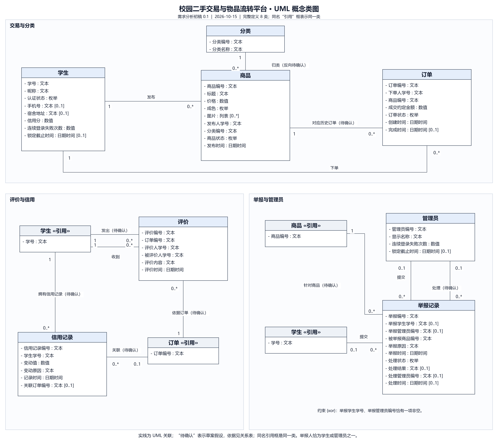

# 校园二手交易与物品流转平台

# 数据、权限与质量需求分析——整合初稿

本初稿依据组长林初仁提供的《马歆远-数据与权限.md》（下称“任务说明”）及本次任务要求编写，范围仅限需求分析阶段的数据、权限与质量。编写日期：2026 年 10 月 15 日；版本：初稿 0.1；负责人：马歆远。

资料检查结果：工作目录除任务说明外，未发现正式术语表、19 个功能说明、业务规则表、状态图、状态转换表或原型。当前沿用原文“学生、商品、订单、分类、评价、举报记录、信用记录”，待 10 月 18 日术语会议后对齐。原文提出术语表确定后再写数据字典；本次按任务要求先交付临时术语初稿，不将其视为已完成正式术语对齐。

依据标记：**原文要求**指任务说明已明确的内容；**本次要求**指本次任务明确的补充；**建议值，待确认**指为使初稿可审阅而提出的字段细则、关系或验收口径。所有未被原文明确的模型细化均为草案建议；字段表中的“是”仅表示该草案采用时的必填性，不代表组长已批准。全文只为八项质量需求使用 NFR-01～NFR-08，不另编 UC、BR、ST、SC、V 编号。

## UML 类图及说明

### 模型性质与依据

本图为需求分析阶段的概念类图，表达业务实体、逻辑属性、关联与多重性，不规定数据库表、类代码、方法、接口或组件。七个核心实体按原文命名；为表达原文允许的“管理员举报”并区分举报人与处理人，补充最小“管理员”概念类，其身份管理方式待确认。未把游客建成持久实体；未认证、已认证是学生的认证状态，买方、卖方是学生在关联中的角色。

图中每个类采用“类名／属性”分隔；属性前的“-”为 UML 私有属性记号，不代表访问权限已由图定义。权限以权限矩阵为准。省略操作分栏；分析模型不需要虚构方法。属性后的 `[0..1]` 表示可空，图片 `[0..*]` 表示列表；这些标记不替代类之间的多重性。

### 图与可编辑文件

文件“校园二手交易平台_UML类图.drawio”为未压缩 mxfile XML，包含单页、三个业务分区。同名且标有“引用”的类框表示同一概念类的重复显示，用于减少交叉线，绝非新增实体或子类。完整属性定义只显示一次，所有字段均在数据字典中定义。PNG 与可编辑图来自相同模型及坐标；建议在 Word 中用横向页面插入整图，并放大阅读分区。

打开方式：在 diagrams.net/draw.io 选择“文件 → 从以下位置打开 → 设备”，选择 `.drawio`。打开后可编辑类框、字段和连接线，保存仍使用 `.drawio`；修改后用“文件 → 导出为 → PNG”更新图片。可离线用 draw.io 桌面版完成相同操作。PNG 供阅读，不作为可编辑源文件。

### 关联与多重性

下表的数量均描述关联两端：例如“学生 1；商品 0..*”表示每件商品对应 1 名学生，每名学生可以对应 0 件或多件商品。图中全部采用 UML 实线关联及端点多重性，无方向箭头；文字“待确认”标记补充或存在歧义的关系，具体依据以此表为准。审核、下架是操作权限，没有据此虚构独立业务实体或级联删除关系。

| 关联（角色） | 关联两端的多重性 | 关联字段 | 依据与边界 |
|---|---|---|---|
| 学生—商品 | 学生 1；商品 0..* | 商品.发布人学号 → 学生.学号 | 原文允许一名学生发布多个商品；每件商品恰有一名发布人 |
| 学生—订单 | 学生 1；订单 0..* | 订单.下单人学号 → 学生.学号 | 原文允许一名学生下多笔订单；每笔订单恰有一名下单人 |
| 商品—订单 | 商品 1；订单 0..* | 订单.商品编号 → 商品.商品编号 | 每笔订单 1 件商品为原文要求；同一商品可有多笔历史订单为暂定解释，待确认，不等于允许同时多笔有效订单 |
| 分类—商品 | 分类 1；商品 0..* | 商品.分类编号 → 分类.分类编号 | 每件商品 1 个分类沿用原文；同分类可含多个商品为建议，待确认；原文两端均写 1，反向数量需澄清 |
| 学生—评价（发出） | 学生 1；评价 0..* | 评价.评价人学号 → 学生.学号 | 补充建模建议，待确认；学生在该关系中扮演评价人 |
| 学生—评价（收到） | 学生 1；评价 0..* | 评价.被评价人学号 → 学生.学号 | 收到评价来自原文；学生在该关系中扮演被评价人 |
| 订单—评价 | 订单 1；评价 0..* | 评价.订单编号 → 订单.订单编号 | 建议值，待确认：评价基于订单；每方可评次数及总上限未定，图中 0..* 仅表示暂不设置上限 |
| 学生—信用记录 | 学生 1；信用记录 0..* | 信用记录.学生学号 → 学生.学号 | 补充建模建议，待确认；信用记录与当前信用分的计算关系未定 |
| 订单—信用记录 | 订单 0..1；信用记录 0..* | 信用记录.关联订单编号 → 订单.订单编号 | 建议值，待确认：信用记录可无订单；每笔订单可被多条信用记录引用 |
| 学生—举报记录（提交） | 学生 0..1；举报记录 0..* | 举报记录.举报学生学号 → 学生.学号 | 学生举报人必须已认证；与管理员提交关系互斥且合计恰一名举报人 |
| 管理员—举报记录（提交） | 管理员 0..1；举报记录 0..* | 举报记录.举报管理员编号 → 管理员.管理员编号 | 原文管理员可举报；与学生提交关系互斥且合计恰一名举报人 |
| 商品—举报记录 | 商品 1；举报记录 0..* | 举报记录.被举报商品编号 → 商品.商品编号 | 建议值，待确认：本草案举报对象仅为商品，尚未覆盖其他对象 |
| 管理员—举报记录（处理） | 管理员 0..1；举报记录 0..* | 举报记录.处理管理员编号 → 管理员.管理员编号 | 建议值，待确认：未处理时无处理人；处理完成恰有一人；不据此认定原文已授权举报处置功能 |

### 需要保持的模型约束

1. 举报人由“举报学生学号／举报管理员编号”二选一构成，恰好一项非空。处理管理员编号是另一个独立角色，未处理可为空。不得强制管理员拥有学生学号。
2. 商品的发布人既承担卖方角色，订单只记录下单人，不重复添加卖方字段。历史订单如何保留卖方身份，以及商品转移所有权是否允许，待组长确定；当前不引入转售链。
3. 商品状态仅保留原文“待审核、在售、已预订、已售出、已下架”，不据此补造状态转换。订单状态只有建议候选值，须由业务规则负责人确认后替换并核对。
4. 商品对应多笔历史订单、分类反向多重性、评价与订单、信用与订单、举报范围等均为待确认关系。图中暂定上限不构成重复成交或无限评价的授权。
5. 本模型不使用组合或聚合来暗示删除级联；删除他人评价的方式、历史保留和信用影响尚未确定。

## 数据字典

### 使用说明

以下为逻辑数据定义。文本长度按字符计；数值、日期时间、枚举与列表均为逻辑类型，不对应具体数据库类型。所有编号生成方式均在各字段约束中说明；除学号明确由学校分配外，系统生成的业务编号不得重复。关联字段须引用存在的对象；对象删除、注销后的历史引用保留规则待确认，不擅自规定级联删除。

学生手机号、宿舍地址均可暂不填写，是否作为认证或交易的前提待确认；填写后严格遵守 NFR-04。学号作为内部关联标识，不因商品或评价公开而自动公开（建议规则，待确认）。登录凭据的保存方式不属于本次逻辑字典；不得由字段缺省推断系统不需要凭据或允许明文保存。

### 逐实体数据定义

#### 学生

| 字段名称 | 数据类型 | 业务含义 | 约束条件 | 是否必填 |
|---|---|---|---|---|
| 学号 | 文本 | 校内学生身份标识；发布人、下单人等关联的统一依据 | 唯一、非空；由学校分配，非系统生成；格式与是否跨校唯一待确认 | 是 |
| 昵称 | 文本 | 展示用称呼；不等同于真实姓名 | 建议值，待确认：1～20 个字符；不允许仅空白 | 是 |
| 认证状态 | 枚举 | 决定是否具备已认证学生权限 | 建议值，待确认：未认证、已认证；认证失败与撤销的表达方式待确认 | 是 |
| 手机号 | 文本 | 学生联系信息；受 NFR-04 保护 | 仅本人和管理员可见；管理员最小必要访问场景为建议，待确认；建议值，待确认：填写时为 11 位数字，仅适用于中国大陆手机号 | 否 |
| 宿舍地址 | 文本 | 学生居住地址；受 NFR-04 保护 | 仅本人和管理员可见；管理员最小必要访问场景为建议，待确认；建议值，待确认：填写时 1～100 个字符 | 否 |
| 信用分 | 数值 | 学生当前信用分 | 他人信用分仅管理员可查看；初始值、上下限、计算及更新规则待确认；不预设 100 分制 | 是 |
| 连续登录失败次数 | 数值 | 支持连续失败 5 次锁定的安全计数 | 非负整数；第 5 次失败触发锁定；成功登录后清零为建议规则，待确认 | 是 |
| 锁定截止时间 | 日期时间 | 账号本次登录锁定的到期时刻 | 第 5 次失败时设为触发时刻后 15 分钟；未锁定可为空；到期后计数重置建议待确认 | 条件必填：锁定时 |

#### 商品

| 字段名称 | 数据类型 | 业务含义 | 约束条件 | 是否必填 |
|---|---|---|---|---|
| 商品编号 | 文本 | 商品唯一标识 | 唯一、非空、由系统生成；编码格式待确认 | 是 |
| 标题 | 文本 | 商品展示标题 | 建议值，待确认：1～50 个字符；不允许仅空白 | 是 |
| 价格 | 数值 | 发布人标示的商品价格 | 建议值，待确认：单位为人民币元；大于 0 且不超过 100000，最多 2 位小数；免费流转是否允许 0 元待确认 | 是 |
| 成色 | 枚举 | 商品新旧程度 | 原文示例为全新、九成新、七成新，未构成封闭集合；建议值，待确认：初稿候选全新、九成新、七成新、其他，最终选项待确认 | 是 |
| 图片 | 列表 | 商品展示图片集合 | 可为空列表；建议值，待确认：0～9 张，每张为一个有效图片条目；不规定存储方式 | 否 |
| 发布人学号 | 文本 | 对应发布该商品的学生.学号 | 必须引用一个已有学生；发布时应为已认证学生；原文“发布人”统一展开为此关联字段 | 是 |
| 分类编号 | 文本 | 对应商品所属的分类.分类编号 | 每件商品恰好关联 1 个分类；原文“分类”枚举在逻辑模型中引用分类实体，类别内容待确认 | 是 |
| 商品状态 | 枚举 | 商品当前生命周期状态 | 仅取原文五值：待审核、在售、已预订、已售出、已下架；初始状态、转换条件、恢复路径均待正式状态图确认 | 是 |
| 发布时间 | 日期时间 | 记录商品发布的业务时刻 | 由系统记录；建议值，待确认：以发布提交成功时刻计，非审核通过时刻 | 是 |

#### 订单

| 字段名称 | 数据类型 | 业务含义 | 约束条件 | 是否必填 |
|---|---|---|---|---|
| 订单编号 | 文本 | 订单唯一标识 | 唯一、非空、由系统生成；编码格式待确认 | 是 |
| 下单人学号 | 文本 | 对应下单学生.学号 | 必须引用一个已有学生；下单时应为已认证学生；订单卖方由商品.发布人学号取得 | 是 |
| 商品编号 | 文本 | 对应订单涉及的商品.商品编号 | 每个订单恰好对应 1 件商品；同商品历史订单数量和同时有效订单限制待确认 | 是 |
| 成交约定金额 | 数值 | 该订单约定的交易金额 | 建议值，待确认：与下单时确认的商品价格一致，人民币元，大于 0 且不超过 100000，最多 2 位小数；议价及免费流转待确认 | 是 |
| 订单状态 | 枚举 | 订单当前业务状态 | 正式状态集合未提供；建议值，待确认：初稿候选待完成、已完成、已取消；不得据此认定状态转换、付款或自动取消规则已确定 | 是 |
| 创建时间 | 日期时间 | 订单成功创建时刻 | 由系统记录；权限或业务条件拒绝时不得生成订单 | 是 |
| 完成时间 | 日期时间 | 订单完成的业务时刻 | 若采用候选已完成状态则必填；不早于创建时间；其他状态允许空，取消后的保留规则待确认 | 条件必填：订单完成时 |

#### 分类

| 字段名称 | 数据类型 | 业务含义 | 约束条件 | 是否必填 |
|---|---|---|---|---|
| 分类编号 | 文本 | 商品分类唯一标识 | 唯一、非空；建议值，待确认：由系统生成；不规定分类维护功能 | 是 |
| 分类名称 | 文本 | 供学生选择和查看的分类名称 | 建议值，待确认：1～20 个字符，同级名称唯一；初稿仅表达单层分类，正式名称及层级待术语表确认 | 是 |

#### 评价

| 字段名称 | 数据类型 | 业务含义 | 约束条件 | 是否必填 |
|---|---|---|---|---|
| 评价编号 | 文本 | 评价唯一标识 | 唯一、非空、由系统生成 | 是 |
| 订单编号 | 文本 | 对应本次评价所依据的订单.订单编号 | 建议值，待确认：每条评价恰好依据一个订单；无交易评价是否允许待确认 | 是 |
| 评价人学号 | 文本 | 对应提交评价的学生.学号 | 提交人须为已认证学生；建议值，待确认：应为关联订单的一方 | 是 |
| 被评价人学号 | 文本 | 对应收到评价的学生.学号 | 恰好关联 1 名学生；建议值，待确认：应为同一订单的另一方，不得自评；单向或双向评价待确认 | 是 |
| 评价内容 | 文本 | 评价的文字内容 | 建议值，待确认：1～500 个字符；不允许仅空白；不额外引入星级评分 | 是 |
| 评价时间 | 日期时间 | 评价成功提交的时刻 | 由系统记录；可评价时点、次数和期限待业务规则确认 | 是 |

#### 举报记录

| 字段名称 | 数据类型 | 业务含义 | 约束条件 | 是否必填 |
|---|---|---|---|---|
| 举报编号 | 文本 | 举报记录唯一标识 | 唯一、非空、由系统生成 | 是 |
| 举报学生学号 | 文本 | 学生举报人的学生.学号 | 与举报管理员编号恰好一项非空；已认证学生可举报；匿名举报不在本草案范围 | 条件必填：学生举报时 |
| 举报管理员编号 | 文本 | 管理员举报人的管理员.管理员编号 | 与举报学生学号恰好一项非空；管理员举报权限来自原文，不冒用学生学号 | 条件必填：管理员举报时 |
| 被举报商品编号 | 文本 | 对应被举报的商品.商品编号 | 建议值，待确认：每条举报先仅针对 1 件商品；是否可举报学生或评价待确认，本草案不宣称已支持 | 是 |
| 举报原因 | 文本 | 说明举报事项 | 建议值，待确认：1～500 个字符；不允许仅空白 | 是 |
| 举报时间 | 日期时间 | 举报成功提交的时刻 | 由系统记录 | 是 |
| 处理状态 | 枚举 | 举报处理进展 | 建议值，待确认：待处理、已处理；是否需要驳回等其他值待确认 | 是 |
| 处理结果 | 文本 | 管理员处理后给出的结论 | 建议值，待确认：处理完成时填写 1～500 个字符；结论本身不自动改变商品、订单或信用分 | 条件必填：处理完成时 |
| 处理管理员编号 | 文本 | 对应实际处理人的管理员.管理员编号 | 未处理时可空；已处理时引用 1 名管理员；处理权限和回避规则待确认 | 条件必填：处理完成时 |
| 处理时间 | 日期时间 | 举报完成处理的时刻 | 由系统记录，不早于举报时间；未处理时可空 | 条件必填：处理完成时 |

#### 信用记录

| 字段名称 | 数据类型 | 业务含义 | 约束条件 | 是否必填 |
|---|---|---|---|---|
| 信用记录编号 | 文本 | 单条信用变动记录唯一标识 | 唯一、非空、由系统生成 | 是 |
| 学生学号 | 文本 | 对应归属学生.学号 | 每条信用记录恰好属于 1 名学生；不因普通学生浏览而公开 | 是 |
| 变动值 | 数值 | 本次信用增减的数值 | 正值增加、负值减少为建议语义，待确认；具体幅度、是否允许 0 及小数待确认 | 是 |
| 变动原因 | 文本 | 本次信用变动的业务依据 | 建议值，待确认：1～200 个字符；触发事件、处理权限及是否关联举报待确认 | 是 |
| 记录时间 | 日期时间 | 该信用变动生效的时刻 | 由系统记录；无权限或操作被拒绝不得产生信用变动 | 是 |
| 关联订单编号 | 文本 | 可选关联订单.订单编号 | 建议值，待确认：最多关联 1 个订单；与订单无关时为空；不强制所有信用变动源于交易 | 否 |

#### 管理员（为管理员举报补充的最小概念类）

| 字段名称 | 数据类型 | 业务含义 | 约束条件 | 是否必填 |
|---|---|---|---|---|
| 管理员编号 | 文本 | 管理员身份的唯一业务标识 | 唯一、非空；建议值，待确认：由系统生成；管理员来源及与学生身份的对应关系待确认 | 是 |
| 显示名称 | 文本 | 管理操作中显示的称呼 | 建议值，待确认：1～20 个字符；不存放无关个人信息 | 是 |
| 连续登录失败次数 | 数值 | 支持管理员账号登录保护 | 非负整数；同样适用连续失败 5 次锁定 15 分钟；计数重置细则待确认 | 是 |
| 锁定截止时间 | 日期时间 | 管理员账号登录锁定到期时刻 | 第 5 次失败时设为触发时刻后 15 分钟；未锁定可为空 | 条件必填：锁定时 |

### 实体关系说明

| 关联（角色） | 关联两端的多重性 | 关联字段 | 依据与边界 |
|---|---|---|---|
| 学生—商品 | 学生 1；商品 0..* | 商品.发布人学号 → 学生.学号 | 原文允许一名学生发布多个商品；每件商品恰有一名发布人 |
| 学生—订单 | 学生 1；订单 0..* | 订单.下单人学号 → 学生.学号 | 原文允许一名学生下多笔订单；每笔订单恰有一名下单人 |
| 商品—订单 | 商品 1；订单 0..* | 订单.商品编号 → 商品.商品编号 | 每笔订单 1 件商品为原文要求；同一商品可有多笔历史订单为暂定解释，待确认，不等于允许同时多笔有效订单 |
| 分类—商品 | 分类 1；商品 0..* | 商品.分类编号 → 分类.分类编号 | 每件商品 1 个分类沿用原文；同分类可含多个商品为建议，待确认；原文两端均写 1，反向数量需澄清 |
| 学生—评价（发出） | 学生 1；评价 0..* | 评价.评价人学号 → 学生.学号 | 补充建模建议，待确认；学生在该关系中扮演评价人 |
| 学生—评价（收到） | 学生 1；评价 0..* | 评价.被评价人学号 → 学生.学号 | 收到评价来自原文；学生在该关系中扮演被评价人 |
| 订单—评价 | 订单 1；评价 0..* | 评价.订单编号 → 订单.订单编号 | 建议值，待确认：评价基于订单；每方可评次数及总上限未定，图中 0..* 仅表示暂不设置上限 |
| 学生—信用记录 | 学生 1；信用记录 0..* | 信用记录.学生学号 → 学生.学号 | 补充建模建议，待确认；信用记录与当前信用分的计算关系未定 |
| 订单—信用记录 | 订单 0..1；信用记录 0..* | 信用记录.关联订单编号 → 订单.订单编号 | 建议值，待确认：信用记录可无订单；每笔订单可被多条信用记录引用 |
| 学生—举报记录（提交） | 学生 0..1；举报记录 0..* | 举报记录.举报学生学号 → 学生.学号 | 学生举报人必须已认证；与管理员提交关系互斥且合计恰一名举报人 |
| 管理员—举报记录（提交） | 管理员 0..1；举报记录 0..* | 举报记录.举报管理员编号 → 管理员.管理员编号 | 原文管理员可举报；与学生提交关系互斥且合计恰一名举报人 |
| 商品—举报记录 | 商品 1；举报记录 0..* | 举报记录.被举报商品编号 → 商品.商品编号 | 建议值，待确认：本草案举报对象仅为商品，尚未覆盖其他对象 |
| 管理员—举报记录（处理） | 管理员 0..1；举报记录 0..* | 举报记录.处理管理员编号 → 管理员.管理员编号 | 建议值，待确认：未处理时无处理人；处理完成恰有一人；不据此认定原文已授权举报处置功能 |

### 关联字段与条件约束

- 一件商品关联一个发布学生和一个分类；一笔订单关联一名下单学生和一件商品。原文商品“分类”字段本为枚举描述，草案统一用分类编号引用分类实体，所选类别名称来自该实体，不维护两个相互冲突的分类值。
- 评价关联评价人、被评价人及一笔订单。订单一方是下单人，另一方是商品发布人；“仅交易双方互评、完成后可评、次数限制”都须正式业务规则确认，本初稿仅把交易双方作为候选数据一致性条件。
- 举报学生学号和举报管理员编号恰好一项非空；处理管理员编号在未处理时可空，在处理完成时必填。处理状态、结果、处理人、处理时间应相互一致，具体处置流程待确认。
- 一名学生有零到多条信用记录，每条记录可选关联一笔订单。是否以记录累计得出信用分、何时同步更新，尚无依据，不编造计算公式。拒绝访问不产生信用扣分。
- 连续登录失败次数、锁定截止时间是对原文登录保护行为的数据补充建议；锁定只约束登录，是否限制已登录会话待确认，不等同于封禁账号或改变学生认证状态。

### 数据可见性与最小必要原则

| 数据范围 | 本人 | 其他学生／游客 | 管理员 | 依据 |
|---|---|---|---|---|
| 学生手机号、宿舍地址 | 可查看本人已提供信息 | 均不可查看，包括交易对方 | 原文允许；建议仅在必要管理场景读取并审计，待确认具体场景 | 原文 NFR-04 |
| 学生信用分 | 建议可看本人，待确认入口 | 均不可查看他人分数 | 可查看他人信用分 | 原文权限表；本人入口为建议 |
| 学号、认证资料、登录计数／锁定时刻 | 本人展示范围待确认；不直接展示内部计数 | 不随公开商品／评价暴露 | 仅必要管理范围；不因管理员角色而批量公开 | 最小权限细化建议，待确认 |
| 商品公开信息 | 与其他浏览者一致；本人额外管理入口未定义 | 仅拟公开标题、价格、成色、图片、分类、商品状态与发布人昵称 | 可浏览；审核所需信息按职责限定 | 浏览许可来自原文；字段清单建议待确认 |
| 本人订单、本人信用记录 | 建议可看本人范围，待确认 | 不得读取他人明细 | 管理访问的目的与范围待确认 | 新增建议，未扩大原文基础权限 |
| 举报记录及举报人身份 | 本人查询功能待确认 | 不公开举报人、处理人等明细 | 仅必要处置范围，处置授权待确认 | 最小权限建议，未新增已确认功能 |

手机号和宿舍地址不得通过商品文字、图片自动填充、订单展示、评价、导出或错误提示绕过限制。用户主动在公开内容中披露隐私时的审核规则另请组长确认。

## 权限矩阵

### 角色及判定口径

游客为未登录访问者；未认证学生、已认证学生为已登录且处于对应认证状态的学生；管理员是独立管理角色。四类角色及下表九项基础权限逐格保留任务说明，不把管理员自动视为已认证学生。一个自然人若同时拥有学生和管理员身份，如何切换角色待确认；当前按本次操作的有效角色判定，禁止借管理员身份发布、下单或评价。

“允许”仅表示通过角色权限条件，仍需通过对象归属、数据可见范围及正式业务状态条件；“拒绝”表示基础角色无权。未认证学生浏览权限不因认证状态而被收回；锁定登录规则不擅自改变浏览或认证状态。

### 基础权限矩阵（原文九项）

| 操作 | 游客 | 未认证学生 | 已认证学生 | 管理员 | 权限拒绝后的处理 |
|---|---|---|---|---|---|
| 浏览商品 | 允许 | 允许 | 允许 | 允许 | 若目标无访问范围，提示“该商品暂不可查看”，不泄露内部审核详情；执行下述统一不变与审计规则 |
| 发布商品 | 拒绝 | 拒绝 | 允许 | 拒绝 | 游客：“请先登录并完成学生认证”；未认证：“请先完成学生认证”；管理员：“管理员无发布商品权限”；执行下述统一不变与审计规则 |
| 下单 | 拒绝 | 拒绝 | 允许 | 拒绝 | 游客：“请先登录并完成学生认证”；未认证：“请先完成学生认证”；管理员：“管理员无下单权限”；执行下述统一不变与审计规则 |
| 评价 | 拒绝 | 拒绝 | 允许 | 拒绝 | 游客：“请先登录并完成学生认证”；未认证：“请先完成学生认证”；管理员：“管理员无评价权限”；执行下述统一不变与审计规则 |
| 举报 | 拒绝 | 拒绝 | 允许 | 允许 | 游客：“请先登录并完成学生认证”；未认证：“请先完成学生认证”；执行下述统一不变与审计规则 |
| 审核商品 | 拒绝 | 拒绝 | 拒绝 | 允许 | 游客：“请先登录管理员账号”；两类学生：“仅管理员可审核商品”；执行下述统一不变与审计规则 |
| 下架违规商品 | 拒绝 | 拒绝 | 拒绝 | 允许 | 游客：“请先登录管理员账号”；两类学生：“仅管理员可下架违规商品”；执行下述统一不变与审计规则 |
| 删除他人评价 | 拒绝 | 拒绝 | 拒绝 | 允许 | 游客：“请先登录管理员账号”；两类学生：“仅管理员可删除他人评价”；执行下述统一不变与审计规则 |
| 查看他人信用分 | 拒绝 | 拒绝 | 拒绝 | 允许 | 游客：“请先登录管理员账号”；两类学生：“无权查看他人信用分”；执行下述统一不变与审计规则 |

浏览商品一行四类角色均允许，不额外设置登录或认证门槛。目标不存在、已不在公开范围等情形应按对象可见性处理，不能伪装成角色无权；具体可浏览商品状态须与原型和状态图对齐。

### 允许操作的对象与业务条件

| 操作 | 允许范围与仍待明确的条件 |
|---|---|
| 浏览商品 | 公开可浏览的商品；可浏览状态范围待确认；不能因此读取学生隐私 |
| 发布商品 | 本人发布；字段和业务条件合法后才成功；是否初始进入待审核待确认 |
| 下单 | 本人下单；可下单商品状态、自购限制、并发成交规则待确认 |
| 评价 | 本人提交；交易资格、可评状态与次数待确认，不能把角色允许等同于可评所有人 |
| 举报 | 学生与管理员均可以自身身份提交；对象范围暂按商品，待确认 |
| 审核商品 | 管理员在可审核状态下执行；审核结论与后续状态须由正式规则确定 |
| 下架违规商品 | 管理员对满足违规处置条件的商品执行；影响关联订单的方式待确认 |
| 删除他人评价 | 仅管理员；删除依据、历史保留及信用影响待确认 |
| 查看他人信用分 | 仅管理员；包括商品发布人、买卖双方及评价对象的分数，普通学生均不得查看 |

### 本人数据与他人数据（必要补充）

| 操作 | 游客 | 未认证学生 | 已认证学生 | 管理员 | 权限拒绝后的处理 |
|---|---|---|---|---|---|
| 查看手机号、宿舍地址 | 拒绝 | 仅本人 | 仅本人 | 原文允许；建议限定必要管理场景并审计 | 提示“仅本人或具备相应管理权限的管理员可查看”；不返回真实值；不改变业务数据与状态 |
| 查看本人信用分（新增建议，待确认） | 拒绝 | 建议允许 | 建议允许 | 管理员本人不是学生时不适用 | 游客提示“请先登录”；他人访问仍按基础矩阵拒绝；不改变分数 |
| 查看本人订单／信用记录（新增建议，待确认） | 拒绝 | 建议仅本人历史数据 | 建议仅本人数据 | 管理访问尚未定义，待确认 | 提示“无权查看该记录”；不得通过换编号读取他人数据；不得改变记录 |

“本人”通过当前登录主体与学生学号的归属判定，不能采信用户自行填写的学号来扩大范围。查看本人不自动赋予修改本人信用分、信用记录、认证状态或删除评价的权限。新增建议入口不表示已属于原文 19 项功能；并入功能范围前应请对应负责人确认。

### 权限控制业务规则

1. **角色与对象校验**：每次实际操作都检查有效身份、角色、对象归属和字段可见范围。隐藏按钮只能辅助交互；直接指定他人编号、换入口或重复提交也必须受同样限制。默认不返回拒绝访问对象的手机号、地址、信用分或举报人身份。
2. **权限拒绝不改变业务**：被拒绝时不创建商品、订单、评价、举报或信用记录，不变更商品、订单、举报处理状态，不删除评价，不更新信用分；不得因一次被拒绝操作扣信用分。允许追加必要的安全审计记录，审计记录不算业务实体变动。
3. **权限拒绝与状态拒绝区分**：角色无权时使用矩阵中的身份或权限提示；角色有权但状态不满足时提示“当前业务状态不支持该操作”，并说明可安全公开的原因。两类拒绝均保持本次操作前的业务数据与状态不变，审计原因分别记录。正式状态规则未到位前，不擅自确定“哪个状态允许哪一步”。
4. **拒绝提示要准确**：未认证学生发布时提示认证，不能误报系统故障；管理员下单时提示角色无权，不能诱导管理员完成学生认证来绕过限制；普通学生看他人信用分时直接提示无权，不能展示部分分数。
5. **必要审计**：记录权限拒绝、敏感个人信息读取和管理员审核／下架／删除等管理操作。审计至少含操作时间、操作者可得标识（游客使用会话标识）、有效角色、动作、目标可得标识、结果和原因类别；不得写入支付密码、登录密码、完整手机号或完整宿舍地址。保留期限、审计访问权限待确认；不新增独立审计管理功能或审计实体设计。
6. **登录失败是独立安全行为**：原文连续失败 5 次锁定 15 分钟会改变登录失败计数和锁定截止时间，并可追加安全日志；这些不属于“发布／下单被拒绝”导致的业务状态变化。不得顺带变更认证状态、商品状态、订单状态或信用分。
7. **在业务状态并发变化时**：候选要求为以提交执行时检查到的合法条件为准；若其他操作已使商品不可下单，应拒绝本次操作，不留下本次新订单或错误预订状态。如何识别唯一有效订单须由业务规则负责人确认；本次无权要求覆盖其他合法操作的结果。
8. **允许操作的影响不混同于拒绝**：管理员审核、下架和删除成功后的状态、历史保留及关联影响须与正式规则对齐；本草案不擅自指定自动取消订单或扣分。举报提交成功本身不等于违规已经成立；是否触发自动下架或其他处置缺少正式定义，待组长确认，本草案不预设自动处置规则。

### 典型走查输入与期望（不另分配 SC 或 V 编号）

| 输入场景 | 提示与判断 | 业务数据／状态的期望 | 可检查的审计 |
|---|---|---|---|
| 游客尝试发布商品 | 请先登录并完成学生认证；权限拒绝 | 不新增商品，不产生待审核商品 | 权限拒绝；角色为游客 |
| 未认证学生尝试下单 | 请先完成学生认证；权限拒绝 | 不新增订单；商品不变成已预订 | 权限拒绝；不记录敏感明文 |
| 已认证学生指定他人学号读取手机号 | 仅本人或具备相应管理权限的管理员可查看 | 不返回手机号；本人、目标学生及业务对象均不变 | 拒绝及目标标识；不含真实手机号 |
| 管理员尝试下单或评价 | 管理员无下单权限／管理员无评价权限 | 无新增订单／评价；不改变商品或信用分 | 权限拒绝；角色为管理员 |
| 已认证学生删除他人评价 | 仅管理员可删除他人评价 | 原评价保留；信用分不变 | 权限拒绝 |
| 已认证学生查看交易对方信用分 | 无权查看他人信用分 | 不返回分数；分数与信用记录不变 | 权限拒绝 |
| 已认证学生下单时商品不满足正式可下单状态条件 | 当前业务状态不支持该操作；状态拒绝 | 不产生本次订单；无本次错误状态变更 | 业务状态拒绝，不误记角色无权 |
| 管理员审核状态不允许审核的商品 | 当前业务状态不支持该操作；状态拒绝 | 商品原状态及订单不变 | 业务状态拒绝 |
| 管理员提交合法举报 | 角色允许；业务条件再判定 | 成功时举报管理员编号有值、举报学生学号为空；不得冒用学号 | 成功操作可追溯；处理人字段不自动等于举报人 |

上述为可用于原型和后续系统验收的预期结果，未执行真实系统测试。状态相关场景的具体初态由正式状态转换表补齐。

## 非功能性质量需求

### 依据和验收前提

原文明确的数字与限制全部保留：NFR-01 为 200 条商品、50 人同时使用、≤ 2 秒；NFR-02 ≤ 3 秒；NFR-04 手机号与宿舍地址仅本人及管理员可见；NFR-05 不存储支付密码等敏感信息；NFR-06 连续失败 5 次锁定 15 分钟；NFR-07 ≤ 5 分钟；NFR-08 ≥ 99%。NFR-03 暂定 500 人，属于建议值，待确认。安全条目用可检查的零泄露、零保存等数量判据细化，没有把不可量化形容词当指标。

以下测试方案均为未来验收设计，不是已经执行的真实系统测试。建议测试前提、取样数量、观察窗口与细则须经组长确认，不提高为已有业务事实。

性能共同前提建议（待确认）：使用拟验收版本和同一套事先登记的测试环境，记录客户端／服务环境配置、浏览器版本、校园网络条件、往返时延与可用带宽；建议受控网络往返时延 ≤ 50 毫秒、每客户端可用带宽 ≥ 10 Mbps。使用不含真实隐私的测试数据；图片建议每张 ≤ 500 KB，并记录每条商品的图片数量、总大小及首屏数量。正式业务数据更大时应增加相应场景，不能缩小数据规避指标。所有端到端时间均从用户动作发起计至明确结果呈现，不能只量内部处理时间。

原文未明确响应时间是最大值、平均值还是分位数，本初稿按有效样本逐次满足原阈值编写，以避免放宽要求；最终统计口径仍列为待确认。工具故障等无效样本须有依据；系统异常、超时及失败必须保留并单列，不得只对成功样本宣称整体达标。

### NFR-01 商品列表加载性能

| 项目 | 内容 |
|---|---|
| 需求编号 | NFR-01 |
| 需求名称 | 商品列表加载性能 |
| 需求描述与依据 | 原文要求：200 条商品、50 人同时使用时，响应时间 ≤ 2 秒。 |
| 测试前提／适用范围 | 原文的 200 条商品、50 人同时使用为固定验收条件。200 条是整个数据集还是单次展示量、是否包含图片完成呈现，原文未明确，均待组长确认；本稿不自行指定首屏数量或分页方式，不以较少商品的首屏加载结果替代原文要求。 |
| 量化指标与统计口径 | 从用户发起列表访问到约定的商品列表内容呈现完毕；具体加载范围和完成判据待确认，确认前不得判定已满足原文性能要求。≤ 2 秒保留为每次有效样本上限，不降为平均值或只看 P95；建议值，待确认：持续 10 分钟、累计至少 500 次有效加载，并分别报告冷启动与后续访问的最大值、P95 和失败率。测试前提按本文件开头的统一前提记录。 |
| 验收方式 | 准备 200 条完整测试商品，50 个会话同时浏览，采集每次端到端时间及截图／计时记录；检查全部有效样本是否 ≤ 2 秒。计时超限和系统失败不得删除；受控测试工具自身故障可说明原因后重测。分页、图片规模及冷启动是否纳入最终判定待确认。 |

### NFR-02 下单响应性能

| 项目 | 内容 |
|---|---|
| 需求编号 | NFR-02 |
| 需求名称 | 下单响应性能 |
| 需求描述与依据 | 原文要求：下单操作响应时间 ≤ 3 秒。 |
| 测试前提／适用范围 | 已认证学生、字段合法、商品满足最终业务可下单状态；不把认证、人工交接或外部支付完成作为计时前提。建议值，待确认：50 个会话并发，每次选择可合法下单的不同商品，累计至少 100 次合法提交；同商品争抢另外做一致性场景。 |
| 量化指标与统计口径 | 从点击确认下单到收到明确结果并看到订单编号或明确失败原因。合法成功样本逐次 ≤ 3 秒，且应已形成一笔可查询订单；失败不能冒充成功。建议值，待确认：权限或状态拒绝也在 3 秒内返回；重复提交、并发与超时后的查询行为待业务规则补齐。 |
| 验收方式 | 记录提交时刻、结果展示时刻及订单编号，对照合法输入与订单记录；检查 ≤ 3 秒且不产生无结果、重复业务记录或错误商品状态。并发拒绝结果与权限矩阵一致。外部支付时间不混入本指标；此口径为建议，待确认。 |

### NFR-03 同时在线容量

| 项目 | 内容 |
|---|---|
| 需求编号 | NFR-03 |
| 需求名称 | 同时在线容量 |
| 需求描述与依据 | 原文人数留空并要求估算；本次按任务要求暂定同时在线 500 人（建议值，待确认），不宣称已有容量依据。 |
| 测试前提／适用范围 | “在线”建议定义为保有有效会话且在测试期间持续活动的 500 个不同用户，不等于每秒 500 个下单请求。建议值，待确认：10 分钟逐步达到 500 人后稳定 30 分钟；每人每 30 秒执行一次操作，浏览占 90%、合法下单占 10%，下单使用不同可交易商品。 |
| 量化指标与统计口径 | 建议值，待确认：500 人稳定期间无会话容量拒绝，无丢失或重复订单，技术失败率 ≤ 1%；正常权限／状态拒绝单列、不作为技术失败，且不能用拒绝替代成功请求。NFR-01 的 200 条／50 人／2 秒条件、NFR-02 的 3 秒条件各自保留；是否在 500 人混合负载下也满足相同时间阈值待确认。 |
| 验收方式 | 使用 500 个独立测试账号／会话，保存活动用户数曲线、请求总数、技术失败数和订单核对记录；技术失败含超时、异常、无结果，比例为技术失败数÷有效操作尝试数。达到 500 人后按稳定阶段统计。根据功能发生频率与学校用户规模请组长及业务规则负责人调整负载。 |

### NFR-04 个人信息保护

| 项目 | 内容 |
|---|---|
| 需求编号 | NFR-04 |
| 需求名称 | 个人信息保护 |
| 需求描述与依据 | 原文要求：手机号、宿舍地址，非本人和非管理员不可见。交易对方、已认证学生和未认证学生均不得因此读取他人信息。 |
| 测试前提／适用范围 | 手机号与宿舍地址覆盖学生详情、商品发布人展示、订单对方信息、评价、搜索、导出及错误提示等实际存在的入口；未实现的入口不虚构为功能。建议限定管理员仅在必要管理场景读取并审计，具体场景待确认。 |
| 量化指标与统计口径 | 所有非本人且非管理员的读取检查中，真实手机号和宿舍地址泄露数为 0；本人读取仅限自己已提供的信息。未经授权的返回内容与页面不得含可还原真实值，不能只在界面遮挡而在返回内容保留。敏感读取和拒绝审计不得含完整敏感值。 |
| 验收方式 | 至少用两名不同学生、游客和管理员覆盖身份组合；交换目标学号及对象编号，检查页面、实际数据返回、导出与错误信息。核对拒绝提示、业务数据不变和审计。建议值，待确认：实际入口覆盖率 100%，不得以无入口代替对象归属验证。 |

### NFR-05 支付信息安全

| 项目 | 内容 |
|---|---|
| 需求编号 | NFR-05 |
| 需求名称 | 支付信息安全 |
| 需求描述与依据 | 原文要求：不存储支付密码等敏感信息。原文未明确平台是否提供在线支付，本需求不能反向作为支付功能已经纳入范围的证据。 |
| 测试前提／适用范围 | 适用于可能接触支付信息的页面、处理过程、持久保存内容、日志、导出和备份。建议支付密码、完整支付凭据及支付验证码不由平台主动收集；凭据类别清单及支付范围待确认。若仅线下交易，明确记录“不提供支付采集入口”。 |
| 量化指标与统计口径 | 支付密码及同等认证秘密的持久保存数为 0，日志、导出、备份中出现次数为 0；不通过错误提示回显。即使编码或加密后保存，仍属于保存支付密码，不满足该要求。可留存的交易参考信息范围待确认，不先增设支付实体。 |
| 验收方式 | 使用专用虚构支付秘密作为标记，检查实际存在的输入、处理、保存、日志与备份路径；确认保存结果均不含秘密或其可恢复形式。无在线支付时审查范围说明及所有实际入口，记录“不适用的支付流程”与“仍通过的未采集／未保存检查”，不得填写已完成支付集成测试。 |

### NFR-06 登录安全

| 项目 | 内容 |
|---|---|
| 需求编号 | NFR-06 |
| 需求名称 | 登录安全 |
| 需求描述与依据 | 原文要求：同一账号连续登录失败 5 次，锁定 15 分钟。学生和管理员账号均按“同一账号”计数；跨设备不能各自重新累计。 |
| 测试前提／适用范围 | 使用专用测试账号，从未锁定、失败计数为 0 开始；计时以系统可核对的时间为准。建议值，待确认：失败定义为凭据校验失败；成功后计数清零；锁定到期清零；锁定期间再次尝试不延长既有锁定截止时间。 |
| 量化指标与统计口径 | 第 1～4 次失败不触发本条锁定；第 5 次失败时记触发时刻 t，在 [t, t+15 分钟) 内即使凭据正确也不能新建登录会话。到达 t+15 分钟后允许重新验证凭据，正确时可以登录。提示“账号已暂时锁定，请稍后重试”，不回显密码；安全日志中的秘密出现数为 0。 |
| 验收方式 | 依次验证 4 次失败、第五次失败、锁定期内正确凭据、临近 15 分钟和满 15 分钟后的正确凭据；跨设备复查。补测成功后计数重置和到期重置候选规则；可使用受控时钟验证边界，须注明方法。登录保护可变更计数／锁定时间，不得改认证状态、商品、订单或信用分。 |

### NFR-07 新用户发布易用性

| 项目 | 内容 |
|---|---|
| 需求编号 | NFR-07 |
| 需求名称 | 新用户发布易用性 |
| 需求描述与依据 | 原文要求：新用户从登录到发布第一件商品，不超过 5 分钟。已认证学生才能发布的基础权限同时成立。 |
| 测试前提／适用范围 | 建议值，待确认：邀请 10 名未使用过系统的学生，事先提供有效且已认证的测试账号、必需商品文字及图片；不计人工认证等待，但从开始执行登录动作计时，包括登录、找入口、填写、提交和看到结果。未认证新用户是否应包含认证总耗时需澄清，不擅自放宽 5 分钟。 |
| 量化指标与统计口径 | 每位受试者在无他人代操作、无操作步骤提示的情况下 ≤ 5 分钟完成首次发布；不改成平均值。完成定义为提交合法商品并收到成功反馈，记录可找到且状态符合正式初始状态；不要求管理员已审核通过。建议样本 10 人全部成功，人数及指导边界待确认。 |
| 验收方式 | 观察并计时每名受试者，记录操作起止、是否求助、是否成功、完成时长、主要错误；超时或需代操作计未通过。测试前确认原型入口与正式状态定义，报告逐人结果；本稿仅提出验收方法，不声称已邀请真实学生测试。 |

### NFR-08 系统可用性

| 项目 | 内容 |
|---|---|
| 需求编号 | NFR-08 |
| 需求名称 | 系统可用性 |
| 需求描述与依据 | 原文要求：可用性 ≥ 99%，考试周等高峰期也要可用。 |
| 测试前提／适用范围 | 建议值，待确认：按校园当地时间每个自然月统计，服务窗口为全天 24 小时，计划维护也计入不可用时间；检查公开浏览、登录和满足业务条件的合法下单。考试周按学校校历确定，另按完整考试周统计，不能用平峰月均值掩盖高峰故障。 |
| 量化指标与统计口径 | 可用性＝（应服务总分钟数－不可用分钟数）÷应服务总分钟数×100%，每月 ≥ 99%；建议考试周单独同样 ≥ 99%。以 30 天月为例，总计 43200 分钟，最多不可用 432 分钟。建议值，待确认：每 1 分钟检查一次，任一关键功能在可控正常条件下失败则该分钟不可用，多功能同时失败只累计一次。 |
| 验收方式 | 核查监测原始记录、故障和维护时间并计算；真实正常权限拒绝、学生个人网络故障不算系统故障，服务端故障及其依赖故障导致不可访问计入。检查可通过重复探测排除单点客户端故障，但确认后的故障从首次失败计起。统计周期未满只能提供阶段结果；不得把短时压力测试等同月度 99% 已达标。 |

### 与数据及权限的对应

| 质量需求 | 涉及数据／权限 | 必须同步检查的行为 |
|---|---|---|
| NFR-01 | 商品、分类；所有角色浏览权限 | 不因速度目标泄露发布人隐私；50 人条件不被 500 人建议替换 |
| NFR-02、NFR-03 | 学生、商品、订单；已认证学生下单 | 权限或状态拒绝不产生业务变动；不能用失败响应凑达标样本 |
| NFR-04 | 学生手机号、宿舍地址；本人／管理员访问范围 | 交易双方也不能读取对方手机号与地址；他人信用分仍仅管理员可见 |
| NFR-05 | 本次未设置支付实体 | 是否在线支付待确认，禁止保存支付密码等秘密的要求先行保留 |
| NFR-06 | 学生、管理员连续失败计数及锁定截止时间 | 账号锁定和认证状态分离，不因失败扣信用分 |
| NFR-07 | 已认证学生发布商品；商品初始状态 | 完成发布不等于完成审核，初始状态以正式规则为准 |
| NFR-08 | 浏览、登录、合法下单关键功能 | 正常业务拒绝单列；考试周统计及维护口径待确认 |

本稿不包含任何缓存、数据库产品、部署或容量实现方案。性能容量能否实现须由后续项目验证，不能由本次文档检查推断。

## 待组长确认事项

以下按主题集中记录，不分配 V、BR、ST 等正式编号。表中“高／中”为本初稿交付影响判断，不代表组长已有优先级结论。未确认内容均保留在可审阅草案中；确认后应同步修改类图、数据字典、权限和质量需求，不只修改整合稿。

| 主题 | 建议确认对象 | 缺失依据／问题 | 本初稿暂用处理 | 需要确认的结论 | 对提交的影响 |
|---|---|---|---|---|---|
| 术语与资料 | 组长；功能／业务规则负责人 | 尚无术语表、19 项功能说明、规则表和状态图；原文安排 10 月 18 日术语会议 | 沿用原文七个实体名称，管理员为补充概念；不分配他人负责的编号 | 需提供正式术语与资料版本；10 月 18 日后先统一名称，再与功能及状态逐项核对 | 高：影响全部文档合稿 |
| 分类关系及表达 | 组长 | 原图示商品 1—分类 1，数据字典将分类列为枚举，反向多重性含义不清 | 每件商品 1 分类，同分类 0..* 商品；分类编号引用实体，均已标注需要澄清 | 确认是否允许同分类多商品、分类名称与是否分层；确认用分类实体承载枚举选项 | 中：影响类图和关联字段 |
| 商品状态转换与历史订单 | 业务规则负责人 | 五种商品状态已给出；转换条件与一件商品有效／历史订单数量未给出 | 五状态逐字保留；商品—订单 0..* 为历史记录暂定解释，不授权重复成交 | 明确初始状态、可下单状态、预订释放、取消后恢复、违规下架关联影响、历史订单与同时有效订单限制 | 高：影响类图、权限状态拒绝和下单验收 |
| 订单状态及成交条件 | 业务规则负责人 | 原文没有订单状态集合与转换表，也未说明自购、议价、重复提交等规则 | 仅建议待完成／已完成／已取消，未建立已确认状态图；金额按确认价格暂定 | 提供正式枚举与状态转换、完成判据、自购限制、取消、重复／并发提交、商品卖方历史保留规则 | 高：影响订单字典、评价资格和性能样本 |
| 评价资格、次数与删除 | 业务规则／功能负责人 | 只明确已认证学生可评价、管理员可删除他人评价 | 暂按一评价一订单、交易双方互评建模，订单 0..* 评价暂不设置上限；未增加评分字段 | 确认单向／双向、可评时机、每方次数／期限、是否允许修改／本人删除、管理员删除条件、历史和信用影响 | 高：影响评价关系及权限对象条件 |
| 举报对象及管理员处置 | 组长；功能／业务规则负责人 | 已认证学生、管理员均可举报；处理流程和对象范围未给出 | 举报对象仅商品；学生／管理员举报标识互斥；处理字段为建议，不声称新增处置功能已批准 | 确认能否举报学生／评价、管理员举报是否需回避、是否纳入处理功能、处理状态和结论及对应权限，以及举报是否触发自动处置 | 高：范围变化会影响举报实体与关系 |
| 信用规则与本人查询 | 业务规则／功能负责人 | 仅给出信用记录实体、管理员可看他人信用分；计算依据未给出 | 不设初始值或分制；信用可选关联订单；本人查询为新增建议 | 确认初始值、范围、增减事件及幅度、更新一致性、是否关联举报、记录查询范围及本人查看入口 | 中：影响信用字段与验收 |
| 身份、隐私及字段建议 | 组长；功能负责人 | 学号与管理员身份关系、字段长度范围、联系信息必填性、认证流程均未给出 | 学号学校分配；管理员独立编号；长度、金额、成色、图片等均标建议；手机号与宿舍地址可选 | 确认学号格式、跨校范围、管理员与学生身份切换、认证状态扩充、公开字段、免费流转、价格上限和成色选项 | 中：影响数据字典与最小权限 |
| 登录安全细则与审计 | 组长；业务规则负责人 | 5 次／15 分钟已定；计数重置、既有会话、日志保留和敏感读取场景未定 | 成功／到期清零、锁定期不延长为建议；锁定不修改认证状态或信用分；必要审计先保留 | 确认失败口径、重置与边界、管理员适用、既有会话、审计保留期限与查看权限；原文身份隐私规则不得擅自扩大 | 中：影响安全验收的可执行性 |
| 性能和容量的完整口径 | 组长；业务规则／原型负责人 | 原文给定 2 秒、3 秒及部分负载；500 人无发生频率或学校规模依据 | 500 人为建议值；逐次阈值不放宽；200 条的展示量与计时完成范围只列待确认，不预设首屏数量；网络／样本／混合负载均建议 | 确认 200 条是否一次全部显示、图片规模、客户端／网络条件、计时与取样口径、500 人活动模型及高负载时间阈值 | 高：影响 NFR-01～03 可执行验收 |
| 支付范围 | 组长；功能负责人 | 原文只要求不存支付密码，未给支付功能 | 不增支付实体或流程；禁止存储支付秘密 | 明确线上或线下支付范围、敏感信息类别和允许保留的交易参考信息；不能据质量要求推定已含在线支付 | 中：影响 NFR-05 的适用测试 |
| 易用性与认证耗时 | 组长；原型负责人 | 从登录到发布 ≤ 5 分钟与先认证后发布并存；人工认证耗时未说明 | 测试用预认证新用户，从开始登录计至发布成功；10 人全部 ≤ 5 分钟为建议 | 确认是否须包括认证总耗时、计时起点、人数、是否可看操作说明及初始发布状态；保留原 5 分钟阈值 | 高：影响 NFR-07 验收 |
| 可用性统计 | 组长 | ≥ 99% 和考试周可用已定；周期、停机定义、维护扣除未定 | 自然月、全天、计划维护计故障；考试周单独同阈值及每分钟检查均建议 | 确认服务时间窗、关键功能、考试周日期、维护／第三方故障统计及监测频率 | 中：影响 NFR-08 验收证据 |
| AI 使用过程证据 | 负责人本人 | 原文要求每次 AI 使用都保存截图或链接，供验证报告填写实际提示词 | 本次成果保存生成与检查脚本及校验记录；这些不等同于完整对话证据 | 提交前保存本次原始提示词和对话截图或分享链接；本稿不虚构已归档的聊天证据 | 中：影响后续 AI 智能体使用验证报告 |

### 10 月 21 日初稿前的处理顺序

1. 10 月 18 日术语会议后先替换正式术语，索取用例与状态资料，核对商品五状态是否有正式调整，并解决订单状态、历史订单、评价与举报范围的高影响分歧。
2. 明确性能测试负载、500 人依据、易用性认证口径；未能确认时保持“建议值，待确认”，作为初稿评审问题提交，不能将建议改成已批准要求。
3. 再次导出与模型一致的 PNG，复核九项基础权限逐格不变、拒绝不改变业务、八项 NFR 无重复编号，并保存 AI 过程证据。

任务说明的交付节点：10 月 21 日（周三）24:00 前交初稿；10 月 25 日完成一致性修改；10 月 26～27 日走查；10 月 28～29 日改走查问题；11 月 1 日由组长提交。上述日期依据任务说明并按当前 2026 年解释。10 月 21 日 24:00 为当日结束，即 10 月 22 日 00:00，均按校园当地时间理解；不要将 11 月 1 日当作初稿截止日期。
