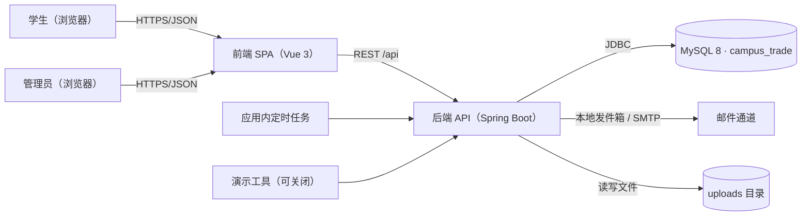
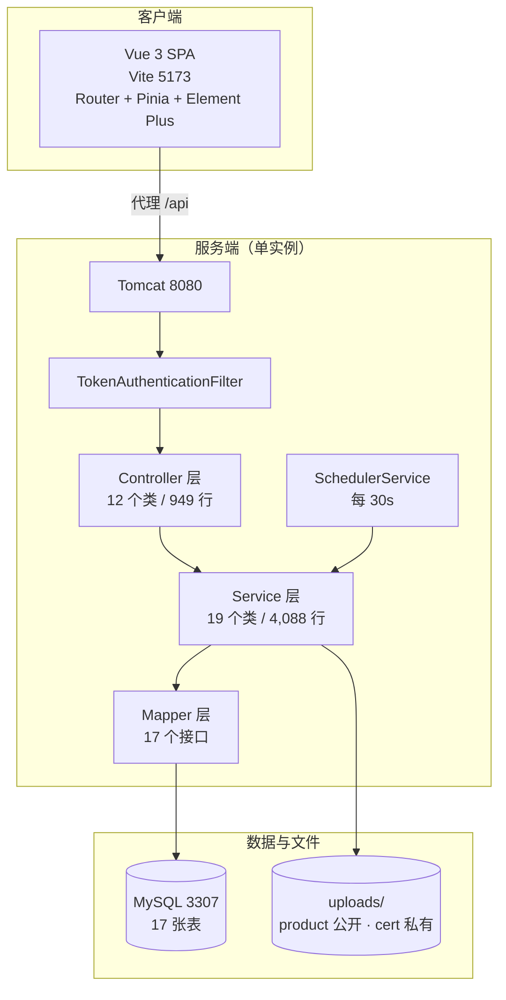
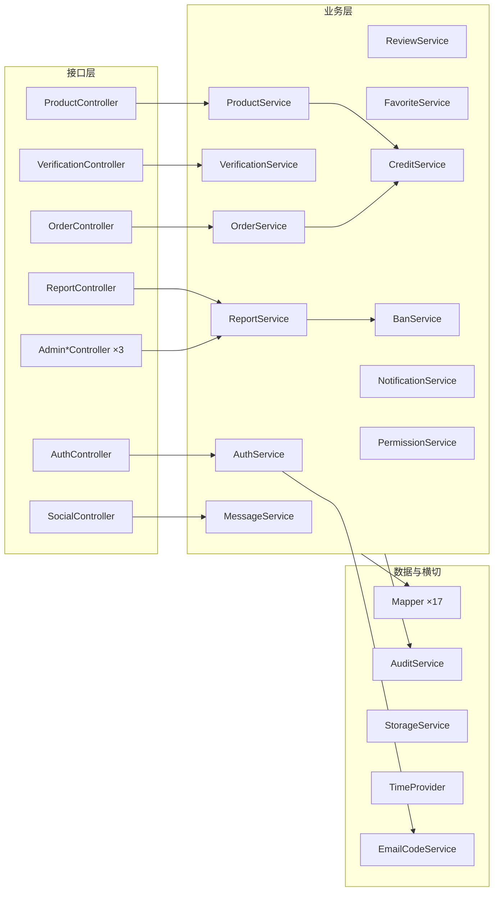
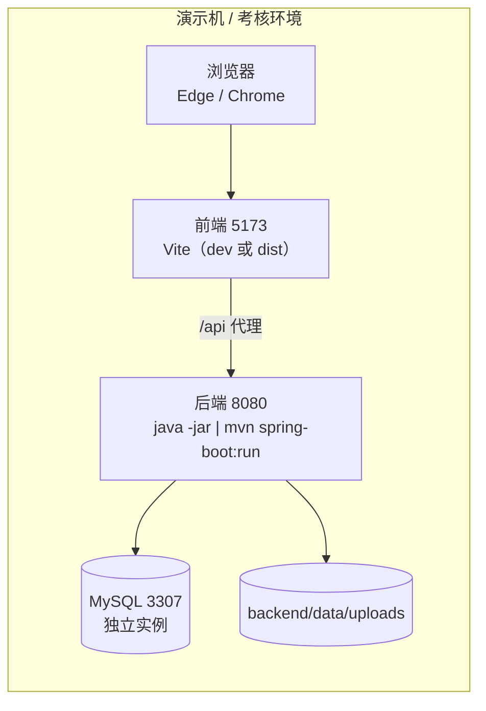
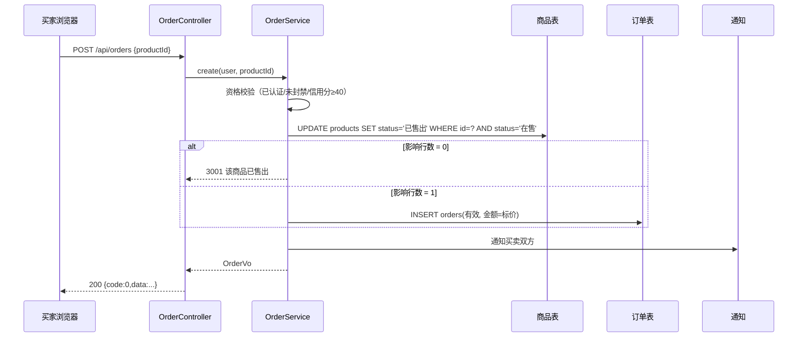
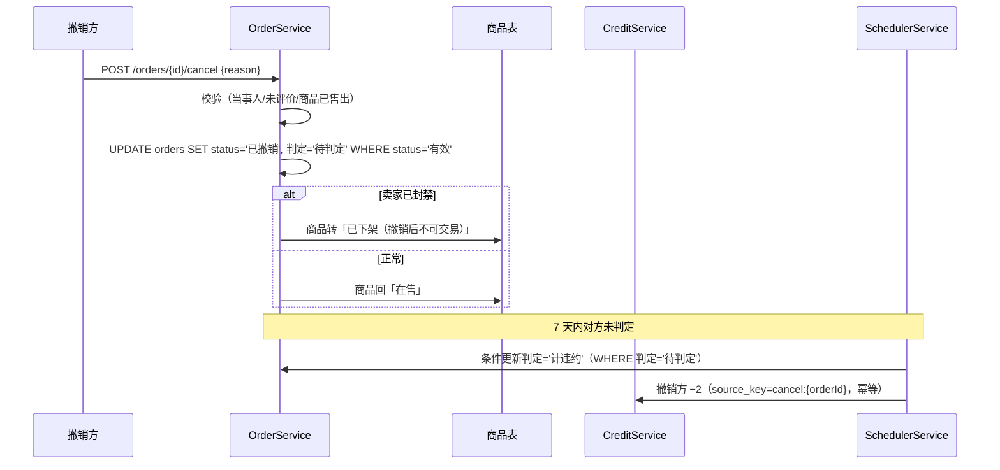
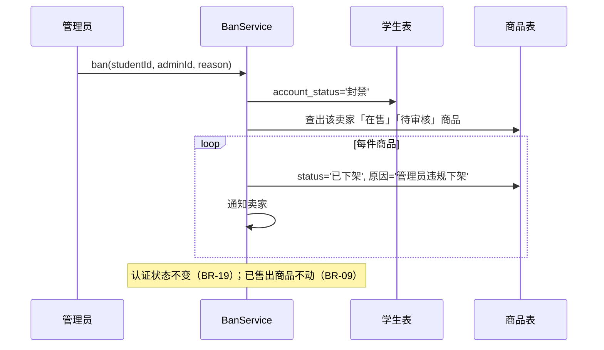
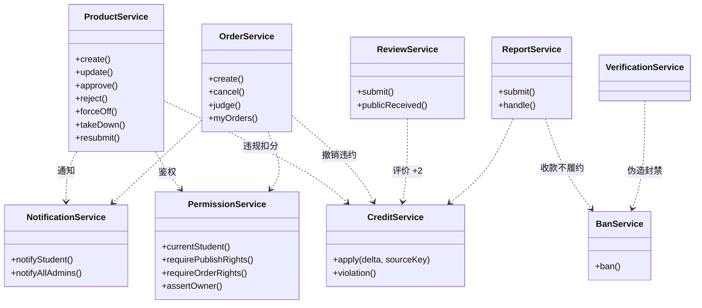
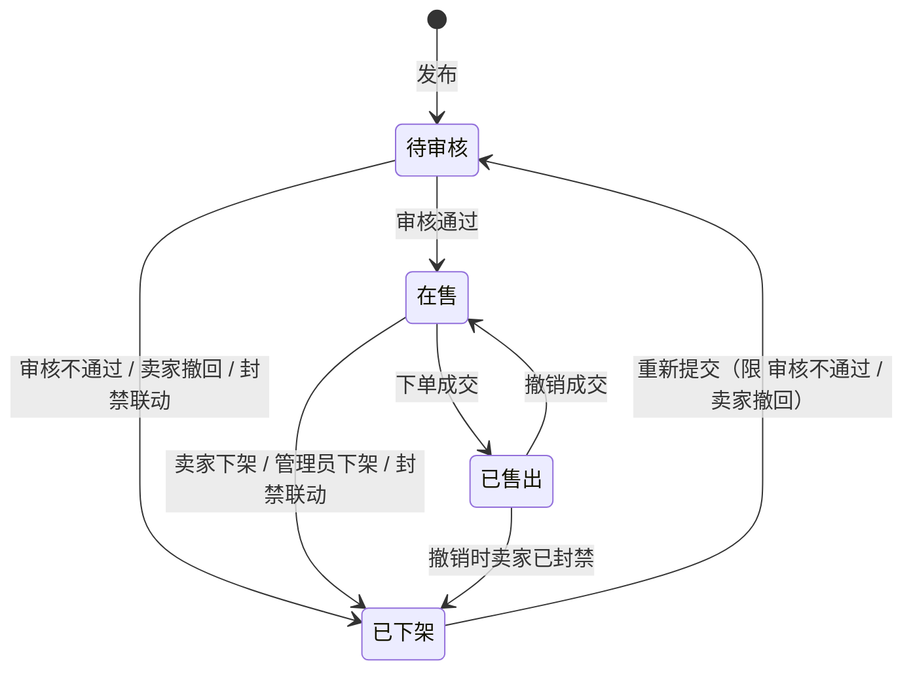
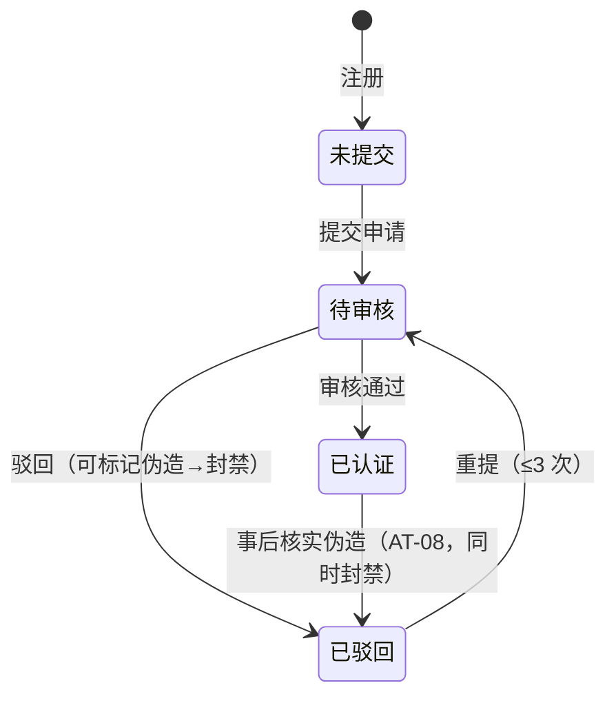

# 软件架构设计说明书

> **性质**：本文件是架构基线的主文档，对照《软件工程》第五章「软件设计」的四个设计层次组织；此前的讨论稿与基线版已按版本约定从目录移除，需要时用 `git log` 回溯。
> **权威顺序**：业务规则以 SRS V2.1 为准 → 架构决策以《架构确认与决策记录》的 ADR 为准 → 接口契约以《接口与关键设计说明书》为准 → 本文件只做展开、度量与论证，**不另行创设规则**。
> **状态**：AI 依《架构设计后确认与分阶段实现操作指引_学生版》模板起草，**须经架构负责人与交叉审查人签字后方可作为实施依据**（签字表见 §14）。
> **数据时点**：2026-11-12，基于 `backend` 当前源码静态扫描（106 个类 / 7,683 行 / 14 个包）。

---

## 0 文档定位与阅读顺序

| 你想知道 | 先看 |
|---|---|
| 系统整体怎么分层、为什么这样分 | §3 体系结构设计 |
| 哪个模块最容易腐化、耦合在哪 | §4 模块划分与内聚/耦合 |
| 数据怎么保证不变量 | §5 数据设计 |
| 接口怎么约定、出错怎么表达 | §6 接口设计 |
| 类怎么设计、状态怎么流转 | §7 构件级设计 |
| 为什么不用 JWT / 为什么订单没状态机 | §11 ADR 摘要（详见 ADR 文件） |
| 哪些东西我们没做到、答辩要如实说 | §13 已知限制 |

**与课程「设计四层次」的对照**

| 课件层次 | 本文件章节 | 产物 |
|---|---|---|
| 数据设计（类设计） | §5 | 17 表 + 约束 + 事务边界 |
| 体系结构设计 | §3、§4 | C4 上下文/容器/组件图 + 包依赖矩阵 |
| 接口设计 | §6 | 契约总则 + 模板 D 示例 + 3 张时序图 |
| 构件（组件）级设计 | §7 | 类图 + 状态机 + SOLID + 设计模式 |

---

## 1 设计目标、约束与驱动因素

### 1.1 目标（可检验）

| 目标 | 架构回应 | 检验方式 | 现状 |
|---|---|---|---|
| 24 UC / 22 BR 落到可审查单元 | 后端按**用例族**切 service，一个类对应一组 UC | `docs/requirements/需求覆盖矩阵.md` 逐条映射 | ✅ 已映射 |
| 权限与隐私不出后端 | 鉴权单入口 `PermissionService` + 出参白名单 `Views` | 越权脚本、字段扫描 | ✅ e2e/smoke 断言 |
| 业务不变量不靠自觉 | MySQL CHECK + 生成列唯一索引 | 直插约束测试、并发脚本 | ✅ 见 §5.2 |
| 需求变更可控 | Q/ADR + 基线索引 + 阶段计划 | 变更记录与复核签字 | ⏳ 待签字 |

### 1.2 约束

| 类型 | 约束 | 对设计的影响 |
|---|---|---|
| 业务 | 平台不碰资金与交付（SRS §2.1） | 订单不建状态机；无支付/物流模块 |
| 业务 | 不接学校统一身份认证 | 自建账号 + 学生证人工核验（AT-01～08） |
| 团队 | 4 人、课程周期、需要答辩演示 | 单实例部署；内置演示工具（重置/时间偏移） |
| 技术 | 考核环境需 JDK 17+ / MySQL 8 / Node 18+ | 放弃 SQLite 单文件便利，换取 CHECK 与并发能力 |
| 验收 | 性能与可用性需长期或真实环境 | 只做抽样，不宣称达标（NFR-03/06/07） |

### 1.3 质量属性场景（驱动设计的三条）

1. **并发抢购**：两名学生同时下单同一件在售商品 → 只允许一笔成交，另一笔必须得到「已售出」的明确失败。
2. **改密即失效**：学生通过邮箱验证码重置密码 → 其所有既有登录会话立即失效（NFR-10 ⑥）。
3. **封禁即下架**：管理员封禁卖家 → 同一动作内其「在售」「待审核」商品全部转「已下架（管理员违规下架）」，不得出现"封了人商品还在卖"的窗口期。

这三条直接决定了 §3.3 的组件划分与 §5.3 的事务边界。

---

## 2 设计思想在本项目的落地

| 设计思想（课件） | 本项目的具体做法 | 反例（我们没做的） |
|---|---|---|
| 分解与抽象 | 按 UC 族切 service；跨层只暴露接口（Mapper 接口、`Views` 视图） | 没有为"未来可能的微服务"过度拆分 |
| 关注点分离 | 控制器不写规则；规则只在 service；出参只在 `Views` | 前端仍有少量展示逻辑（金额去 `.00`） |
| 模块化 | 14 个包、106 个类，包内高内聚、包间单向依赖 | 没有把 24 个 UC 拆成 24 个类（过度碎片化） |
| 信息隐藏 | `entity` 不出 controller；手机号/宿舍/真实姓名只在本人/管理员视图 | 内部 id 仍出现在 URL（可接受） |
| 契约式设计 | DTO 校验（`@Valid`）+ 统一错误码 + 幂等键 | 未给每个方法写前置/后置断言 |
| 重构与演化 | 由 Node 单体迁移为 Spring Boot（ADR-001） | 未做持续重构，仅在阶段边界整理 |

---

## 3 体系结构设计

### 3.1 系统上下文（C4-L1）



**边界**：不接支付、物流、学校统一认证；不记录交付事实；沟通仅限站内私信（SRS §2.1）。

### 3.2 容器视图（C4-L2）



**为什么是单实例**：课程场景无水平扩展需求；代价是不做分布式锁，并发一致性依赖"单写者 + 数据库约束"（见 §5.3）。

### 3.3 组件视图（C4-L3）与实测规模



**实测规模（静态扫描，非估算）**

| 包 | 类数 | 行数 | 方法数 | 说明 |
|---|---:|---:|---:|---|
| `service` | 19 | 4,088 | 159 | 业务规则唯一落点，占比最大 |
| `controller` | 12 | 949 | 81 | 只做参数与响应 |
| `entity` | 17 | 421 | 0 | 纯数据载体（Lombok） |
| `vo` | 1 | 339 | 22 | 出参白名单（`Views` 内部类） |
| `config` | 5 | 291 | 8 | 参数、安全、跨域、OpenAPI |
| `seed` | 1 | 275 | 7 | 演示数据 |
| `common` | 5 | 253 | 20 | 响应、错误码、异常处理 |
| `constant` | 15 | 251 | 2 | 状态/原因/事件闭集 |
| `security` | 5 | 231 | 11 | 令牌、过滤器、当前用户解析 |
| `dto` | 5 | 216 | 25 | 入参 + 校验注解 |
| `mapper` | 17 | 153 | 0 | MyBatis-Plus |
| `util` | 2 | 110 | 7 | 时间源、内容过滤 |
| `audit` | 1 | 86 | 6 | 审计 |
| 根 | 1 | 20 | 1 | 启动类 |
| **合计** | **106** | **7,683** | **—** | — |

> `service` 占全部代码 53%，说明业务复杂度集中在领域层——这是**按用例族切分**的预期结果，也是 §4 要讨论的风险点。

### 3.4 分层规则与依赖方向（可自动检查）

**三条硬规则**

1. `controller` 不得直接依赖 `mapper`（必须经 service）。
2. `mapper` 不得依赖 `service`（数据层不回调业务）。
3. `entity` 不得依赖任何业务包（纯数据）。

**静态检查结果**：三条规则 **0 违反**。

**包级依赖（前 12 条，数字为 import 次数）**

| from → to | 次数 | 是否允许 |
|---|---:|---|
| service → constant | 42 | ✅ |
| service → entity | 41 | ✅ |
| service → mapper | 41 | ✅ |
| controller → security | 23 | ✅ |
| controller → service | 20 | ✅ |
| mapper → entity | 17 | ✅ |
| service → config | 17 | ✅ |
| service → util | 17 | ✅ |
| service → common | 16 | ✅ |
| controller → common | 14 | ✅ |
| service → audit | 10 | ✅ |
| service → vo | 10 | ✅ |

**没有出现**的方向：`mapper → service`、`entity → *`、`controller → mapper`。分层是结构性的，不是约定性的。

> 说明：`service → config` 表示读取 `AppProperties`（阈值/期限），属于"读配置"，不构成反向依赖。

### 3.5 部署视图



启动顺序：MySQL → 后端（自动执行 `schema.sql`，库空时灌种子）→ 前端。三个 `.bat` 已处理换行与端口占用提示。

---

## 4 模块划分与内聚/耦合（本章重点）

### 4.1 划分依据：为什么按「用例族」而不是按「技术层」

| 方案 | 内聚 | 耦合 | 结论 |
|---|---|---|---|
| 按技术层（所有查询 / 所有写入） | 低（一个类里混 7 个 UC 的规则） | 高（改一个规则要动多个层） | ❌ 不采用 |
| 按用例族（product / order / review…） | 高（一个文件就是一组 UC 的全部规则） | 低（同层之间很少互相调用） | ✅ 采用 |

### 4.2 服务间依赖（构造器注入，实测）

```text
AdminService    → Audit, Ban, Credit, Notification, Permission
AuthService     → Audit, EmailCode, Mail, Notification, Token
OrderService    → Audit, Credit, Notification, Permission
ProductService  → Audit, Credit, Notification, Permission, Storage
ReportService   → Audit, Ban, Credit, Notification, Permission
VerificationService → Audit, Ban, Credit, Notification, Permission, Storage
ReviewService   → Audit, Credit, Notification, Permission
SchedulerService→ Credit, Notification
MessageService  → Audit, Notification, Permission
FavoriteService → Audit, Permission
BanService      → Notification
CreditService   → Audit, Notification
ProfileService  → Review
```

**扇入（被多少个服务依赖）**：`NotificationService` 11、`AuditService` 10、`PermissionService` 8、`CreditService` 7、`BanService` 3、`StorageService` 2。

**环检测**：**无环**。这是"按用例族切分"能成立的关键——业务服务之间几乎不互相调用，公共能力（鉴权/审计/通知/扣分）都被下沉为叶节点。

### 4.3 三个具体判断（含反例）

**判断一：`ProductService` 是"上帝服务"吗？**

| 指标 | 数值 | 判读 |
|---|---:|---|
| 行数 | 669 | 全项目最大 |
| 方法数 | 30 | 远超均值（service 平均 8.4） |
| 承载 UC | 7 个（UC-05/06/07/08/11/17/32） | 功能内聚，但职责跨度大 |
| 扇入 | 2（仅 ReportService 与 AdminService 间接用） | 改动影响面小 → **可拆** |

**结论**：属于"功能内聚但体量偏大"，不是"低内聚"。
**建议拆分**（未实施，列入 §12）：`ProductCommandService`（发布/编辑/下架/删除）、`ProductQueryService`（搜索/分类/详情/我的商品）、`ProductReviewService`（审核/驳回/强制下架/撤销处置）。
**为什么现在不拆**：拆分会产生跨服务事务调用（例如审核通过要发通知、撤销处置要恢复在售），在没有领域事件的单事务模型下，拆完反而增加隐式耦合。

**判断二：`OrderService` 直接操作商品表，耦合吗？**

`OrderService` 注入 `ProductMapper`，在"下单即成交"里直接条件更新 `products.status`。

- **代价**：订单模块知道商品表结构；若商品状态语义变化，订单要跟着改。
- **收益**：BR-06 要求"创建订单"与"商品转已售出"**同一事务原子完成**，跨服务调用会引入"谁的事务边界"问题。
- **判断**：接受该耦合，因为它是**一致性要求带来的必要耦合**，且已由 `uk_order_one_valid` 兜底。
- **替代方案（未采用）**：领域事件 + 最终一致——与 BR-06 的"任一步失败整体回滚"冲突。

**判断三：`Views` 只有 1 个文件 339 行，合理吗？**

- 它承担全部出参整形，**扇出大、扇入也大**（10 个服务引用）。
- 好处：隐私字段只有一处能把关（NFR-04 结构性保证）。
- 风险：单点修改影响全部接口。
- **判断**：合理，且是**有意的中心化**——隐私约束比"文件小"更重要。

### 4.4 内聚度自评（按课件七种内聚）

| 模块 | 主要内聚类型 | 说明 |
|---|---|---|
| `CreditService` | 功能内聚 | 只做信用分变动与截断 |
| `PermissionService` | 功能内聚 | 只做资格判定 |
| `ProductService` | 功能内聚（偏过程内聚） | 方法按操作顺序组织，可再分 |
| `Views` | 通信内聚 | 同一份输出数据被多处使用 |
| `SchedulerService` | 过程内聚 | 按时间顺序执行多个判定任务 |

**耦合度自评**：业务服务之间为**数据耦合**（传 id 与 DTO），无内容耦合；公共能力为**控制耦合**（如 `PermissionService` 抛异常中断流程），可接受。

---

## 5 数据设计

### 5.1 实体与关系

17 张表：`admins`、`students`、`login_sessions`、`certification_applications`、`categories`、`products`、`product_images`、`favorites`、`trade_orders`、`reviews`、`reports`、`credit_records`、`notifications`、`chat_messages`、`email_codes`、`settings`、`audit_logs`。

关系要点（详表见 `docs/design/数据库设计.md`）：

- 学生 1—N 商品/订单/评价/举报/信用记录/通知/私信；商品 1—N 图片（1～9 张）、1—N 订单（历史多条，有效至多 1 条）、1—N 收藏。
- 「会话」不建表：由同一（商品, 双方）的消息聚合（SRS §6.2.1）。

### 5.2 不变量与数据库兜底

| 不变量 | 实现 | 防的是什么 |
|---|---|---|
| 信用分 0～150 | `ck_student_credit` + 服务层截断 | 越界写入 |
| 价格 >0 且 ≤50000 | `ck_product_price` | 脏价格 |
| 已下架 ⇔ 有下架原因 | `ck_product_reason` | 状态与原因不同步 |
| 同商品至多一条有效成交 | **生成列 `valid_product_id` + 唯一索引** | 并发双开单 |
| 同一学生至多一条待审核核验 | 生成列 `pending_sid` + 唯一索引 | 重复提交 |
| 一人一单一评 | `uk_review_order_reviewer` | 重复评价 |
| 撤销五字段一致性 | `ck_order_cancel` | 半成品撤销 |
| 举报类型×对象匹配 | `ck_report_type_match` | 错误举报 |
| 信用流水幂等 | `uk_credit_source` | 定时任务重复扣分 |

> 设计取向：**能写进 DDL 的规则不放在 service 里**。service 负责"能不能做"，数据库负责"做出来是否合法"。

### 5.3 事务边界

| 业务动作 | 同一事务内必须成功的写 | 需求 |
|---|---|---|
| 下单成交 | 条件更新商品为「已售出」+ 插入订单 + 通知 | BR-06 |
| 撤销成交 | 订单改「已撤销」+ 商品回「在售」/（卖家封禁时）转「已下架」+ 通知 | BR-21、ST-10/11 |
| 举报处置 | 商品下架 + 扣分流水 + 学生争议数 +1 + 举报改「已处理」 | BR-14②、ST-07 |
| 封禁 | 账号置封禁 + 批量下架在售/待审核 + 通知 | BR-10、ST-13 |
| 核验通过 | 申请改「已通过」+ 学生置「已认证」+ 写学号 | AT-03 |

**事务外副作用**：图片落盘、邮件发送、审计写入（失败不回滚业务，但审计失败会告警）。

---

## 6 接口设计

### 6.1 契约总则（所有接口适用）

| 项 | 约定 |
|---|---|
| 风格 | REST，`/api` 前缀；资源名复数；动作用子路径（`/cancel`、`/approve`） |
| 认证 | `Authorization: Bearer <token>`（兼容 HttpOnly Cookie）；令牌为不透明串，库内只存 SHA-256 |
| 信封 | `{code, message, data}`，`code=0` 成功；HTTP 状态与错误码语义一致 |
| 错误码 | 1001 未登录 / 1003 无权 / 1004 封禁 / 1005 仅管理员（已定义未使用）/ 1006 锁定 / 2001 参数 / 3001 状态拒绝 / 3002 不存在 / 3003 冲突 / 4001 频控 / 5000 内部；明细与源码交叉核对见《接口与关键设计说明书》§1.3 |
| 分页 | `page`（1 起）、`pageSize`（≤60）；返回 `total/page/pageSize/items` |
| 幂等 | 下单重复提交返回同一订单；信用流水按 `source_key` 唯一；审核/判定用条件更新 |
| 隐私 | 手机号/宿舍/真实姓名/学号只在本人或管理员视图；日志与审计禁止明文 |

### 6.2 契约示例（模板 D，节选：下单成交）

| 项目 | 内容 |
|---|---|
| 接口编号/名称 | API-34 / 下单成交（编号见《接口与关键设计说明书》§1.5） |
| 依据 | UC-10、BR-01/05/06/13、ST-05、ADR-004 |
| 方法与路径 | `POST /api/orders` |
| 调用者与权限 | 已认证、未封禁、信用分 ≥40 的学生；不能购买自己的商品 |
| 请求体 | `productId: Long`，必填 |
| 成功响应 | `200 {code:0, data:OrderVo}`，`status="有效"`，`amount` 等于商品当前标价 |
| 失败响应 | 3001 商品不可购买/已售出/自购；1003 未认证或信用分不足；1004 封禁；3002 商品不存在。**失败不产生订单、不改商品状态** |
| 前置与后置 | 前置：商品 `status='在售'` 且未删除；后置：商品 `已售出`、恰一条有效订单、双方收到通知 |
| 并发与幂等 | 条件更新 `WHERE status='在售'` + `uk_order_one_valid`；重复提交返回同一订单 |
| 事务 | 商品状态、订单、通知同事务；失败整体回滚 |
| 隐私 | 返回双方昵称与信用分，不含手机号/宿舍 |
| 测试关联 | `tools/smoke.mjs` 下单与重复提交用例、`SC-03` 并发 |

### 6.3 时序图

**(1) 下单成交（BR-06 / ST-05）**



**(2) 撤销与免责判定（BR-21 / ST-10、ST-11）**



**(3) 封禁联动下架（BR-10 / ST-13）**



---

## 7 构件级设计

### 7.1 设计类图（核心域）



**分层说明**：`PermissionService` / `CreditService` / `NotificationService` 是叶节点（扇入 8/7/11），
业务服务只单向依赖它们，**没有业务服务之间的横向调用**——这是无环的根本原因。

### 7.2 状态机

**商品四态（ST-01～ST-13）**



**认证四态（AT-01～AT-08）**



**订单**：**没有状态机**，只有两个标记（ADR-004）：

| 标记 | 取值 | 合法组合 |
|---|---|---|
| 成交状态 | 有效 / 已撤销 | 有效时撤销四字段全空 |
| 撤销免责判定 | 待判定 / 已免责 / 计违约 | 仅已撤销时非空；判「已免责」「计违约」时必有判定时间 |

### 7.3 关键算法

**(1) 信用分原子增减 + 截断（BR-13/BR-14）**

```text
apply(studentId, delta, eventType, sourceKey):
  若 sourceKey 已存在 → 直接返回（幂等）
  before = 当前分数
  after  = clamp(before + delta, 0, 150)      // 越界按边界值截断
  applied = after - before
  若 applied == 0 → 不写流水（变动值不允许 0）
  更新学生分数 + 写信用记录（delta = applied，不是名义值）
```

为什么不用"读-改-写"两步？因为并发下会丢失更新；实现上使用条件更新 + 同事务回读。
为什么记录 `applied` 而不是 `delta`？因为 BR-13 明确"截断值写入信用记录"。

**(2) 幂等键设计**

| 场景 | source_key | 效果 |
|---|---|---|
| 评价加分 | `review:{orderId}:{studentId}` | 一人一单一次 |
| 未评价扣分 | `noreview:{orderId}:{studentId}` | 定时任务重跑不重复扣 |
| 撤销违约 | `cancel:{orderId}` | 每笔成交最多一次 |
| 举报成立扣分 | `violation:report:{reportId}` | 同一举报不重复扣 |

**(3) 并发控制的三种手段**

| 场景 | 手段 | 位置 |
|---|---|---|
| 抢购同一商品 | 条件更新 + 生成列唯一索引 | `OrderService#create` / `uk_order_one_valid` |
| 撤销与超时判定竞争 | 条件更新 `WHERE 判定='待判定'` | `OrderService#judge` / `SchedulerService` |
| 重复收藏 / 重复举报 | 唯一索引 | `uk_favorite` / `uk_report_reporter` |

### 7.4 SOLID 落地对照（课件要求逐条）

| 原则 | 是否遵守 | 证据 | 已知偏差 |
|---|---|---|---|
| **S** 单一职责 | 基本遵守 | `PermissionService` 只管资格、`CreditService` 只管分数、`Views` 只管出参 | `ProductService` 669 行承担 7 个 UC，偏胖（§4.3） |
| **O** 开闭原则 | 遵守 | 新增状态原因只需扩 `constant` + CHECK 枚举；审核动作按类型分支不改调用方 | 审核规则为硬编码 if/else，新增"处置手段"需改 `ReportService` |
| **L** 里氏替换 | 不适用/低 | 未使用继承体系（无抽象业务基类） | — |
| **I** 接口隔离 | 遵守 | `Mapper` 接口只暴露 `BaseMapper` 必要方法；`Views` 按角色拆分视图 | — |
| **D** 依赖倒置 | 部分遵守 | 业务依赖 `Mapper` 接口而非具体 SQL；配置经 `AppProperties` 注入 | 直接依赖 MyBatis-Plus 的 `BaseMapper`，未再抽仓储接口（见 ADR 权衡） |

**关于 D 的取舍**：再抽一层 `Repository` 接口能让业务不依赖 MyBatis-Plus，但会为 17 张表各写一个空壳接口，收益低于成本；单测可用 Mockito mock Mapper 达到同样隔离效果。

### 7.5 设计模式：采用与未采用

| 模式 | 是否采用 | 在哪里 | 理由 |
|---|---|---|---|
| 单例 | ✅ | Spring Bean 默认单例 | 无状态服务，天然安全 |
| 模板方法 | ✅ | `ServiceImpl` / `BaseMapper` | 复用 CRUD 骨架 |
| 适配器 | ✅ | `Views`（entity → VO） | 隔离持久化模型与对外契约 |
| 观察者 | ✅（轻量） | `NotificationService` 由业务点触发 | 通知与主流程解耦；未引入事件总线，避免异步一致性 |
| 代理 | ✅ | `@Transactional`（AOP 代理） | 事务声明式 |
| 策略 | ❌ 未采用 | 审核/处置分支用 if/else | 分支有限（5 种处置、6 种举报类型），引入策略类反而增加跳转 |
| 组合 | ❌ 未采用 | 分类为单层（SRS 明确） | 无树形结构，用了是过度设计 |
| 工厂 | ❌ 未采用 | 无多实现场景 | — |
| 建造者 | ❌ 未采用 | DTO 字段少，record 足够 | — |

> 答辩口径：**"没用设计模式"不等于设计差；能说清为什么不用，比硬套更有说服力。**

---

## 8 横切关注点

| 关注点 | 实现机制 | 位置 | 说明 |
|---|---|---|---|
| 认证 | Servlet Filter 解析令牌 → `SecurityContext` | `TokenAuthenticationFilter` | 解析失败不拦截，交给入口点返回 401 |
| 授权 | 服务层显式调用 `PermissionService` | 全部 service | **不依赖注解**，便于逐条对照 §5.2 权限矩阵 |
| 事务 | `@Transactional` + 条件更新 | service 写方法 | 见 §5.3 |
| 异常 | `@RestControllerAdvice` 统一映射 | `GlobalExceptionHandler` | 业务异常带语义状态码；拒绝类同时写审计 |
| 审计 | 显式调用 `AuditService` | 审核、处置、扣分、敏感读取、拒绝 | 写入前按字段名脱敏 |
| 配置 | `@ConfigurationProperties` | `AppProperties` | 业务参数全部外置 |
| 时间 | `TimeProvider.now()` | 全业务 | 唯一时间源，可整体偏移演示 |
| 日志 | SLF4J | 关键路径 | 禁止打印密码/完整手机号/验证码 |
| 跨域 | `CorsConfigurationSource` | `WebConfig` | 仅允许 localhost |

**为什么授权不用注解？** §5.2 权限矩阵有 24 行，且含"对象归属"判断（如"仅限本人发布的商品"），注解表达不了；显式调用让每条规则都能在代码里被 grep 到。

---

## 9 质量属性与验证映射

| 质量属性 | 架构手段 | 验证证据 | 结论 |
|---|---|---|---|
| 安全 | 单入口鉴权、出参白名单、审计、防枚举 | `smoke` 越权用例、`e2e` 控制台零报错 | ✅ 已覆盖 |
| 一致性 | 单事务 + DDL 约束 + 幂等键 | 并发用例、重复执行定时任务 | ✅ 已覆盖 |
| 性能 | 索引、分页、连接池 20 | autocannon：列表 50 并发 max 385ms；下单 max 37ms | ✅ 抽样通过 |
| 可用性 | 全局异常兜底、统一响应 | 异常注入 | ⏳ 月度 99% 需长期监测 |
| 可维护性 | 分层、UC↔service 对照、闭集常量 | 需求覆盖矩阵、本文件 §3.4 依赖检查 | ✅ |
| 可测试性 | dev 工具、种子数据、三套脚本 | `smoke` 72 项 / `e2e` 22 项 / `bench` | ✅ |

---

## 10 接口与关键设计的冻结状态

| 阶段 | 已冻结接口 | 状态 | 文件 |
|---|---|---|---|
| S1 | 8 个核心写接口：API-02、API-03、API-11、API-13、API-18、API-19、API-28、API-29 | 已出契约，**未签字（草案）** | `接口与关键设计说明书.md` §2 |
| S1 后半～S3 | 商品收尾、交易、治理、私信、管理端（API-12～API-71） | 已实现，**未冻结** | `接口与关键设计说明书.md` §1.5、§4 |

> Swagger 为**运行时真相**：启动后端后 `/swagger-ui.html` 可见全部当前接口（统计时点 73 个路径 / 77 个操作，与《接口与关键设计说明书》§1.5 同源，由 `tools/gen-api-inventory.py` 生成）。静态文档与 Swagger 冲突时，以 Swagger + 测试用例为准并回写文档。

---

## 11 ADR 摘要（详见《架构确认与决策记录》）

| 编号 | 决策 | 放弃了什么 | 影响 |
|---|---|---|---|
| ADR-001 | 以 Spring Boot + Vue 重写替代 Node 单体 | 零安装、单文件交付的便利 | 需 JDK/MySQL；结构标准化 |
| ADR-002 | MySQL 8 + 库内约束表达不变量 | SQLite 的可移植性 | 约束更强，部署更重 |
| ADR-003 | 不透明令牌 + 会话表，而非 JWT | 无状态、跨服务扩展性 | 换来实现"改密即全端下线" |
| ADR-004 | 订单不建状态机，只留两个标记 | 支付/交付类状态的可视化 | 只能证明"下单成功" |
| ADR-005 | 禁售判定保持人工，系统只记录类目编号 | 自动化内容识别 | 依赖管理员，但可追溯 |
| ADR-006 | 分三阶段交付（S1→S2→S3） | 一次性完成 | 需维护阶段门禁与回归 |

**本文件新增的两条候选 ADR（待评审，未替代任何既有决策）**

| 候选 | 内容 | 触发原因 |
|---|---|---|
| ADR-007（候选） | `ProductService` 是否按 CQS 拆分 | §4.3 的体量度量 |
| ADR-008（候选） | 演示工具 `GET /api/dev/state` 是否纳入开关与鉴权 | 基线版 §9 已列为风险 |

---

## 12 演化与重构

| 时点 | 动作 | 结果 |
|---|---|---|
| 初版 | Node + SQLite 单体 | 可运行，但与课程"分层/前后端分离"要求有差距 |
| 重写 | Spring Boot 3 + MyBatis-Plus + Vue 3（ADR-001） | 106 类 / 7,683 行；三套测试脚本 |
| 修复 | ①`updateById` 跳过 null 导致状态清空失败 ②会话 TTL 跟随演示时间 ③种子数据单卖家 | 分别由冒烟脚本与浏览器脚本暴露 |
| 待办 | `ProductService` 拆分、`dev/state` 加固、单元测试补强 | 见 §13 |

**方法论**：本项目实践了课件的"演化式设计"——设计不是一次成型，而是被**测试暴露的问题**推动改进（三个真实缺陷都是脚本先发现，不是靠读代码）。

---

## 13 已知限制与风险（答辩须如实说明）

1. **订单无状态机**：无法证明货款已付、货物已交付（ADR-004）。
2. **撤销不可回滚**：救济手段只有"判违约 −2 + 举报"。
3. **禁售判定靠人工**：系统只校验"必须选类目编号"，不做语义识别（ADR-005）。
4. **演示工具默认开启**：`enable-dev-tools=true`；`GET /api/dev/state` 未受开关保护（基线版 §9 已记录）。
5. **管理员初始密码未强制修改**：种子 `must_change_password=0`，正式部署应置 1 并加拦截。
6. **单实例假设**：无分布式锁与水平扩展；并发一致性依赖单写者 + 数据库约束。
7. **未关闭的 Q**（Q-01～Q-06）：相关条款只能判"与实现一致"，不能判"符合需求"。
8. **性能样本有限**：NFR-01/02 为抽样（50 并发 / 10 笔），NFR-03/06/07 未验收。
9. **前端无自动化回归之外的视觉基线**：样式靠截图人工比对，无视觉回归测试。

---

## 14 附录

### 14.1 与《操作指引》模板的对应

| 指引要求 | 本文件位置 / 关联文件 |
|---|---|
| 模板 A：Q 确认与关闭记录 | 《架构确认与决策记录》§1（Q-01～Q-06） |
| 模板 B：ADR | 同上 §2（ADR-001～006）；本文件 §11 摘要 |
| 模板 C：基线索引 | 《基线索引.md》 |
| 模板 D：接口契约 | 《接口与关键设计说明书》§2；本文件 §6.2 示例 |
| 模板 E：测试案例 | `tools/smoke.mjs`、`tools/e2e.mjs`、`docs/test/验收与测试记录.md` |
| 模板 F：阶段计划 | 《分阶段实现与测试计划.md》 |
| 模板 G：任务卡 | `tasks/` |
| 模板 H：审查与测试记录 | `evidence/` |
| 模板 I：阶段验收单 | 待各阶段结束时填写 |

> 表中 `tools/`、`tasks/`、`evidence/` 为实现侧路径，相对仓库根目录；
> 《架构确认与决策记录》《接口与关键设计说明书》《分阶段实现与测试计划》《基线索引》与本文件同属 `docs/`。

### 14.2 术语

| 术语 | 含义 |
|---|---|
| UC / BR / ST / AT / NFR | 用例 / 业务规则 / 商品状态转换 / 认证状态转换 / 非功能需求（编号沿用 SRS V2.1） |
| 有效成交 | `orders.status='有效'`，同商品至多一条 |
| 撤销免责判定 | 撤销后对方在 7 天内选择"已免责"或"计违约" |
| 生成列唯一索引 | MySQL 用 `GENERATED ... STORED` + 唯一索引模拟"部分唯一索引" |
| 幂等键 | `credit_records.source_key`，保证同一业务事件只记一次 |

### 14.3 确认与签字（AI 无最终确认权）

| 角色 | 姓名 | 结论 | 日期 |
|---|---|---|---|
| 架构负责人 | ______ | □ 通过 □ 需修改 | ______ |
| 交叉审查人 | ______ | □ 通过 □ 需修改 | ______ |
| 基线维护人 | ______ | 已登记至《基线索引》 □ | ______ |

> 本文件的所有度量数据可用 `tools/metrics.py` 复现；图表为 Mermaid，GitHub / Typora 可直接渲染。
