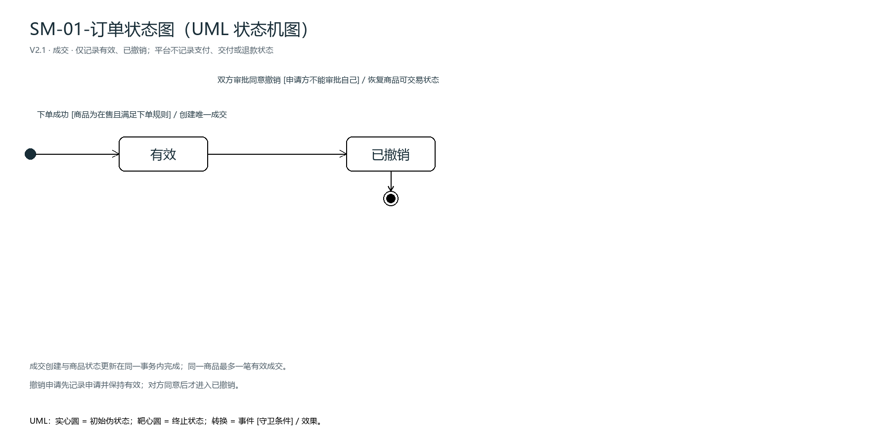
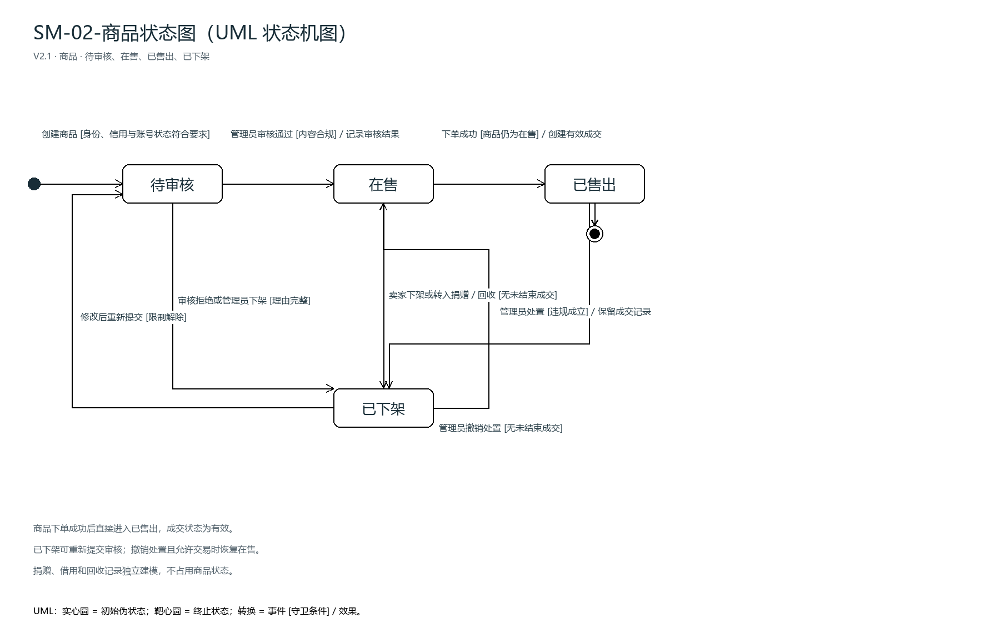
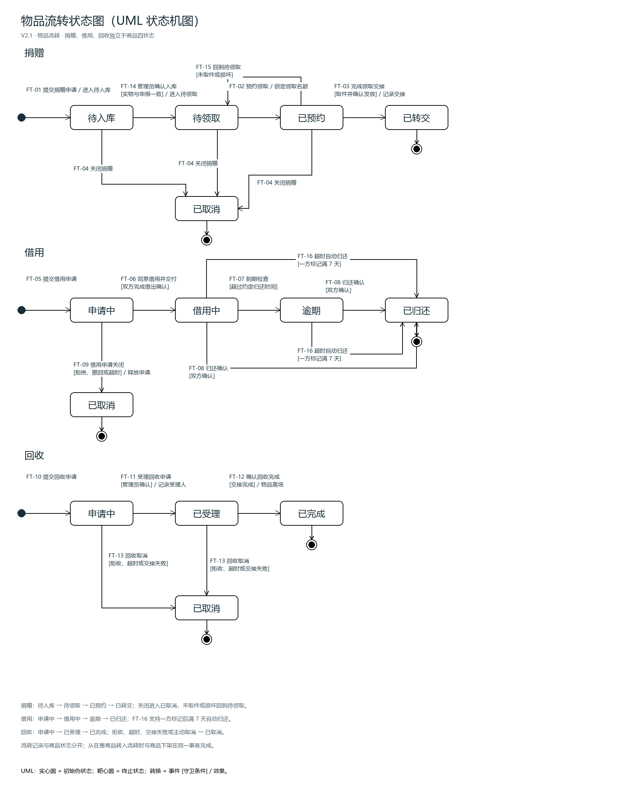

# 校园二手交易与物品流转平台：业务规则与状态初始需求分析

- 版本：v0.5，2026-10-27；阶段：需求分析修订，文档修订完成；14 条 AI 候选 BR 已获用户授权确认，其余 9 条维持团队已复核，成员签字待补。
- 分工负责人：吕锦浩；本稿由 AI 辅助编制，规则依据组长裁定完成复核。
- 本次交付：业务规则表、订单、商品与物品流转三张状态图、状态转换说明表、SC-01～SC-10 场景走查草案。
- 输入依据：项目功能清单、需求规格说明书 v1.1、A/B 报告模板及既有规则与状态材料。附件中的示例视为参考和候选，不视为已确认业务事实。
- 本文不代替其他成员的功能说明、权限表、数据字典、质量需求及小组最终 A/B 报告。UC 编号待与赵俊豪的功能清单对齐，不自行编造。

## 1. 范围、术语与建模前提

平台面向校园内部用户，支持注册认证、商品发布审核、搜索筛选、收藏咨询、下单确认、线下交付、评价举报、管理审核封禁、状态流转和数据统计。本文集中定义这些功能涉及的判定条件与状态结果。

买家与卖家是学生在具体交易中的身份，同一学生可以在不同交易中承担不同身份；管理员具有审核、违规处置权限；系统负责定时检查和规则执行。具体权限由马歆远维护，此处仅描述状态操作所需权限。

商品指一次发布的一件闲置物品；订单指买卖双方针对该商品的一次交易约定；交付记录是卖家提交的线下交付说明，不能单独证明买家已经收货。完成后的再次流转建议由新持有人创建新商品记录，原订单及原发布记录保留，不直接将已售出记录恢复在售。

**建模前提：** 平台不接触资金，买家通过微信或支付宝直接向卖家付款。买家可在平台标记“已付款”，系统记录标记时间并通知卖家；该操作不改变订单主状态。卖家核对到账后在系统内确认收款，订单才从“待支付”进入“已支付”。八个订单主状态为“待支付、已支付、待交付、待确认、已完成、已取消、退款中、已退款”；退款由线下处理，平台只记录状态变化，不实现退款。

## 2. 关键事实与业务规则表

BR-02、BR-05、BR-06、BR-07、BR-10、BR-11、BR-12、BR-21、BR-23 标记为“团队已复核”。其余 14 条 AI 候选于 2026-10-27 由用户明确要求按当前候选值全部采纳，状态记为“用户授权确认”；这不等同于其他成员的个人签字、教师确认或真实业务方确认。来源列只使用规定的三种分类；从分工材料引用的候选保留其原有来源性质。

| 编号 | 规则内容 | 来源 | 状态 | 依据与确认/待办 |
|---|---|---|---|---|
| BR-01 | 学生完成校内身份认证且账号未封禁，才可发布、购买；不能购买本人商品 | AI 候选 | 用户授权确认 | 2026-10-27 用户授权按当前候选值采纳；认证方式与有效期作为实现前校核项 |
| BR-02 | 同一学号最多同时发布 5 件在售商品；预订中的商品不计入该上限 | 分析推导 | 团队已复核 | 组长裁定 v1.2；预订商品不计入发布上限 |
| BR-03 | 订单创建后达到 24 小时且仍待支付，系统自动取消；释放商品时须再次检查商品是否允许销售 | AI 候选 | 用户授权确认 | 2026-10-27 用户授权采纳；计时起点为创建时间，边界为当前时间大于等于截止时间；固定为 24 小时 |
| BR-04 | 禁售品类在审核时拒绝，发现违规在售商品可下架并说明理由 | AI 候选 | 用户授权确认 | 2026-10-27 用户授权采纳；正式禁售清单仍需在实现前补充 |
| BR-05 | 引入信用分：初始 100，范围 0～150；低于 60 禁止发布新商品，低于 40 禁止下单，已发布和进行中的订单不受影响 | 分析推导 | 团队已复核 | 组长裁定 v1.2，2026-10-22；信用分公开，明细仅本人和管理员可见 |
| BR-06 | 价格与成交金额须合法且一致；平台不做议价；不设单笔金额上限 | 分析推导 | 团队已复核 | 组长裁定 v1.2；价格只校验合法性和正数 |
| BR-07 | 举报须核实后再处罚；下架与账号封禁须记录原因、操作者和证据；管理员可直接封禁，解封须人工复核并留痕；不设累计封禁次数阈值 | 分析推导 | 团队已复核 | 组长裁定 v1.2；避免把举报提交等同于违规成立 |
| BR-08 | 商品提交后待审核，通过才在售；拒绝审核进入已下架并保留理由；修改已下架商品再提交须重新审核 | AI 候选 | 用户授权确认 | 2026-10-27 用户授权采纳；关联 ST-15～ST-17、ST-21 |
| BR-09 | 同一商品最多有一个未结束订单；创建订单与在售转已预订必须同时成功；重复请求不得重复创建 | AI 候选 | 用户授权确认 | 2026-10-27 用户授权采纳；未结束指待支付、已支付、待交付、待确认、退款中 |
| BR-10 | 平台不核验付款凭据；买家标记已付款后通知卖家，只有卖家在系统内确认收款才进入已支付；重复标记或确认不得重复转换 | 分析推导 | 团队已复核 | 组长裁定 v1.0，2026-10-15；平台不接触资金 |
| BR-11 | 仅订单卖家可在 `待交付` 时提交一次交付记录，记录订单、时间、约定地点及说明；仅订单买家可确认收货，买家点击“已收到”不代替交付记录或确认收货。交付记录生成后不可修改，确需更正由管理员在后台操作并留痕；进入 `待交付` 后超时未完成交付的，系统提醒双方，仍不交付的任一方可按 UC-20 申请取消，须对方同意，不为此新增订单状态 | AI 候选 | 团队已复核 | 组长裁定 v1.2；不采集不必要的精确行踪信息 |
| BR-12 | 待支付且未标记付款的订单允许买家取消；已标记付款但卖家超过 48 小时未确认的待支付订单，买家可取消并进入退款；已支付后的取消须经对方同意，依次经 `退款中`、卖家标记已退回、买家确认收到后进入 `已退款`。退款不是平台功能，只是订单状态变化 | AI 候选 | 团队已复核 | 组长裁定 v1.2；资金线下处理，平台只记录状态 |
| BR-13 | 订单取消或退款完成时，商品仍已预订且无违规限制、卖家可交易，才恢复在售；否则下架或保持已下架 | AI 候选 | 用户授权确认 | 2026-10-27 用户授权采纳；防止违规下架后被取消订单重新上架；商品恢复转换按 ST-20、ST-24、ST-27 |
| BR-14 | 买家确认收货须有交付记录、关联商品已预订且不存在未解决的交易限制；订单完成与商品售出同时成功。交付记录生成满 7 天、无人工处置、争议或退款申请时，系统按 ST-34 代买家自动确认收货，仍视为确认收货的自动执行 | AI 候选 | 用户授权确认 | 2026-10-27 用户授权采纳；自动确认仍视为确认收货，重复确认不重复成交和统计 |
| BR-15 | 仅已完成订单的参与双方可各发表一次评价，不可评价本人；举报须关联对象和原因，处理结果可追溯 | AI 候选 | 用户授权确认 | 2026-10-27 用户授权采纳；评价修改期限、补充证据和申诉细则作为实现前校核项 |
| BR-16 | 卖家仅可主动下架自己的在售商品；管理员可下架待审核、在售、已预订商品；预订中的订单按付款状态处置 | AI 候选 | 用户授权确认 | 2026-10-27 用户授权采纳；待支付订单按 ST-29／ST-27 同时取消并保持下架；已支付、待交付或待确认订单按 ST-12 保持状态、标记人工处置并阻止继续交付或完成 |
| BR-17 | 封禁后禁止新增发布、咨询和下单；允许查看本人历史、提交举报及参与既有交易的人工处理 | AI 候选 | 用户授权确认 | 2026-10-27 用户授权采纳；封禁时在售商品按 ST-23 下架；待支付订单按 ST-29 取消；已付款交易按 ST-12 进入人工处理，不抹去双方权利 |
| BR-18 | 搜索默认只展示在售商品；收藏不锁定商品；状态变更后收藏页显示实际状态，咨询不产生订单 | AI 候选 | 用户授权确认 | 2026-10-27 用户授权采纳；搜索范围和未认证用户可见性由 UC-06、§5 权限统一约束 |
| BR-19 | 成交笔数与金额以已完成订单去重统计；订单取消、举报提交和交付记录不计成交 | AI 候选 | 用户授权确认 | 2026-10-27 用户授权采纳；统计时间范围和隐私权限作为实现前校核项 |
| BR-20 | 已完成订单与已售出商品保留历史；捐赠、借用、回收使用独立的物品流转状态，不占用商品五状态。捐赠须经管理员确认入库后进入待领取；借用归还可由双方确认，也可在一方标记归还后满 7 天由系统按 FT-16 处理 | AI 候选 | 用户授权确认 | 2026-10-27 用户授权采纳；在售商品转捐赠／回收按 ST-37；捐赠使用 FT-01、FT-14、FT-15；回收使用 FT-10～FT-13；再次转售仍须新建发布记录 |
| BR-21 | 信用分初始 100，范围 0～150；交易完成且双方互评后双方各 +2（每订单每人一次）；订单超时未支付自动取消买家 -2，举报成立或商品被强制下架卖家 -10，买家确认收货后 7 天内未评价买家 -1；只与举报成立关联，提交或不成立不扣分；低于 60 禁止发布新商品，低于 40 禁止下单，既有发布和订单不受影响。每次变动必须生成信用记录，记录变动值、原因、时间和关联订单编号；按事件次数计分，不按金额计分；权限拒绝、状态拒绝一律不扣分 | 分析推导 | 团队已复核 | 组长裁定 v1.2，2026-10-22；分数公开，明细仅本人和管理员可见 |
| BR-22 | 在登录与身份核验结果、下单成功、买家标记已付款、卖家确认收款、订单取消、进入退款、退款完成、交付安排变更、商品审核驳回、商品因违规被下架、卖家主动下架、举报受理与处置结果、申诉复核结果、捐赠入库与领取发放、信用分变更、借用到期与逾期等事件发生时，系统应主动发送站内通知；通知由系统发起，不是用例 | AI 候选 | 用户授权确认 | 2026-10-27 用户授权采纳；与 SRS §4.2 合并 |
| BR-23 | 「人工处置」不是订单状态，只是订单的附属业务标记；仅管理员可标记，标记期间阻止继续交付与完成。管理员撤销处置后清除订单标记；有未结束订单时商品按 ST-35 恢复 `已预订`，否则按 ST-28 恢复 `在售`，标记与撤销均须填写理由并留痕 | 分析推导 | 团队已复核 | 组长裁定 v1.2；与 ST-12、ST-28、ST-35 同步 |
| BR-24 | 同一学生同时处于 `有效` 状态的买方订单不得超过 5 笔；已撤销订单不计入上限。达到上限时拒绝新下单，不改变商品状态且不生成订单 | 分析推导 | 用户授权确认 | 个人下单总量限制；上限集中配置为 5 |
| BR-25 | 下单成功时生成交割截止时间，默认为成交时间后 7×24 小时；平台不确认线下交付事实，截止后只提醒双方，不自动伪造交付或改变订单状态 | 分析推导 | 用户授权确认 | 交割时间限制采用可观测的截止时间与提醒，不新增不可观测的交付状态 |

## 3. 状态定义及图模型

| 对象 | 状态 | 含义 |
|---|---|---|
| 订单 | 待支付 | 创建成功且商品已锁定，等待买家付款 |
| 订单 | 已支付 | 卖家已在系统内确认收款，尚未完成交付 |
| 订单 | 待交付 | 卖家已确认收款，等待线下交付 |
| 订单 | 待确认 | 卖家已提交交付记录，等待买家确认 |
| 订单 | 有效 | 下单即成交；保存交割截止时间，平台不记录线下交付事实 |
| 订单 | 已取消 | 付款前取消或超时关闭，不接受新的付款转换 |
| 订单 | 退款中 | 已标记付款的订单取消，等待卖家标记退回并由买家确认收到 |
| 订单 | 已退款 | 线下退款完成的终态 |
| 商品 | 待审核 | 已提交，尚未审核通过 |
| 商品 | 在售 | 审核通过且可被下单 |
| 商品 | 已预订 | 已被一个未结束订单占用 |
| 商品 | 已售出 | 对应订单已完成 |
| 商品 | 已下架 | 审核拒绝、卖家撤回、卖家主动下架、转入捐赠／回收或违规限制，不可下单；必须保存下架原因与操作者 |

> **实现口径同步（V2.1）**：当前代码采用“下单即成交”模型，订单实际状态仅为 `有效`／`已撤销`；上表中“待支付、已支付、待交付、待确认、已完成、退款中、已退款”属于旧版线下交付流程的候选状态，不作为本次实现的可写状态。交割限制由 BR-25 的 `交割截止时间` 与到期提醒表达，不改变订单状态。
| 物品流转（捐赠） | 待入库、待领取、已预约、已转交、已取消 | 捐赠申请先进入待入库，管理员确认入库后进入待领取；可因超期、撤回或预约取消关闭 |
| 物品流转（借用） | 申请中、借用中、逾期、已归还、已取消 | 借用申请经同意后进入借用中，可逾期后归还，也可在申请阶段关闭 |
| 物品流转（回收） | 申请中、已受理、已完成、已取消 | 回收申请经管理员受理后完成物品离场，拒收或取消时关闭 |

- SM-01：订单状态图，建模对象为订单，关联 BR-03、BR-09～BR-14、BR-16、BR-21、BR-23；源文件 `SM-01-订单状态图.drawio`，导出 `SM-01-订单状态图.png`。
- SM-02：商品状态图，建模对象为商品，关联 BR-08、BR-09、BR-13、BR-14、BR-16、BR-20、BR-23；源文件 `SM-02-商品状态图.drawio`，导出 `SM-02-商品状态图.png`。
- SM-03：物品流转状态图，建模捐赠、借用与回收记录，关联 BR-14、BR-20；源文件 `物品流转状态图.drawio`，导出 `物品流转状态图.png`。捐赠链为“待入库→待领取→已预约→已转交”，可因超期、撤回或预约取消转为“已取消”，已预约可在未取件或损坏时回到“待领取”；借用链为“申请中→借用中→逾期→已归还”，逾期后仍可归还，申请拒绝、撤回或超时进入“已取消”，一方标记归还后超时可自动进入“已归还”；回收链为“申请中→已受理→已完成/已取消”。
- 三图采用 UML 状态机图：圆角矩形表示状态，实心圆表示初始伪状态，靶心圆表示终止状态，带开放箭头的实线表示转换；标注采用“事件 [守卫条件] / 效果”，ST 或 FT 编号关联下表。初始转换不设置触发事件或守卫，其创建条件在 ST-01、ST-15、FT-01、FT-05、FT-10 中说明。
- 已完成、已取消、已退款、已售出、已转交、已归还、已完成（回收）经无触发完成转换到达 UML 终止状态，表示本次交易、发布或物品流转生命周期结束，不删除历史数据；这类符号性完成转换不新增业务编号。后续重复请求由系统按 ST/FT 表返回既有结果。已下架仍可重新提交，不是终止状态。捐赠的 `已预约` 可在未取件或损坏时回到 `待领取`，因此不是终态。
- 买家付款标记是待支付订单上的操作记录，不是订单主状态；退款处理仍在线下完成，平台只记录退款状态变化，不接收或核验资金。

## 4. 状态转换说明表

涉及两个对象的变化必须作为同一业务操作整体成功，失败则两者均保持操作前状态，不保留半笔订单或半次成交。拒绝操作可增加失败审计记录，但不改变订单、商品和成交统计。系统判断使用服务端最新状态，不使用页面缓存状态。

### 4.1 订单（SM-01）

| 编号 | 当前状态 | 触发事件 | 执行角色 | 条件或判定依据 | 目标状态及业务结果 | 失败或拒绝时处理 |
|---|---|---|---|---|---|---|
| ST-01 | 尚无订单 | 提交下单 | 买家 | BR-01、BR-09；商品在售且未被占用 | 待支付；同时 ST-18 锁定商品并保存成交价 | 拒绝并提示原因，不生成订单、不锁定商品 |
| ST-02 | 待支付 | 买家标记已付款 | 买家 | BR-10；本人订单且仍在付款期限内 | 状态保持待支付；记录标记时间并通知卖家核对到账 | 非本人、已过期或重复标记时状态保持待支付，不产生付款事实 |
| ST-03 | 待支付 | 确认收款 | 卖家 | BR-10；本人订单，卖家核对微信或支付宝已到账，且存在买家付款标记 | 已支付；记录卖家确认时间 | 未标记、未到账或越权时保持待支付；重复确认时保持已支付，不重复通知 |
| ST-04 | 已支付 | 双方确认交付安排 | 买家／卖家 | BR-11；卖家已确认收款，买家与卖家对时间、地点和交付方式达成一致 | 待交付；记录交付安排并通知双方 | 任一方未确认或安排不完整时状态保持已支付 |
| ST-05 | 待交付 | 卖家提交线下交付记录 | 卖家 | BR-11；本人订单，记录完整且无人工处置标记；买家点击“已收到”不代替本转换 | 待确认；保存唯一交付记录 | 状态保持待交付，不新增有效交付记录；买家只能按 ST-06／ST-34 确认收货 |
| ST-06 | 待确认 | 买家确认收货 | 买家 | BR-14；本人订单，有交付记录且商品已预订、无交易限制 | 已完成；同时 ST-19，成交只统计一次 | 状态保持待确认，不新增成交 |
| ST-07 | 待支付 | 到期检查 | 系统 | BR-03；当前时间达到截止时间，仍未完成买家付款标记 | 已取消；商品按 ST-20、ST-24 或 ST-27 处理；买家信用分 -2 | 执行失败状态保持并重试；若已标记付款则不取消 |
| ST-08 | 待支付 | 取消订单 | 买家 | BR-12；本人订单且未标记付款 | 已取消；商品按 ST-20、ST-24 或 ST-27 处理 | 状态保持，说明无权限或已标记付款 |
| ST-09 | 已支付／待交付／待确认 | 发起取消申请 | 买家／卖家 | BR-12；本人订单、取消理由有效，且不存在待处理的同向取消申请 | 状态保持原状态；记录申请人、原因、时间和退款申请，通知对方 | 越权、状态不允许或重复申请时状态保持，不进入退款 |
| ST-10 | 已支付／待交付／待确认 | 对方同意取消 | 对方（买家／卖家） | BR-12；存在另一方发起的有效取消申请且未过期 | 退款中；记录同意时间，进入线下退款流程 | 未同意、无申请或已撤回时保持原状态，不自动退款 |
| ST-31 | 退款中 | 卖家标记已退回 | 卖家 | BR-12；本人为收款方，存在有效退款记录，且尚未标记 | 状态保持退款中；记录退回时间和退款参考号，通知买家确认 | 非收款方、重复标记或金额不一致时保持退款中 |
| ST-32 | 退款中 | 买家确认收到退款 | 买家 | BR-12；卖家已按 ST-31 标记退回，本人为退款接收方 | 已退款；记录退款完成时间；商品按 ST-20／ST-24／ST-27 处理；清除人工处置标记 | 未标记退回、越权或确认失败时保持退款中，不释放商品 |
| ST-11 | 已取消／已退款 | 再次付款、收款确认或交付 | 买家／卖家／系统 | 订单已进入终态 | 状态保持原终态，不重新预订 | 拒绝请求并返回既有状态 |
| ST-12 | 已支付／待交付／待确认 | 标记人工处置 | 管理员 | BR-12、BR-16、BR-17、BR-23；管理员有权限且理由有效 | 状态保持；记录人工处置标记、原因、操作管理员和时间，阻止交付与完成；不反向调用 ST-23 | 非管理员、理由不完整或重复标记时保持原状态，不自动完成或释放为在售 |
| ST-13 | 已完成 | 重复确认收货 | 买家 | BR-14；本人订单已完成 | 状态保持已完成；返回已有结果 | 越权拒绝，不重复统计 |
| ST-14 | 待支付／已支付／待交付／待确认 | 非订单当事人操作 | 其他学生 | BR-10、BR-11；身份与所需角色不符 | 各自状态保持，不产生有效业务记录 | 明确提示无权限，不泄露订单敏感内容 |
| ST-29 | 待支付 | 违规处置联动取消 | 系统 | BR-16；关联商品已由 ST-23 下架，订单仍待支付 | 已取消；商品按 ST-27 保持已下架并解除占用；不扣买家信用分 | 执行失败保持待支付并重试；若已付款则转 ST-12 人工处置 |
| ST-30 | 待交付 | 自提点取货确认 | 买家 | BR-11、BR-14；交付方式为自提点，卖家已送达并生成有效取货码，订单无人工处置标记 | 待确认；记录取货时间，等待买家确认收货 | 状态保持待交付，不生成有效取货记录 |
| ST-33 | 待支付 | 买家取消已标记付款订单 | 买家 | BR-12；本人订单、已标记付款、卖家超过 48 小时未确认，且无人工处置标记 | 退款中；记录取消申请和退款；商品保持已预订，后续按 ST-31、ST-32 处理 | 未满 48 小时、未标记付款或卖家已确认时保持待支付 |
| ST-34 | 待确认 | 自动确认收货 | 系统 | BR-14；交付记录生成满 7 天，无人工处置、争议或退款申请 | 已完成；同时 ST-19，成交只统计一次 | 条件不满足时保持待确认并继续检查；不重复统计 |

### 4.2 商品（SM-02）

| 编号 | 当前状态 | 触发事件 | 执行角色 | 条件或判定依据 | 目标状态及业务结果 | 失败或拒绝时处理 |
|---|---|---|---|---|---|---|
| ST-15 | 尚无发布记录 | 提交商品 | 卖家 | BR-01、BR-08；身份有效且必填内容完整 | 待审核；创建发布记录 | 不生成有效发布记录，提示缺失内容 |
| ST-16 | 待审核 | 审核通过 | 管理员 | BR-04、BR-08；有权限，内容符合已采用的审核标准 | 在售；记录审核结果 | 状态保持待审核，记录失败原因 |
| ST-17 | 待审核 | 审核拒绝或违规下架 | 管理员 | BR-04、BR-08、BR-16；理由完整 | 已下架；记录原因并通知卖家 | 状态保持待审核 |
| ST-18 | 在售 | 下单成功 | 买家 | BR-09；关联 ST-01，商品未被其他订单占用 | 已预订；绑定唯一未结束订单 | 状态保持在售，不生成订单；竞争失败者按 ST-25 处理 |
| ST-19 | 已预订 | 确认成交 | 买家／系统 | BR-14；与 ST-06 或 ST-34 同一业务操作 | 已售出；保留订单关联；成交只统计一次 | 状态保持已预订；订单也不完成 |
| ST-20 | 已预订 | 取消或退款完成后恢复销售 | 系统 | BR-13；关联 ST-07、ST-08 或 ST-32，订单已进入已取消／已退款；商品无违规限制且卖家可交易 | 在售；解除原订单占用 | 状态保持已预订；取消或退款操作整体失败后重试 |
| ST-21 | 已下架 | 修改后重新提交 | 卖家 | BR-08；本人商品、账号可用、限制已解除且无未结束订单；下架原因不是未撤销的违规处置 | 待审核；生成新审核记录 | 状态保持已下架，解释限制 |
| ST-22 | 在售 | 卖家主动下架 | 卖家 | BR-16；卖家本人且商品在售，无需取消订单 | 已下架；记录主动下架原因 | 状态保持在售；越权或状态不符时拒绝 |
| ST-23 | 在售／已预订 | 违规处置下架 | 管理员 | BR-07、BR-16、BR-21；管理员有权限、违规成立且理由完整 | 已下架；同一处置事件中，待支付订单按 ST-29／ST-27 处理，已付款订单按 ST-12 标记人工处置，卖家按 BR-21 扣分一次 | 整个处置在一个事务中执行；权限拒绝或证据不足时商品、订单、信用均保持原状态，不重复扣分 |
| ST-24 | 已预订 | 取消或退款完成时发现禁止继续销售 | 系统／管理员 | BR-13、BR-17；关联 ST-07、ST-08 或 ST-32 后订单已结束，卖家封禁、账号不可交易或商品存在有效限制 | 已下架；解除原订单占用、保留处置原因和操作者 | 整体失败状态保持，进入重试或人工处理 |
| ST-25 | 已预订／已售出／已下架／待审核 | 尝试下单 | 买家 | BR-08、BR-09；最新状态非在售 | 各自状态保持；不创建订单 | 提示商品不可购买并刷新状态 |
| ST-26 | 已预订 | 卖家主动下架 | 卖家 | BR-16；存在未结束订单 | 状态保持已预订 | 拒绝直接下架，提示使用订单取消或争议处理入口 |
| ST-27 | 已下架 | 关联订单取消或退款完成 | 系统／管理员 | BR-13；商品已经下架，关联 ST-07、ST-08、ST-29 或 ST-32 | 状态保持已下架；解除原订单占用；清除订单人工处置标记 | 不得恢复在售；执行失败重试，违规取消不得触发买家超时扣分 |
| ST-28 | 已下架 | 管理员撤销违规处置（无未结束订单） | 管理员 | BR-23；下架原因确为违规处置，处置依据不成立或申诉复核通过，理由完整，且无未结束订单 | 在售；清除订单人工处置标记，记录撤销理由与操作人 | 状态保持已下架，记录失败原因 |
| ST-35 | 已下架 | 管理员撤销违规处置（存在未结束订单） | 管理员 | BR-23；下架原因确为违规处置，处置依据不成立或申诉复核通过，理由完整，且仍有未结束订单 | 已预订；清除订单人工处置标记，保留原订单关联并记录撤销理由 | 状态保持已下架，不释放订单或商品 |
| ST-36 | 待审核 | 卖家撤回待审商品 | 卖家 | BR-08；本人商品且仍待审核 | 已下架；下架原因记为“卖家撤回”，保留原商品编号，可在 ST-21 重新提交 | 状态保持待审核，记录拒绝原因 |
| ST-37 | 在售 | 商品转入捐赠／回收 | 卖家／管理员 | BR-20；商品在售、无未结束订单，捐赠或回收申请有效 | 已下架；下架原因记为“转入物品流转”；若原为在售商品，ST-37 与 FT-01／FT-10 在同一事务中成功，不进入商品五状态中的成交链 | ST-37 不成立时，原商品状态保持在售，且不生成基于该商品的捐赠／回收申请；独立新建物品的捐赠／回收不受影响 |

### 4.3 物品流转（SM-03）

物品流转状态与商品五状态分开建模，捐赠品、出借品和回收品不经过“在售→已预订→已售出”。

| 编号 | 当前状态 | 触发事件 | 执行角色 | 条件或判定依据 | 目标状态及业务结果 | 失败或拒绝时处理 |
|---|---|---|---|---|---|---|
| FT-01 | 尚无捐赠记录 | 提交捐赠申请 | 捐赠者 | BR-20；信息完整且身份有效 | 待入库；创建捐赠记录；若原为在售商品，与 ST-37 在同一事务中执行 | 校验失败，状态保持无记录，商品状态不变 |
| FT-14 | 待入库 | 管理员确认入库 | 管理员 | BR-20；物品与申报一致且已完成实物接收 | 待领取；记录入库时间、操作人和接收位置 | 不接收时按 FT-04 关闭，状态保持待入库或进入已取消 |
| FT-02 | 待领取 | 预约领取 | 领取者 | 领取者符合条件且尚无其他有效预约 | 已预约；锁定领取名额 | 不符合条件或重复预约，状态保持待领取 |
| FT-03 | 已预约 | 完成领取交接 | 领取者／管理员 | BR-20；领取者取件且管理员确认发放，物品与记录一致 | 已转交；记录领取人、发放人和交接时间 | 未取件或发放失败，状态保持已预约；损坏或超时按 FT-15 处理 |
| FT-04 | 待入库／待领取／已预约 | 撤回、拒收或超期关闭 | 捐赠者／管理员／系统 | BR-20；达到约定期限、撤回理由有效或不符合捐赠要求 | 已取消；释放预约并通知相关方 | 条件不满足，状态保持原状态 |
| FT-05 | 尚无借用记录 | 提交借用申请 | 借用者 | 借用物品可借且申请信息完整 | 申请中 | 校验失败，状态保持无记录 |
| FT-06 | 申请中 | 同意借用并交付 | 出借者／借用者 | 出借者同意，双方完成借出确认 | 借用中；记录起止时间 | 拒绝或未完成交付，状态保持申请中 |
| FT-07 | 借用中 | 到期检查 | 系统 | 当前时间超过约定归还时间且未归还 | 逾期；通知双方 | 检查失败，状态保持借用中并重试 |
| FT-08 | 借用中／逾期 | 归还确认 | 借用者／出借者 | 双方确认物品已归还 | 已归还；记录归还时间 | 归还未核实，状态保持原状态 |
| FT-09 | 申请中 | 关闭借用申请 | 借用者／出借者／系统 | 出借者拒绝、借用者撤回或超过约定回应时限 | 已取消；释放申请并通知相关方 | 条件不满足，状态保持申请中 |
| FT-10 | 尚无回收记录 | 提交回收申请 | 申请人 | 物品不在危险废弃物范围且申请信息完整 | 申请中；创建回收记录；若原为在售商品，与 ST-37 在同一事务中执行 | 校验失败，状态保持无记录，商品状态不变 |
| FT-11 | 申请中 | 受理回收申请 | 管理员 | 回收范围与物品信息核对通过 | 已受理；记录受理人和受理时间 | 拒收或核对失败按 FT-13 处理 |
| FT-12 | 已受理 | 确认回收完成 | 管理员 | 申请人已完成线下交接，管理员核实物品与申报一致 | 已完成；登记物品离场并通知申请人 | 未完成交接，状态保持已受理 |
| FT-13 | 申请中／已受理 | 取消回收申请 | 申请人／管理员／系统 | 申请人撤回、管理员拒收、超时未受理或交接失败 | 已取消；记录原因并释放申请 | 条件不满足，状态保持原状态 |
| FT-15 | 已预约 | 逾期未取或发放时损坏 | 系统／管理员 | BR-20；超过约定领取期限，或管理员确认物品损坏；该次预约未完成 | 待领取；解除本次预约，记录原因并重新开放 | 条件不满足，状态保持已预约 |
| FT-16 | 借用中／逾期 | 超时自动归还 | 系统 | BR-20；一方已标记归还，另一方超过 7 天未确认，且无争议处理中标记 | 已归还；记录系统确认时间并通知双方 | 未满足超时或存在争议时保持原状态，不自动归还 |

ST-02、ST-09、ST-11、ST-12、ST-13、ST-14、ST-26、ST-27、ST-31 以及 FT 表中的失败分支属于状态保持记录，不绘制为成功转换箭头；ST-10、ST-32、ST-33、ST-34、ST-35、ST-36、ST-37 和 FT-14～FT-16 是 v0.5 新同步的实际状态转换。ST-22、ST-23 分别表示卖家主动下架和管理员违规处置。ST-20 覆盖付款前取消以及退款完成后的可售恢复；ST-24 覆盖取消或退款完成后发现不可销售的商品侧结果；ST-27 覆盖商品已经下架时的订单取消或退款完成。ST-29 与 ST-07 都使待支付订单进入已取消，但 ST-29 不扣买家信用；ST-30 与 ST-05 都使订单进入待确认，分别对应自提点取货和线下交付记录。ST-37 与基于原在售商品的 FT-01／FT-10 在同一事务中成功，任一步失败均不生成流转记录并保持商品在售。

## 5. 场景走查草案与验收预期

以下为场景设计与走查依据，统一依据本稿 v0.5、SM-01、SM-02、SM-03。`规则与状态/A.5场景走查记录.md` 已按 SC-01～SC-10 记录 2026-10-28 由吕锦浩一人分角色完成的实际实人文档走查；原型页面层核对另见 PV-03。场景编号与 SRS §7.6 一致。

| 编号及类型 | 初始条件与操作顺序 | 预期状态与数据结果 | 关联规则／转换 |
|---|---|---|---|
| SC-01 正常主流程 | 已认证卖家发布→管理员通过→另一学生下单→买家标记已付款→卖家确认收款→双方确认安排→见面交付或自提点取货→买家确认 | 商品待审核→在售→已预订→已售出；订单待支付→已支付→待交付→待确认→已完成；见面交付使用 ST-05，自提点使用 ST-30；付款标记作为待支付期间的记录 | BR-08～BR-14；ST-15、16、01、18、02、03、04、05、06、19、30 |
| SC-02 权限 | 第三名学生对他人待交付订单提交交付记录 | 拒绝，订单保持待交付、商品保持已预订；不新增交付 | BR-11；ST-14 |
| SC-03 状态与超时 | 待支付订单在截止时刻触发到期检查；随后尝试标记付款 | 已取消，正常商品恢复在售；再次付款订单保持已取消 | BR-03、BR-10、BR-13；ST-07、ST-20、ST-11 |
| SC-04 并发异常 | 两名买家同时对同一在售商品下单 | 仅一笔订单成功；商品已预订，另一请求被拒；不存在两笔未结束订单 | BR-09；ST-01、ST-18、ST-25 |
| SC-05 违规异常 | 管理员下架已预订商品；关联订单待支付 | 商品已下架，订单经 ST-29 取消；解除商品占用但保持已下架；重复取消不得恢复在售，也不扣买家超时信用 | BR-13、BR-16、BR-21；ST-23、ST-29、ST-27 |
| SC-06 已付款争议 | 已支付、待交付或待确认订单的商品被管理员违规下架；买家与卖家按 ST-09、ST-10 处理退款；管理员在退款完成后的不同时点依法撤销处置 | 商品已下架；订单保持原状态并标记人工处置；后续交付或确认被阻止；对方同意后进入退款中；卖家按 ST-31 标记已退回，买家按 ST-32 确认收到后退款完成；退款完成前撤销且仍有未结束订单按 ST-35 恢复已预订，订单结束后撤销按 ST-28 恢复在售 | BR-12、BR-16、BR-23；ST-23、ST-12、ST-09、ST-10、ST-31、ST-32、ST-28、ST-35 |
| SC-07 重复与失败 | 重复标记付款、重复确认收款、重复确认收货；模拟成交写入失败 | 同一事件仅记录一次；整体写入失败时订单与商品均保留原状态 | BR-09、BR-10、BR-14、BR-19；ST-02、03、04、05、06、13、19 |
| SC-08 物品流转 | 提交捐赠→管理员入库→预约→交接；提交借用申请→同意交付→逾期→归还；申请回收→受理→完成；各链执行一次取消或回退分支 | 捐赠待入库→待领取→已预约→已转交，超期或撤回→已取消，未取件或损坏→待领取；借用申请中→借用中→逾期→已归还，申请阶段可取消，借用中或逾期可由双方确认归还，或一方标记归还后满 7 天由系统自动归还；回收申请中→已受理→已完成/已取消；失败分支保持原状态 | BR-20；FT-01、FT-14、FT-02、FT-03、FT-04、FT-15、FT-05～FT-09、FT-16、FT-10～FT-13 |
| SC-09 浏览与自助管理 | 已认证学生搜索商品→按分类筛选→收藏并在收藏页查看商品当前状态→在「我的商品」下架一件在售商品→在「我的订单」取消一笔待支付订单→查看消息通知 | 搜索结果只含在售商品；收藏不锁定商品，状态变更后收藏页显示实际状态；卖家主动下架在售商品后商品已下架；有未结束订单时下架被拒、商品保持已预订；待支付订单取消后订单已取消、商品由已预订转在售；上述事件按通知规则生成站内通知 | BR-02、BR-12、BR-13、BR-16、BR-18、BR-22；ST-08、ST-20、ST-22、ST-26 |
| SC-10 举报与评价 | 买家举报违规商品→管理员核实后强制下架并扣卖家信用分→另一笔已完成订单双方互评→查看信用分与变动明细。待支付样本 P1/O1 与已付款样本 P2/O2 为不同商品、不同订单，按互斥分支执行；评价使用已完成订单 O3 | 举报须关联对象与原因，处理结果可追溯；核实成立后商品已下架、卖家信用分 -10 且只扣一次；P1/O1 按 ST-29 取消且不扣买家信用，P2/O2 按 ST-12 保持原状态并标记人工处置；互评后双方各 +2 并各生成一条信用记录；信用分低于 60 禁止发布、低于 40 禁止下单 | BR-05、BR-07、BR-15、BR-19、BR-21、BR-23；ST-12、ST-23、ST-29 |

> 场景来源：SRS §7.6。**SC-09、SC-10 由组长补入**，用于补充浏览与自助管理、举报与评价两条场景链。本稿第 2 节已纳入 BR-22（站内通知）和 BR-23（人工处置标记与撤销），场景引用与 SRS 一致。

## 6. 已识别问题及待确认事项

本节保留初稿阶段本地问题记录。原编号仅作历史追溯，不参与原走查的全局 `V-01～V-27` 编号；不将“已修改”写为“团队已确认”。相关修订已并入本稿第 2～5 节，独立审查表未纳入本次仓库同步。

| 历史编号 | 问题与依据 | 初稿处理及位置 | 影响、建议负责人及下一步 |
|---|---|---|---|
| H-01 | 原分工 ST-03 同时声称订单已取消又保持待支付，前后矛盾 | 已在订单 ST-07 中明确取消后的目标状态 | 同步功能说明中的状态名称 |
| H-02 | 平台不接触资金，无法取得外部有效付款结果 | 已按组长裁定调整 BR-10 与订单 ST-02、ST-03；卖家确认到账后才进入已支付 | 与功能负责人对齐买家标记、卖家确认收款操作 |
| H-03 | 取消即恢复在售会使违规商品重新出现 | BR-13、ST-20、ST-24、ST-27 增加可售判定；撤销违规处置按 ST-28／ST-35 恢复 | 与权限负责人核对封禁、商品恢复及重新提交条件 |
| H-04 | 付款后取消与退款处理需区分平台状态和资金操作 | BR-12、ST-09、ST-10、ST-31、ST-32 记录申请、同意、退回和确认；ST-33 处理卖家 48 小时未确认收款；资金仍在线下处理 | 与组长确认退款凭证、处理时限及争议申诉规则 |
| H-05 | 物品流转范围包含捐赠、借用，回收规则仍未定义 | v0.5 已在 SM-03 和 FT-10～FT-16 中补齐回收、捐赠入库与回退、借用自动归还，并区分同名状态 | 由团队人工复核回收范围、受理人、入库人与取消条件 |
| H-06 | 发布上限、金额上限及部分处罚规则尚未确认 | BR-02、BR-06、BR-07 已按组长裁定改为团队已复核；BR-05、BR-21 的信用分规则已写入 | 后续仅确认仍未复核的规则，不重复讨论已裁定项 |

还需确定认证来源、订单当事人账号注销和评价修改期限。交付超期取消、交付记录管理员更正、捐赠入库与回退、借用超时自动归还、管理员撤销处置后的商品恢复均已有文档状态；申诉证据、审批授权与团队业务确认仍待人工复核，未经确认不把这些规则写为团队已确认。

## 7. 合稿与证据交接

- 向林初仁交付本文件及三组状态图源文件与导出图；本文未向任何人发送消息。
- 向林初仁交付 PV-03 状态走查记录（`规则与状态/吕锦浩-PV-03状态走查记录.md`）。
- 与赵俊豪对齐发布审核、下单、付款范围、取消、交付、确认、举报处理的实际 UC 编号；与马歆远对齐本稿状态枚举、订单商品关联、处置标记及权限；向过振宇提供第 5 节预期场景。
- 当前已完成规则、状态转换和场景的文档层推演，三张状态图已更新；已完成 2026-10-28 吕锦浩一人分角色的 A.5 实际实人文档走查和 PV-03 原型页面层核对；尚未开展真实交易、人员访谈、教学模拟确认和系统测试，原型也未实现业务持久化。
- AI-01：本次任务为根据输入资料及用户项目描述生成规则与状态初稿。实际提示词见当前聊天用户请求；实际操作为阅读资料、生成本稿及图模型。初稿生成时没有发生人工追问或独立核验；后续于 2026-10-27 发生用户授权采纳，见下一条。操作者身份未核实，不以分工姓名代替实际操作者。
- 关键 AI 候选包括并发唯一订单、违规后不自动恢复在售、付款后转人工处理。2026-10-27 用户已授权按当前候选值全部采纳，状态记为 `用户授权确认`；该记录不扩展为其他成员的个人判断，也不填写虚构的“采纳理由”。本文件不是完整 AI 交互原始记录，后续应保留当前聊天原文或截图并建立证据索引。
- 后续 A 报告可引用第 2、3、4、5、6 节；B 报告可引用上述 AI-01，但人工决定、实际验证和原始聊天附件必须据实补充。是否布置 B5 当前未知，不代填“不适用”。
