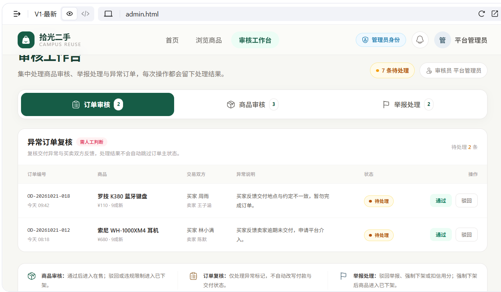
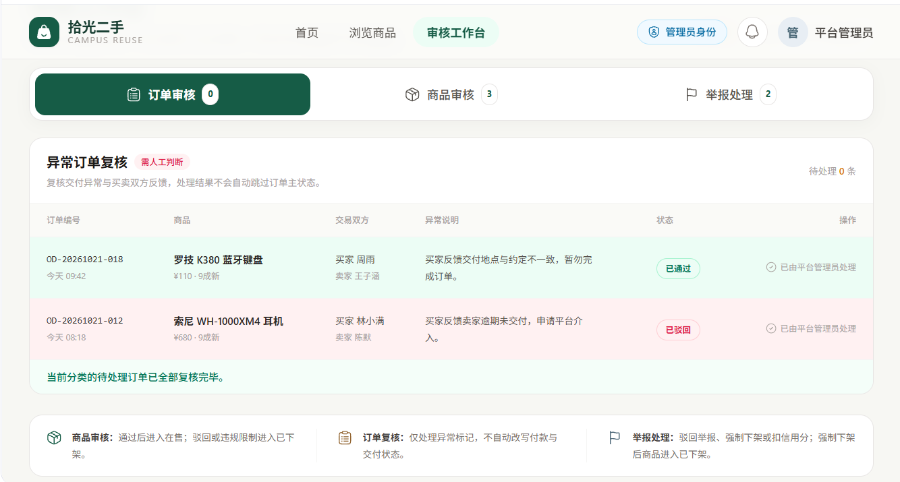
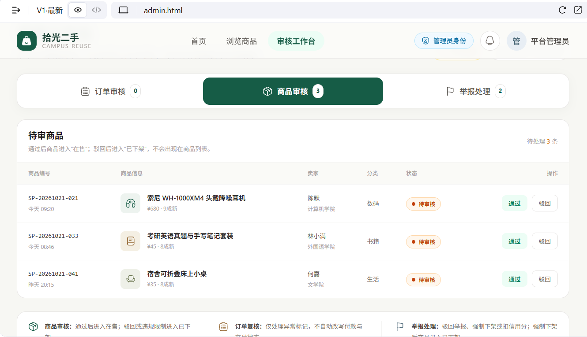
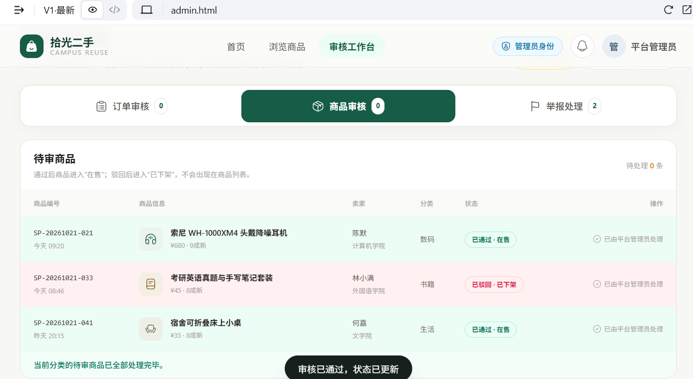
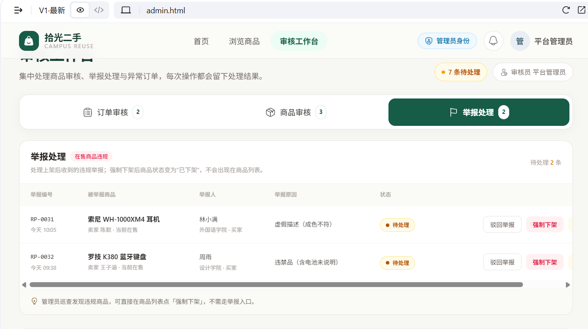
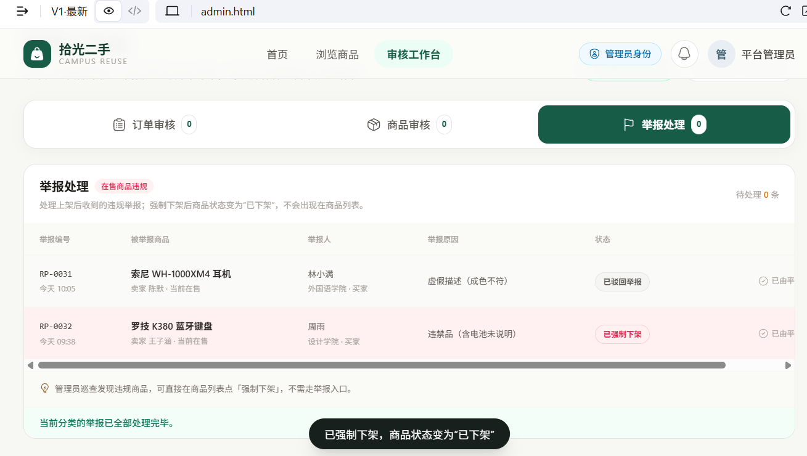
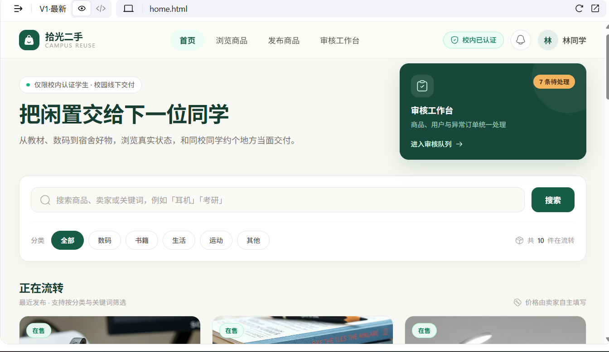

#A.6 原型走查记录汇总

> **本条只走原型**，与 A.5 场景走查分开；A.5 不碰原型、本条不碰需求文档的场景表。
>
> **走查路径**：`home.html` → `detail.html` → `checkout.html`（`campus-market/` 下 4 个可点击页面中的 3 个，`admin.html` 不属 PV-01）。
>
> **本轮填写方式**：结果为**静态核对页面源码与页面可见文案**得出（当前环境无法鼠标点击），点击过程与截图证据待过振宇补；凡依赖状态持久化的判定一律记「未验证」。
> 实际结果只取 **通过 / 失败 / 未验证** 三选一；「发现的问题」列：无问题写「无」，没走这步写「未验证」。

---

## PV-01 正常主流程

| 验证编号 | 测试条件与输入 | 预期结果 | 实际结果 | 发现的问题 | 证据位置 |
|---|---|---|---|---|---|
| **PV-01-1** | 打开 `home.html`，看商品卡片的状态标签 | 标签只取「待审核 / 在售 / 已预订 / 已售出 / 已下架」之一；不出现「未通过」「强制下架」 | 通过 —— 首页 10 张商品卡片的状态标签只有「在售」×9 与「已预订」×1，无「未通过」「强制下架」；详情页状态图例也是 5 个 | 无 |  |
| **PV-01-2** | 首页搜索关键词 → 点分类筛选 → 点重置 | 列表有响应，结果与关键词、分类相符 | 失败 —— 搜索与分类筛选均生效（结果计数与空态切换正常），但**页面上没有常驻的「重置」按钮**，仅在 0 结果空态里有「清除筛选」，正常列表态无重置入口 | 筛选区缺常驻「重置」入口；「清除筛选」只出现在空态（`home.html` 空态按钮）。建议在筛选区常驻「重置」，或把走查步骤改为「搜索无结果 → 空态点清除筛选」 |  |
| **PV-01-3** | 点一张商品卡片进 `detail.html` | 显示卖家信息、成色、交付地点、商品状态 | 失败 —— 卖家（昵称／信用分／实名标）、交付地点、交付方式、商品状态与 5 状态图例都在，但**无「成色」字段**，成色只出现在卖家描述正文里 | 详情页信息区缺「成色」字段（`detail.html` 信息栅格只有交付地点／发布时间／交付方式／商品编号）。§6.2.1 商品.成色为必填字段，建议补一格显示「成色」，与发布表单一致 |  |
| **PV-01-4** | 详情页点「立即下单」 | 进入 `checkout.html` | 通过 —— 「立即下单」是链接 `href="checkout.html?item=…"`，并由 `handleBuy` 按当前商品替换参数 | 无 |  |
| **PV-01-5** | 下单页选交付方式 → 提交 | 页面切到订单结果视图（页面层）；**商品是否真的变「已预订」属业务层，一律判未验证** | 通过（页面层）—— 交付方式为必填（带 `*`），未勾「交易确认」点提交会提示「请先勾选交易确认，再提交订单」；勾选后切到「订单已提交」结果视图，状态徽标「待支付」。**商品是否变「已预订」= 未验证**，静态原型无状态持久化 | 未验证 —— 订单号由 `Math.random()` 生成（`checkout.html` 的 `OD-20261021-XXXX`），无存储，刷新即丢；商品状态不会真的变更，业务层无法在本原型验证 |  |
| **PV-01-6** | 看订单结果页的状态流转说明 | 列出 **8 个**订单状态；只列 5 个 → 判**失败** | 失败 —— 「订单状态流转」只演示 `待支付 → 已支付 → 待确认 → 已完成` 四段，另以文字提到「已取消」，**实际共 5 个**；缺「待交付」「退款中」「已退款」 | 结果页状态流转缺 3 个状态（待交付、退款中、已退款），与 §7.1 定案的 8 状态不一致（`checkout.html` 流转区 + 超时说明文案）。建议按 8 状态重排流转图，至少补「待交付」「退款中 → 已退款」两段 |  |

---

## 顺手记：原型没做什么（交过振宇汇总）

| # | 现象 | 位置 |
|---|---|---|
| 1 | 无后端、无存储：提交订单只生成随机单号，商品状态不随订单变化，刷新即重置 | `checkout.html` 订单号生成处 |
| 2 | 筛选区无常驻「重置」，清除筛选只在空态出现 | `home.html` 空态按钮 |
| 3 | 详情页无「成色」字段 | `detail.html` 信息栅格 |
| 4 | 订单结果页状态流转只 5 个（缺待交付／退款中／已退款） | `checkout.html` 流转区 |
| 5 | 无登录／认证入口，无收藏页、无「我的订单」「我的商品」页、无消息通知页、无举报入口 | 四个页面均无 |
| 6 | 「查看主页」「联系卖家」只弹提示，未实现 | `detail.html` 两个按钮 |
| 7 | 后台只有审核页（`admin.html`），无举报处置／申诉／信用分管理 | `admin.html` |

---

## 结论

| 项 | 内容 |
|---|---|
| PV-01 结论 | **失败**（内容层），原因：状态流转只列 5 个状态（缺待交付／退款中／已退款）、详情页缺成色字段、筛选区无重置入口 |
| 范围说明 | 能点通：首页 → 详情 → 下单 → 订单结果视图，页面流程成立；**业务层（商品变已预订、订单状态持久化）一律未验证**，不得据此判"下单功能通过" |
| 判据来源 | 前 3 列来自组内 PV-01 定义，未作改动 |

---

---

# PV-02 管理员权限与审核工作台原型走查记录

## 一、走查基本信息

| 项目 | 内容 |
|---|---|
| 走查编号 | PV-02 |
| 原型名称 | 校园二手交易与物品流转平台（拾光二手） |
| 走查对象 | 管理员审核工作台及相关页面 |
| 原型文件 | `admin.html`，并参考 `home.html` 页面 |
| 原型入口 | [墨刀原型链接](https://modao.cc/ai/share/project/6ad8788f75d0275ef61e8106) |
| 走查环境 | 墨刀在线原型、浏览器 |
| 走查人 | 待填写 |
| 走查日期 | 2026年10月29日 |
| 走查目的 | 检查管理员审核工作台的页面结构、主要审核操作、状态反馈，以及相关权限要求在原型中的体现情况。 |

## 二、走查依据与范围

本次走查依据《校园二手交易与物品流转平台需求规格说明书》中关于角色定义、基础权限矩阵、业务对象权限及权限校验的相关要求开展，主要检查以下内容：

1. 管理员是否具有独立、明确的审核工作台入口。
2. 订单审核功能是否能够区分待处理、已通过和已驳回等状态。
3. 商品审核功能是否能够区分审核通过与审核驳回，并体现商品上架、下架状态。
4. 举报处理功能是否能够体现举报驳回、强制下架等处理结果。
5. 管理员身份是否受到业务权限约束，不能借管理员身份执行仅允许普通认证学生执行的操作。
6. 操作结果是否有明确反馈，处理后的状态是否与界面展示一致。

**走查说明：** 本次检查以原型页面及实际可观察到的交互结果为依据。页面展示的状态变化只能证明原型表现出了相应效果，不能单独证明真实后端、数据库或权限校验机制已经实现。

## 三、走查过程与结果

### 3.1 管理员工作台入口检查

**走查编号：PV-02-01**

- **检查目的：** 确认管理员审核工作台能够正常打开，并检查页面的基本布局及功能入口。
- **操作步骤：**
  1. 打开墨刀分享的校园二手交易平台原型。
  2. 进入 `admin.html` 页面。
  3. 检查顶部导航栏、管理员身份标识及审核工作台模块。
- **预期结果：** 页面能够正常展示，管理员身份和主要审核模块具有明确的视觉标识，用户能够识别不同审核功能的入口。
- **实际结果：** 页面正常显示“审核工作台”，顶部显示“管理员身份”和“平台管理员”标识；工作台提供“订单审核”“商品审核”和“举报处理”三个主要模块，并显示待处理数量。
- **走查结论：通过（界面层面）。**
- **证据位置：** `PV-02-01界面打开正常.png`

### 3.2 订单审核功能检查

**走查编号：PV-02-02**

- **检查目的：** 检查异常订单审核列表、订单状态展示及审核处理结果。
- **操作步骤：**
  1. 进入管理员审核工作台的“订单审核”模块。
  2. 查看异常订单列表及其异常说明。
  3. 对待处理订单执行审核操作。
  4. 检查操作后的订单状态、待处理数量及结果提示。
- **预期结果：** 系统能够展示需要人工判断的异常订单；审核后应显示相应处理状态，并且订单审核不应自动修改付款和交付状态。
- **实际结果：** 操作前页面展示两条待处理异常订单，分别涉及买家反馈交付地点与约定不一致、卖家逾期未交付等情况。操作后，待处理数量变为 0，两条记录分别显示“已通过”和“已驳回”，并出现“已由平台管理员处理”的提示。
- **走查结论：通过（原型交互与状态展示层面）。**
- **补充说明：** 截图能够证明原型展示了审核前后的状态差异，但无法据此确认真实订单数据是否被持久化，也无法证明付款和交付状态在后台完全不受影响。
- **证据位置：** `PV-02-02订单审核功能正常.png`

### 3.3 商品审核界面检查

**走查编号：PV-02-03**

- **检查目的：** 检查待审商品列表及审核操作入口是否清晰。
- **操作步骤：**
  1. 进入“商品审核”模块。
  2. 查看待审商品的编号、商品信息、卖家、分类、状态及操作按钮。
  3. 确认审核通过与驳回操作具有明确的入口。
- **预期结果：** 待审商品列表应提供必要的商品信息，管理员能够区分待审核商品，并找到相应的审核操作。
- **实际结果：** 页面展示三条待审核商品记录，分别为头戴式降噪耳机、考研英语真题与手写笔记套装、宿舍可折叠床上小桌。每条记录均展示商品编号、商品信息、卖家、分类、待审核状态，以及“通过”“驳回”按钮。
- **走查结论：通过（界面层面）。**
- **证据位置：** `PV-02-03商品审核界面正常.png`

### 3.4 商品审核操作与状态变化检查

**走查编号：PV-02-04**

- **检查目的：** 检查商品审核完成后，审核结果及商品状态是否得到清晰展示。
- **操作步骤：**
  1. 在商品审核列表中选择待审核商品。
  2. 执行审核通过或驳回操作。
  3. 观察商品状态、待处理数量及提示信息。
- **预期结果：** 审核通过的商品应进入在售状态；审核驳回的商品应进入已下架状态，不应继续出现在正常商品列表中。
- **实际结果：** 操作后，待处理商品数量由 3 条变为 0 条。两条商品显示“已通过·在售”，一条商品显示“已驳回·已下架”；页面提示“审核已通过，状态已更新”。
- **走查结论：通过（原型交互与状态展示层面）。**
- **补充说明：** 原型体现了审核结果与商品状态之间的对应关系，但商品列表是否真实同步更新、商品状态是否写入后端，仍需在实际系统中验证。
- **证据位置：** `PV-02-04商品审核功能正常.png`

### 3.5 举报处理界面检查

**走查编号：PV-02-05**

- **检查目的：** 检查举报记录、举报原因和处理入口是否完整清晰。
- **操作步骤：**
  1. 进入“举报处理”模块。
  2. 查看举报编号、被举报商品、举报人、举报原因和处理状态。
  3. 检查“驳回举报”和“强制下架”等操作入口。
- **预期结果：** 管理员能够查看待处理举报的基本信息，并根据举报内容选择相应处理方式。
- **实际结果：** 页面展示两条待处理举报记录，涉及“虚假描述（成色不符）”和“违禁品（含电池未说明）”两类举报原因。每条记录均展示举报信息，并提供“驳回举报”“强制下架”等操作入口。
- **走查结论：通过（界面层面）。**
- **证据位置：** `PV-02-05举报处理功能正常.png`

### 3.6 举报处理操作与状态变化检查

**走查编号：PV-02-06**

- **检查目的：** 检查举报处理完成后，举报状态、商品状态和待处理数量的展示情况。
- **操作步骤：**
  1. 对待处理举报执行相应处理操作。
  2. 检查举报记录的最终状态。
  3. 观察待处理数量及操作反馈。
- **预期结果：** 被驳回的举报应显示相应处理结果；执行强制下架的举报应体现商品已下架状态，并给出明确反馈。
- **实际结果：** 操作后，待处理举报数量由 2 条变为 0 条。其中一条举报显示“已驳回举报”，另一条显示“已强制下架”；页面提示“已强制下架，商品状态变为‘已下架’”。
- **走查结论：通过（原型交互与状态展示层面）。**
- **补充说明：** 页面体现了举报处理结果及强制下架的反馈，但实际商品数据是否同步更新、举报处理是否留下可追溯的后台审计记录，仍需进一步验证。
- **证据位置：** `PV-02-06举报处理功能正常.png`

### 3.7 管理员身份与下单权限检查

**走查编号：PV-02-07**

- **检查目的：** 检查管理员角色是否与普通认证学生角色相区分，以及管理员是否能够绕过角色限制执行下单操作。
- **需求预期：** 根据需求规格说明书的角色定义及基础权限矩阵，管理员不能借助管理员身份执行仅允许认证学生执行的下单操作。对于不允许的操作，系统应阻止操作，并避免产生订单等业务数据。
- **操作步骤：**
  1. 查看首页的用户身份标识及商品浏览界面。
  2. 检查页面中的“发布商品”“浏览商品”和“审核工作台”等入口。
  3. 尝试确认当前页面对应的身份，以及是否能够在该身份下完成下单操作。
- **实际结果：** 现有截图显示首页具有“发布商品”“浏览商品”和“审核工作台”等入口，页面右上角显示“校内已认证”和“林同学”。截图未能证明当前实际使用的是管理员身份，也未展示管理员身份下尝试下单后的拦截结果。
- **走查结论：未验证（存在待确认事项）。**
- **原因说明：** 当前证据不足以确认管理员身份是否能够下单，也不足以确认系统是否执行了真实的角色权限校验。不能仅根据页面入口的存在或缺失判断权限控制是否正确。
- **后续验证建议：**
  1. 明确切换或进入真正的管理员身份。
  2. 尝试从商品详情页进入下单流程。
  3. 记录是否允许提交订单，以及是否出现明确的权限拒绝提示。
  4. 如果可以检查实际系统数据，还应确认被拒绝的操作不会创建订单或修改业务状态。
- **证据位置：** `PV-02-07管理员身份不能下单 存疑.png`

## 四、权限六问核对结果

| 核对维度 | 核对内容 | 当前结果 | 说明 |
|---|---|---|---|
| 角色 | 管理员与普通认证学生是否明确区分 | 部分通过 | 管理工作台显示管理员身份标识，但仍需验证身份切换及实际角色校验 |
| 操作 | 管理员是否具备必要的审核操作入口 | 通过 | 已观察到订单审核、商品审核和举报处理模块 |
| 对象 | 审核操作是否对应具体订单、商品或举报记录 | 通过（界面层面） | 列表展示了相应编号、对象信息及处理原因 |
| 条件 | 不同状态下是否允许执行相应操作 | 部分通过 | 原型展示待处理及处理后的状态，但尚未覆盖全部业务状态与边界条件 |
| 拒绝 | 越权操作是否会被阻止且不修改业务数据 | 未验证 | 尚无管理员身份下尝试下单、评价或提交举报的有效证据 |
| 反馈与审计 | 操作结果是否明确，是否具备可追溯记录 | 部分通过 | 页面提供状态变化和“已由平台管理员处理”等反馈，真实后台审计记录尚未验证 |

**核对说明：** 上表为依据需求内容整理的六个检查维度。如果项目组已有统一的“权限六问”正式表格，应将本表内容对应填入原表，不应以本表替代项目组的正式格式要求。

## 五、问题与待验证事项

| 编号 | 问题或待验证事项 | 影响 | 建议处理方式 |
|---|---|---|---|
| PV-02-I01 | 管理员身份下的下单权限尚未验证 | 无法确认角色权限边界是否得到落实 | 使用明确的管理员身份开展越权操作测试 |
| PV-02-I02 | 原型展示的审核状态变化尚不能证明真实数据已更新 | 无法确认后台业务逻辑和数据持久化情况 | 在实际系统或后端测试环境中进一步验证 |
| PV-02-I03 | 操作审计记录的真实存储与查询能力尚未验证 | 无法确认管理操作是否完整留痕 | 检查实际系统的操作日志或审计记录 |
| PV-02-I04 | 尚未覆盖所有角色、对象及异常状态组合 | 无法全面确认权限校验和业务状态约束 | 后续补充不同角色、不同对象及不同状态下的测试 |

## 六、总体结论

本次 PV-02 原型走查围绕校园二手交易平台的管理员审核工作台开展，完成了管理员工作台入口、订单审核、商品审核和举报处理四个方面的检查，并对管理员身份下的下单权限进行了初步核对。

从已观察到的原型表现来看，管理工作台能够清晰展示三类审核模块，相关记录包含必要的对象信息和状态信息；操作后，订单、商品及举报的处理状态均出现相应变化，并提供了明确的界面反馈。因此，**订单审核、商品审核和举报处理在原型交互与状态展示层面基本符合预期。**

但是，本次走查主要基于墨刀原型进行，现有证据不能证明真实后台的权限校验、业务数据持久化和操作审计机制已经实现。特别是管理员身份下的下单权限，目前仍缺乏有效验证证据，应继续列为待验证事项。

综合来看，本次原型走查的界面与主要交互检查已完成，权限边界及后台行为仍需进一步验证。后续应结合实际系统测试，对管理员越权操作、业务状态约束、数据一致性和操作审计进行补充检查。

## 七、证据截图清单

| 截图编号 | 文件名 | 对应检查内容 |
|---|---|---|
| PV-02-01 | `PV-02-01界面打开正常.png` | 管理员审核工作台初始界面 |
| PV-02-02 | `PV-02-02订单审核功能正常.png` | 订单审核后的状态展示 |
| PV-02-03 | `PV-02-03商品审核界面正常.png` | 商品审核待处理列表 |
| PV-02-04 | `PV-02-04商品审核功能正常.png` | 商品审核后的状态变化 |
| PV-02-05 | `PV-02-05举报处理功能正常.png` | 举报处理待处理列表 |
| PV-02-06 | `PV-02-06举报处理功能正常.png` | 举报处理后的状态变化 |
| PV-02-07 | `PV-02-07管理员身份不能下单 存疑.png` | 管理员下单权限待验证页面 |

> 归档提示：如果需要在本地 Markdown 阅读器中直接显示截图，请将本文件与上述 7 张图片放在同一目录，并保持图片文件名不变。若项目组要求将走查记录与截图统一归档，建议同时提交本 Markdown 文件和截图文件夹。

---

---

# PV-03 状态流转与异常验证记录

> 验证对象：校园二手交易与物品流转平台原型（订单结果与状态展示、确认订单、商品详情、首页、发布商品、审核工作台）。
> 判定依据：任务文件 `03_吕锦浩(1).md`；`校园二手交易与物品流转平台-需求规格说明书-v1.1.md` §7.1～§7.5；`规则与状态/吕锦浩-业务规则与状态-初稿.md` v0.5 的 SM-01、SM-02 与 ST 表。
> 判定范围：页面层只核对状态数量、名称、入口与可观察的页面反馈；状态是否真正持久化、跨页面同步属于业务层，不在静态原型中推定通过。
> 复核日期：2026-10-31。

## 一、状态名逐字核对表

### 订单状态（SM-01）

| 对象 | 状态名 | 需求文档 v1.1 | ST 表对应转换 | 原型页面 | 逐字核对结论 |
|---|---|---|---|---|---|
| 订单 | `待支付` | §7.1、§7.2 定义，8 状态之一 | ST-01 创建；ST-02 标记付款时保持 | 有（订单结果页当前订单徽标、确认订单页状态说明、商品详情页交易提示） | 名称一致 |
| 订单 | `已支付` | §7.1、§7.2 定义，8 状态之一 | ST-03 卖家确认收款 | 有（确认订单页状态说明、商品详情页交易提示） | 名称一致 |
| 订单 | `待交付` | §7.1、§7.2 定义，8 状态之一 | ST-04 双方确认交付安排 | 有（确认订单页状态说明、商品详情页交易提示、订单结果页阶段卡片） | 名称一致 |
| 订单 | `待确认` | §7.1、§7.2 定义，8 状态之一 | ST-05 提交交付记录；自提走 ST-30 | 有（确认订单页状态说明、商品详情页交易提示） | 名称一致 |
| 订单 | `已完成` | §7.1、§7.2 定义，8 状态之一 | ST-06 买家确认收货；ST-34 自动确认 | 有（确认订单页状态说明、商品详情页交易提示） | 名称一致 |
| 订单 | `已取消` | §7.1、§7.2 定义，8 状态之一 | ST-07 超时、ST-08 主动取消、ST-29 违规联动取消 | 有（确认订单页状态说明、订单结果页阶段展示、取消后徽标） | 名称一致 |
| 订单 | `退款中` | §7.1、§7.2 定义，8 状态之一 | ST-10 对方同意取消；ST-33 已标记付款后取消 | 有（确认订单页状态说明、商品详情页交易提示） | 名称一致 |
| 订单 | `已退款` | §7.1、§7.2 定义，8 状态之一 | ST-32 买家确认收到退款 | 有（确认订单页状态说明、商品详情页交易提示） | 名称一致 |

> 订单状态集合核对结果：8/8。订单结果页标注“八种主状态 · 非同时生效”，确认订单页“订单状态说明”逐条列出 8 个状态，商品详情页交易提示列出完整链路，名称与 SM-01 逐字一致。

### 商品状态（SM-02）

| 对象 | 状态名 | 需求文档 v1.1 | ST 表对应转换 | 原型页面 | 逐字核对结论 |
|---|---|---|---|---|---|
| 商品 | `待审核` | §7.1、§7.3 定义，5 状态之一 | ST-15 创建；ST-21 已下架后重新提交 | 有（商品详情页标签、发布商品页说明） | 名称一致 |
| 商品 | `在售` | §7.1、§7.3 定义，5 状态之一 | ST-16 审核通过；ST-20 取消或退款后恢复；ST-28 撤销违规处置 | 有（商品详情页标签、首页商品卡片、审核工作台说明） | 名称一致 |
| 商品 | `已预订` | §7.1、§7.3 定义，5 状态之一 | ST-18 下单成功 | 有（商品详情页标签、首页商品卡片、确认订单反馈） | 名称一致 |
| 商品 | `已售出` | §7.1、§7.3 定义，5 状态之一 | ST-19 确认成交 | 有（商品详情页标签） | 名称一致 |
| 商品 | `已下架` | §7.1、§7.3 定义，5 状态之一 | ST-17 审核拒绝；ST-22 卖家下架；ST-23 违规处置；ST-24／ST-27 保持下架；ST-36 撤回待审 | 有（商品详情页标签、审核工作台说明） | 名称一致 |

> 商品状态集合核对结果：5/5。发布商品页写明“提交后的初始商品状态为「待审核」，审核通过后才进入「在售」”；审核工作台写明“审核通过进入在售，驳回或违规限制进入已下架”，没有把 `未通过`、`强制下架` 等审核结果或操作当作正式状态值。

## 二、PV-03 六步判定

| **验证编号** | **测试条件与输入** | **预期结果** | **实际结果** | **发现的问题** | **证据位置** |
|---|---|---|---|---|---|
| **PV-03-1** | 打开订单结果页，数状态个数 | **8 个** → 通过；**5 个** → 失败 | **通过**；订单结果页标注“八种主状态 · 非同时生效”，确认订单页“订单状态说明”逐条列出 8 个状态，商品详情页交易提示列出完整链路。 | 无。 | 订单结果页截图（014018）、确认订单页截图（013853）、商品详情页截图（013907） |
| **PV-03-2** | 逐个比对状态名与 SM-01 的 8 个名字 | 逐字一致；差一个字 → **失败** | **通过**；8 个名称逐字一致：待支付、已支付、待交付、待确认、已完成、已取消、退款中、已退款。 | 无。 | 确认订单页截图（013853）、商品详情页截图（013907） |
| **PV-03-3** | 打开商品详情页，看「平台商品状态」标签 | 正好 5 个，且名称与 SM-02 一致 | **通过**；商品详情页展示待审核、在售、已预订、已售出、已下架 5 个名称，与 SM-02 逐字一致；首页、发布页、审核工作台也验证了状态出现位置。 | 无。 | 商品详情页截图（013907）、首页截图（014006）、发布页截图（014012）、审核工作台截图（013835） |
| **PV-03-4** | 检查有没有把「待卖家确认收款」当状态用 | 不应出现；出现 → **失败**（它只该是转换条件） | **通过**；页面没有「待卖家确认收款」这个状态标签，只写成“卖家确认收款后订单变为已支付”的转换条件。 | 无。 | 订单结果页截图（014018）、确认订单页截图（013853） |
| **PV-03-5** | 找「取消订单」入口 | 有则核对去向；没有 → **未验证** | **通过（页面层）**；点击「取消订单」并确认后，当前订单状态徽标变为「已取消」，并提示商品恢复“在售”。 | 顶部标题仍写“订单已提交／待支付”，流程节点仍高亮“待支付”，商品信息仍显示“已预订”，三处未随取消同步。 | `pv03-5.png` |
| **PV-03-6** | 找「超时未支付自动取消」的演示 | 有则记录；没有 → **未验证**；状态是否真的转过属业务层，一律判未验证 | **未验证**；只有“超时未支付或主动取消时，订单将进入已取消”的文字说明，没有倒计时或定时任务；等待 10 秒状态仍为待支付。 | 缺少超时自动取消演示；状态未持久化，刷新后无法保留。 | `pv03-6.png` |

> 证据说明：原始截图存于 `走查记录/吕锦浩走查/原型走查/`，均为原始截图，未做拼贴或标注叠加。

## 三、状态相关问题清单

| 编号 | 级别 | 问题 | 影响 | 建议处理 |
|---|---|---|---|---|
| ST-I-01 | P2 | 订单结果页只呈现 5/8 订单状态，与确认订单页、商品详情页的 8 状态说明不一致 | 页面之间状态覆盖不一致，交互演示无法覆盖 `待交付`、`退款中`、`已退款` | 补齐订单结果页的状态节点与退款分支，与 8 状态设计保持一致。 |
| ST-I-02 | P1 | 取消订单后页面只有状态徽标变化，顶部标题、流程节点、商品状态未同步 | 用户会同时看到“已取消”和“待支付／已预订”，状态自相矛盾 | 取消成功后同步更新标题、流程高亮、商品状态和订单信息卡。 |
| ST-I-03 | P2 | 没有超时未支付自动取消的演示 | PV-03-6 只能判“未验证” | 增加倒计时、到期检查或后端任务的可观察结果。 |
| ST-I-04 | P1 | 状态只存在页面 JavaScript 变量中，`localStorage` / `sessionStorage` 均为 0 次 | 刷新或跳转后状态丢失，不能证明“状态真的发生转换” | 明确这是页面演示；若要做转换验证，增加持久化或接口层。 |
| ST-I-05 | P2 | 任务文件把“提交交付记录”写成 `已支付 → 待交付` | 与正式 ST 表冲突：确认交付安排才执行 ST-04 进入 `待交付`，提交交付记录执行 ST-05 进入 `待确认` | 以需求文档和 ST 表为准，统一说明文字。 |

## 四、结论

- **原型是否符合要求：状态展示与命名层面符合。** 订单状态 8/8、商品状态 5/5，名称与 SM-01、SM-02 逐字一致，PV-03-1、PV-03-2、PV-03-3 均通过。
- **商品状态范围：通过。** 商品详情页、首页、发布页、审核工作台均未把“未通过”“强制下架”等审核结果或操作当作正式状态值。
- **状态名使用范围：通过。** 未把“待卖家确认收款”当独立状态，页面把它写成转换条件。
- **取消订单范围：页面层通过。** 入口可用，确认后进入“已取消”；但标题、流程节点和商品状态未同步，属于实现缺陷。
- **超时自动取消范围：未验证。** 没有倒计时或定时任务演示，等待 10 秒状态未变化。
- **业务转换范围：未验证。** 状态仅保存在页面变量中，没有持久化，不能证明跨页面或刷新后的状态转换。
