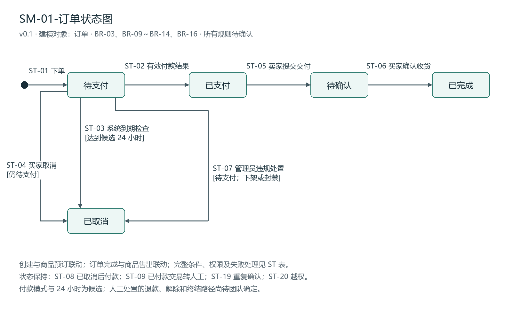
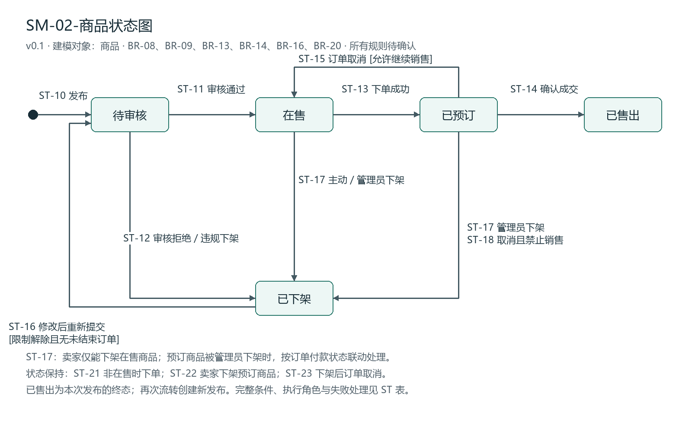

# 校园二手交易与物品流转平台：业务规则与状态初始需求分析

- 版本：v0.1，2026-10-15；阶段：初始需求分析，待团队讨论。
- 分工负责人：吕锦浩；本稿由 AI 辅助编制，尚未经过本人或团队复核。
- 本次交付：业务规则表、订单与商品两张状态图、状态转换说明表。
- 输入依据：项目十项核心功能、同目录上一级的《吕锦浩-规则与状态.md》和《学生需求分析与AI智能体使用验证报告.md》。附件中的示例视为参考和候选，不视为已确认业务事实。
- 本文不代替其他成员的功能说明、权限表、数据字典、质量需求及小组最终 A/B 报告。UC 编号待与赵俊豪的功能清单对齐，不自行编造。

## 1. 范围、术语与建模前提

平台面向校园内部用户，支持注册认证、商品发布审核、搜索筛选、收藏咨询、下单确认、线下交付、评价举报、管理审核封禁、状态流转和数据统计。本文集中定义这些功能涉及的判定条件与状态结果。

买家与卖家是学生在具体交易中的身份，同一学生可以在不同交易中承担不同身份；管理员具有审核、违规处置权限；系统负责定时检查和规则执行。具体权限由马歆远维护，此处仅描述状态操作所需权限。

商品指一次发布的一件闲置物品；订单指买卖双方针对该商品的一次交易约定；交付记录是卖家提交的线下交付说明，不能单独证明买家已经收货。完成后的再次流转建议由新持有人创建新商品记录，原订单及原发布记录保留，不直接将已售出记录恢复在售。

**暂定建模前提：** 为衔接分工给出的状态名称，本稿采用“待支付—已支付—待确认—已完成”候选流程。其中付款成功指可信支付结果确认，不等同于买家上传截图。原始题目仅明确线下交付，没有明确平台在线收款，因此支付方式是首要待确认项。若团队选择线下付款，需统一改写订单状态、事件、规则、原型与相关功能说明。本稿不表示已经接入支付，也不将真实支付作为本次实施承诺。

## 2. 关键事实与业务规则表

所有规则均为待确认。来源列只使用规定的三种分类；从分工材料引用的候选保留其原有来源性质。确认记录目前均为“尚无”；建议吕锦浩在 10 月 18 日讨论时记录实际参与者、角色、日期、理由和结论。AI 自检不构成人工确认。

| 编号 | 规则内容 | 来源 | 状态 | 依据与未确认处理 |
|---|---|---|---|---|
| BR-01 | 学生完成校内身份认证且账号未封禁，才可发布、购买；不能购买本人商品 | AI 候选 | 待确认 | 分工认证示例及本稿补充；认证方式、有效期交团队决定 |
| BR-02 | 同一学号最多同时发布 5 件在售商品 | 分析推导 | 待确认 | 分工原候选；5 件不是确定上限，预订商品是否计入待讨论，初稿不据此承诺拦截 |
| BR-03 | 订单创建后达到 24 小时且仍待支付，系统自动取消；释放商品时须再次检查商品是否允许销售 | AI 候选 | 待确认 | 分工原候选；计时起点为创建时间，边界为当前时间大于等于截止时间；24 小时待确认 |
| BR-04 | 禁售品类在审核时拒绝，发现违规在售商品可下架并说明理由 | AI 候选 | 待确认 | 分工示例；违禁品、药品、代写服务仅为候选清单，正式清单待团队确定 |
| BR-05 | 是否引入信用分，以及低于何值限制交易，暂不决定 | 分析推导 | 待确认 | 分工原候选；不编造 X，不加入当前状态转换判定 |
| BR-06 | 是否设置单笔金额上限及具体数值暂不决定；价格和成交金额须合法且一致 | 分析推导 | 待确认 | 分工金额上限候选；免费赠送是否支持另行确定 |
| BR-07 | 举报须核实后再处罚；下架与账号封禁须记录原因、操作者和证据；扣分及累计封禁次数暂不设定 | 分析推导 | 待确认 | 分工原候选；避免把举报提交等同于违规成立 |
| BR-08 | 商品提交后待审核，通过才在售；拒绝审核进入已下架并保留理由；修改已下架商品再提交须重新审核 | AI 候选 | 待确认 | 本稿候选，关联 ST-10～ST-12、ST-16 |
| BR-09 | 同一商品最多有一个未结束订单；创建订单与在售转已预订必须同时成功；重复请求不得重复创建 | AI 候选 | 待确认 | 本稿补充并发规则；未结束指待支付、已支付、待确认 |
| BR-10 | 付款须核验订单归属、待支付状态、金额、截止时间及可信交易凭据；重复结果不得重复入账或转换 | AI 候选 | 待确认 | 依赖支付范围确认；取消后的迟到付款须登记异常并核查退款，不恢复订单 |
| BR-11 | 仅订单卖家可在已支付时提交交付记录，记录订单、时间、约定地点及说明；仅订单买家可确认收货 | AI 候选 | 待确认 | 本稿候选；不采集不必要的精确行踪信息 |
| BR-12 | 待支付订单允许买家取消；付款后的撤销、退款和交付争议先人工处理，不自动取消或判定成交 | AI 候选 | 待确认 | 已支付异常闭环待明确；本稿不虚构退款状态 |
| BR-13 | 订单取消时，商品仍已预订且无违规限制、卖家可交易，才恢复在售；否则下架或保持已下架 | AI 候选 | 待确认 | 防止违规下架后被取消订单重新上架 |
| BR-14 | 买家确认收货须有交付记录、关联商品已预订且不存在未解决的交易限制；订单完成与商品售出同时成功 | AI 候选 | 待确认 | 本稿候选；重复确认不重复成交和统计 |
| BR-15 | 仅已完成订单的参与双方可各发表一次评价，不可评价本人；举报须关联对象和原因，处理结果可追溯 | AI 候选 | 待确认 | 评价修改期限、举报补充证据与申诉机制待讨论 |
| BR-16 | 卖家仅可主动下架自己的在售商品；管理员可下架待审核、在售、已预订商品；预订中的订单按付款状态处置 | AI 候选 | 待确认 | 待支付订单同时取消；已支付或待确认订单保持状态、标记人工处置并阻止继续交付或完成 |
| BR-17 | 封禁后禁止新增发布、咨询和下单；允许查看本人历史、提交举报及参与既有交易的人工处理 | AI 候选 | 待确认 | 封禁时在售商品下架，待支付订单取消；已付款交易进入人工处理，不抹去双方权利 |
| BR-18 | 搜索默认只展示在售商品；收藏不锁定商品；状态变更后收藏页显示实际状态，咨询不产生订单 | AI 候选 | 待确认 | 搜索范围和未认证用户可见性与功能负责人对齐 |
| BR-19 | 成交笔数与金额以已完成订单去重统计；订单取消、举报提交和交付记录不计成交 | AI 候选 | 待确认 | 统计按完成时间归属，时间范围及隐私权限交相关负责人确认 |
| BR-20 | 已完成订单与已售出商品保留历史；再次流转须新建发布记录，可关联上一笔完成交易 | AI 候选 | 待确认 | 暂按转售理解物品流转，赠送、交换、借用是否纳入待讨论 |

## 3. 状态定义及图模型

| 对象 | 状态 | 含义 |
|---|---|---|
| 订单 | 待支付 | 创建成功且商品已锁定，尚无有效付款结果 |
| 订单 | 已支付 | 付款结果有效，尚未提交交付记录 |
| 订单 | 待确认 | 卖家已提交交付记录，等待买家确认 |
| 订单 | 已完成 | 买家有效确认，成交已记录 |
| 订单 | 已取消 | 付款前取消或超时关闭，不接受新的付款转换 |
| 商品 | 待审核 | 已提交，尚未审核通过 |
| 商品 | 在售 | 审核通过且可被下单 |
| 商品 | 已预订 | 已被一个未结束订单占用 |
| 商品 | 已售出 | 对应订单已完成 |
| 商品 | 已下架 | 审核拒绝、主动下架或违规限制，不可下单 |

- SM-01：订单状态图，建模对象为订单，关联 BR-03、BR-09～BR-14、BR-16；源文件 `SM-01-订单状态图.drawio`，导出 `SM-01-订单状态图.png`。
- SM-02：商品状态图，建模对象为商品，关联 BR-08、BR-09、BR-13、BR-14、BR-16、BR-20；源文件 `SM-02-商品状态图.drawio`，导出 `SM-02-商品状态图.png`。
- 图中箭头以 ST 编号关联下表，条件与异常处理以表格为准。初始黑点表示记录创建前，不是持久化业务状态。已完成、已取消、已售出无返回箭头。
- 人工处置标记是订单附加业务属性，不是新增主状态；目前仅定义暂停及转人工，退款和纠纷终结路径仍待确认，不能据此宣称全业务闭环已完成。

## 4. 状态转换说明表

涉及两个对象的变化必须作为同一业务操作整体成功，失败则两者均保持操作前状态，不保留半笔订单或半次成交。拒绝操作可增加失败审计记录，但不改变订单、商品和成交统计。系统判断使用服务端最新状态，不使用页面缓存状态。

### 4.1 订单（SM-01）

| 编号 | 当前状态 | 触发事件 | 执行角色 | 条件或判定依据 | 目标状态及业务结果 | 失败或拒绝时处理 |
|---|---|---|---|---|---|---|
| ST-01 | 尚无订单 | 提交下单 | 买家 | BR-01、BR-09；商品在售且未被占用 | 待支付；同时 ST-13 锁定商品并保存成交价 | 拒绝并提示原因，不生成订单、不锁定商品 |
| ST-02 | 待支付 | 有效付款结果 | 系统（买家发起付款） | BR-10；未到截止时间且无交易限制 | 已支付；商品保持已预订，保存付款引用 | 支付失败状态保持待支付；不重复记账 |
| ST-03 | 待支付 | 到期检查 | 系统 | BR-03；当前时间达到截止时间，仍未支付 | 已取消；按 ST-15、ST-18 或 ST-23 处理商品 | 执行失败状态保持并重试；若已付款则不取消 |
| ST-04 | 待支付 | 取消订单 | 买家 | BR-12；本人订单且未付款 | 已取消；按 ST-15、ST-18 或 ST-23 处理商品 | 状态保持，说明无权限或已付款 |
| ST-05 | 已支付 | 提交线下交付记录 | 卖家 | BR-11；本人订单，记录完整且无人工处置标记 | 待确认；保存交付记录 | 状态保持已支付，不新增有效交付记录 |
| ST-06 | 待确认 | 确认收货 | 买家 | BR-14；本人订单，有交付记录且商品已预订、无交易限制 | 已完成；同时 ST-14，成交只统计一次 | 状态保持待确认，不新增成交 |
| ST-07 | 待支付 | 违规下架或封禁处置 | 管理员 | BR-07、BR-16、BR-17；有效处置权限及理由 | 已取消；关联商品按 ST-17、ST-18 或 ST-23 处理 | 整体失败则状态保持，记录处理失败 |
| ST-08 | 已取消 | 再次付款或迟到支付结果 | 买家／系统 | BR-10；最新状态已经取消 | 状态保持已取消；不重新预订 | 新付款请求拒绝；若已经发生外部扣款，登记异常，转人工核查退款，不声称未收款 |
| ST-09 | 已支付／待确认 | 违规下架、封禁、撤销或争议申请 | 管理员／订单参与者 | BR-12、BR-16、BR-17；有权限且理由有效 | 各自状态保持；标记人工处置；管理员违规处置时商品执行 ST-17 | 越权拒绝；不得自动完成、退款或释放为在售 |
| ST-19 | 已完成 | 重复确认收货 | 买家 | BR-14；本人订单已完成 | 状态保持已完成；返回已有结果 | 越权拒绝，不重复统计 |
| ST-20 | 待支付／已支付／待确认 | 非订单当事人操作 | 其他学生 | BR-10、BR-11；身份与所需角色不符 | 各自状态保持，不产生有效业务记录 | 明确提示无权限，不泄露订单敏感内容 |

### 4.2 商品（SM-02）

| 编号 | 当前状态 | 触发事件 | 执行角色 | 条件或判定依据 | 目标状态及业务结果 | 失败或拒绝时处理 |
|---|---|---|---|---|---|---|
| ST-10 | 尚无发布记录 | 提交商品 | 卖家 | BR-01、BR-08；身份有效且必填内容完整 | 待审核；创建发布记录 | 不生成有效发布记录，提示缺失内容 |
| ST-11 | 待审核 | 审核通过 | 管理员 | BR-04、BR-08；有权限，内容符合已采用的审核标准 | 在售；记录审核结果 | 状态保持待审核，记录失败原因 |
| ST-12 | 待审核 | 审核拒绝或违规下架 | 管理员 | BR-04、BR-08、BR-16；理由完整 | 已下架；记录原因并通知卖家 | 状态保持待审核 |
| ST-13 | 在售 | 下单成功 | 买家 | BR-09；关联 ST-01，商品未被其他订单占用 | 已预订；绑定唯一未结束订单 | 状态保持在售，不生成订单；竞争失败者按 ST-21 处理 |
| ST-14 | 已预订 | 买家确认成交 | 买家 | BR-14；与 ST-06 同一业务操作 | 已售出；保留订单关联 | 状态保持已预订；订单也不完成 |
| ST-15 | 已预订 | 订单付款前取消 | 买家／系统 | BR-13；关联 ST-03 或 ST-04；允许继续销售 | 在售；解除原订单占用 | 状态保持已预订；取消操作整体失败后重试 |
| ST-16 | 已下架 | 修改后重新提交 | 卖家 | BR-08；本人商品、账号可用、限制已解除且无未结束订单 | 待审核；生成新审核记录 | 状态保持已下架，解释限制 |
| ST-17 | 在售／已预订 | 主动下架或管理员下架 | 卖家／管理员 | BR-16；卖家仅限在售；管理员须有理由 | 已下架；待支付订单同步 ST-07；已付款订单 ST-09 | 状态保持各自原状态；不得静默撤销已付款订单 |
| ST-18 | 已预订 | 取消时发现禁止继续销售 | 系统／管理员 | BR-13、BR-17；订单取消，卖家封禁或存在有效限制 | 已下架；解除原订单占用、保留处置原因 | 整体失败状态保持，进入重试或人工处理 |
| ST-21 | 已预订／已售出／已下架／待审核 | 尝试下单 | 买家 | BR-08、BR-09；最新状态非在售 | 各自状态保持；不创建订单 | 提示商品不可购买并刷新状态 |
| ST-22 | 已预订 | 卖家主动下架 | 卖家 | BR-16；存在未结束订单 | 状态保持已预订 | 拒绝直接下架，提示使用订单取消或争议处理入口 |
| ST-23 | 已下架 | 关联待支付订单取消 | 系统／管理员 | BR-13；商品已经下架，关联 ST-03、ST-04 或 ST-07 | 状态保持已下架；解除原订单占用 | 不得恢复在售；执行失败重试 |

ST-17 在图中分两条箭头表示同一规则的两个起始状态。ST-08、ST-09、ST-19～ST-23 属于状态保持记录，不绘制为成功转换箭头。

## 5. 场景走查草案与验收预期

以下仅为待执行的场景设计，不是已开展的人工走查或实际功能验证。统一依据 v0.1、SM-01、SM-02；参与者、日期、实际结果和证据均待实际开展后填写。SC 编号为本模块拟用编号，合稿时由组长检查冲突。

| 编号及类型 | 初始条件与操作顺序 | 预期状态与数据结果 | 关联规则／转换 |
|---|---|---|---|
| SC-01 正常主流程 | 已认证卖家发布→管理员通过→另一学生下单→付款→卖家记录交付→买家确认 | 商品待审核→在售→已预订→已售出；订单待支付→已支付→待确认→已完成；一条交付、一次成交 | BR-08～BR-14；ST-10、11、01、13、02、05、06、14 |
| SC-02 权限 | 第三名学生对他人已支付订单提交交付记录 | 拒绝，订单保持已支付、商品保持已预订；不新增交付 | BR-11；ST-20 |
| SC-03 状态与超时 | 待支付订单在候选截止时刻触发到期检查；随后尝试付款 | 已取消，正常商品恢复在售；再次付款订单保持已取消；外部迟到扣款进入人工核查 | BR-03、BR-10、BR-13；ST-03、15、08 |
| SC-04 并发异常 | 两名买家同时对同一在售商品下单 | 仅一笔订单成功；商品已预订，另一请求被拒；不存在两笔未结束订单 | BR-09；ST-01、13、21 |
| SC-05 违规异常 | 管理员下架已预订商品；关联订单待支付 | 商品已下架，订单已取消；重复取消不得将商品恢复在售 | BR-13、BR-16；ST-17、07、23 |
| SC-06 已付款争议 | 已支付或待确认订单的商品被管理员违规下架 | 商品已下架；订单保持原状态并标记人工处置；后续交付或确认被阻止；退款闭环待确定 | BR-12、BR-16；ST-17、09 |
| SC-07 重复与失败 | 重复付款通知、重复确认收货；模拟成交写入失败 | 同一付款仅记录一次，同一成交只统计一次；整体写入失败时订单与商品均保留原状态 | BR-09、BR-10、BR-14、BR-19；ST-02、06、14、19 |

## 6. 已识别问题及待确认事项

本节为 AI 资料比对与分析结果，人工复核尚未开展；不将“已修改”写为“团队已确认”。

| 编号 | 问题与依据 | 初稿处理及位置 | 影响、建议负责人及下一步 |
|---|---|---|---|
| V-01 | 分工 ST-03 同时声称订单已取消又保持待支付，前后矛盾 | 修改：第 4 节 ST-08 明确当前与目标均已取消 | 吕锦浩复核；同步功能及原型 |
| V-02 | 项目未明确在线支付，分工示例却包含付款、24 小时超时 | 暂缓确定：第 1 节支付前提、BR-03／BR-10 | 林初仁组织边界讨论；线下支付方案需重画订单图 |
| V-03 | 取消即恢复在售会使违规商品重新出现 | 修改：BR-13、ST-15／18／23 增加可售判定 | 吕锦浩与权限负责人核对封禁规则 |
| V-04 | 付款后下架、撤销及争议没有退款和终结路径 | 暂缓：BR-12、ST-09 定义暂停并转人工，尚不构成闭环 | 组长与功能负责人确定退款责任、处理时限、申诉和终态；实施前必须解决 |
| V-05 | “物品流转”是否包含赠送、交换、借用不清楚 | 暂按转售候选：BR-20 | 组长确认边界，涉及赠送时重新核对价格与支付规则 |
| V-06 | 发布上限、信用分、金额上限及处罚次数均无已确认依据 | 保留候选：BR-02、05、06、07 | 10 月 18 日讨论，未确认前不固化阈值 |

还需确定认证来源、交易超期交付处理、订单当事人账号注销、交付记录更正、评价修改期限和管理员误下架恢复机制。未经确认不自动追加状态箭头。人工处置解除与商品恢复预订应在后续修订中给出一致的授权及状态规则。

## 7. 合稿与证据交接

- 向林初仁交付本文件及四个图文件；初稿截止按分工为 10 月 21 日 24:00，10 月 25 日定稿。本文未向任何人发送消息。
- 与赵俊豪对齐发布审核、下单、付款范围、取消、交付、确认、举报处理的实际 UC 编号；与马歆远对齐本稿状态枚举、订单商品关联、处置标记及权限；向过振宇提供第 5 节预期场景。
- 当前仅完成文档与图模型草案，未实现或执行原型、真实交易、人员访谈、教学模拟确认、团队走查和功能测试。
- AI-01：本次任务为根据两份输入资料及用户项目描述生成规则与状态初稿。实际提示词见当前聊天用户请求；实际操作为阅读资料、生成本稿及图模型。没有发生人工追问、采纳决定或独立核验；操作者身份未核实，不以分工姓名代替实际操作者。
- 关键 AI 候选包括并发唯一订单、违规后不自动恢复在售、付款后转人工处理。保留待人工确认，不填写虚构的“采纳理由”。本文件不是完整 AI 交互原始记录，后续应保留当前聊天原文或截图并建立证据索引。
- 后续 A 报告可引用第 2、3、4、5、6 节；B 报告可引用上述 AI-01，但人工决定、实际验证和原始聊天附件必须据实补充。是否布置 B5 当前未知，不代填“不适用”。
