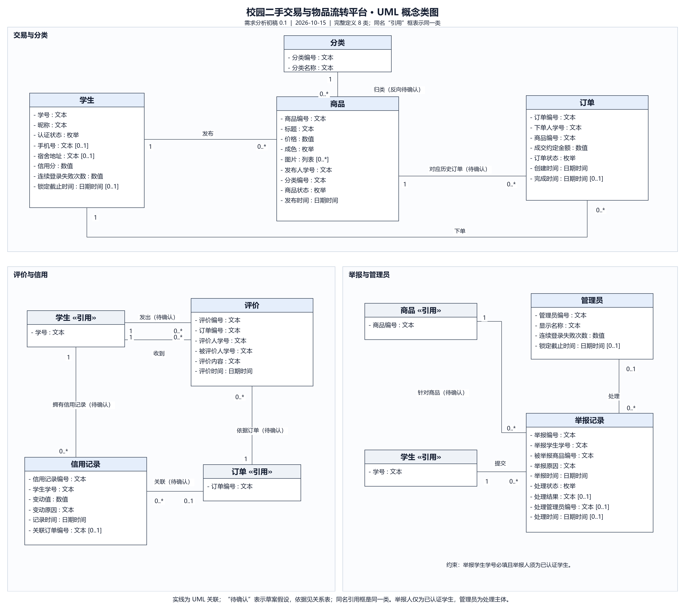

# UML 类图及说明

## 模型性质与依据

本图为需求分析阶段的概念类图，表达业务实体、逻辑属性、关联与多重性，不规定数据库表、类代码、方法、接口或组件。七个核心实体按原文命名；补充最小“管理员”概念类，表示管理员审核商品与直接处置的操作主体，不表示管理员可作为举报人。未把游客建成持久实体；未认证、已认证是学生的认证状态，买方、卖方是学生在关联中的角色。

图中每个类采用“类名／属性”分隔；属性前的“-”为 UML 私有属性记号，不代表访问权限已由图定义。权限以权限矩阵为准。省略操作分栏；分析模型不需要虚构方法。属性后的 `[0..1]` 表示可空，图片 `[0..*]` 表示列表；这些标记不替代类之间的多重性。

## 图与可编辑文件

文件“校园二手交易平台_UML类图.drawio”为未压缩 mxfile XML，包含单页、三个业务分区。同名且标有“引用”的类框表示同一概念类的重复显示，用于减少交叉线，绝非新增实体或子类。完整属性定义只显示一次，所有字段均在数据字典中定义。PNG 与可编辑图来自相同模型及坐标；建议在 Word 中用横向页面插入整图，并放大阅读分区。

打开方式：在 diagrams.net/draw.io 选择“文件 → 从以下位置打开 → 设备”，选择 `.drawio`。打开后可编辑类框、字段和连接线，保存仍使用 `.drawio`；修改后用“文件 → 导出为 → PNG”更新图片。可离线用 draw.io 桌面版完成相同操作。PNG 供阅读，不作为可编辑源文件。

## 关联与多重性

下表的数量均描述关联两端：例如“学生 1；商品 0..*”表示每件商品对应 1 名学生，每名学生可以对应 0 件或多件商品。图中全部采用 UML 实线关联及端点多重性，无方向箭头；文字“待确认”标记补充或存在歧义的关系，具体依据以此表为准。审核、下架是操作权限，没有据此虚构独立业务实体或级联删除关系。

| 关联（角色） | 关联两端的多重性 | 关联字段 | 依据与边界 |
|---|---|---|---|
| 学生—商品 | 学生 1；商品 0..* | 商品.发布人学号 → 学生.学号 | 原文允许一名学生发布多个商品；每件商品恰有一名发布人 |
| 学生—订单 | 学生 1；订单 0..* | 订单.下单人学号 → 学生.学号 | 原文允许一名学生下多笔订单；每笔订单恰有一名下单人 |
| 商品—订单 | 商品 1；订单 0..* | 订单.商品编号 → 商品.商品编号 | 每笔订单 1 件商品为原文要求；同一商品可有多笔历史订单为暂定解释，待确认，不等于允许同时多笔有效订单 |
| 分类—商品 | 分类 1；商品 0..* | 商品.分类编号 → 分类.分类编号 | 每件商品 1 个分类沿用原文；同分类可含多个商品为建议，待确认；原文两端均写 1，反向数量需澄清 |
| 学生—评价（发出） | 学生 1；评价 0..* | 评价.评价人学号 → 学生.学号 | 补充建模建议，待确认；学生在该关系中扮演评价人 |
| 学生—评价（收到） | 学生 1；评价 0..* | 评价.被评价人学号 → 学生.学号 | 收到评价来自原文；学生在该关系中扮演被评价人 |
| 订单—评价 | 订单 1；评价 0..* | 评价.订单编号 → 订单.订单编号 | 建议值，待确认：评价基于订单；每方可评次数及总上限未定，图中 0..* 仅表示暂不设置上限 |
| 学生—信用记录 | 学生 1；信用记录 0..* | 信用记录.学生学号 → 学生.学号 | 补充建模建议，待确认；信用记录与当前信用分的计算关系未定 |
| 订单—信用记录 | 订单 0..1；信用记录 0..* | 信用记录.关联订单编号 → 订单.订单编号 | 建议值，待确认：信用记录可无订单；每笔订单可被多条信用记录引用 |
| 学生—举报记录（提交） | 学生 1；举报记录 0..* | 举报记录.举报学生学号 → 学生.学号 | 每条举报必须由 1 名已认证学生提交；管理员不得作为举报人 |

| 商品—举报记录 | 商品 1；举报记录 0..* | 举报记录.被举报商品编号 → 商品.商品编号 | 建议值，待确认：本草案举报对象仅为商品，尚未覆盖其他对象 |
| 管理员—举报记录（处理） | 管理员 0..1；举报记录 0..* | 举报记录.处理管理员编号 → 管理员.管理员编号 | 管理员是举报处理主体，不是举报人；未处理时无处理人，处理完成恰有一人 |

## 需要保持的模型约束

1. 举报学生学号必填且举报人须为已认证学生；管理员不得作为举报人。处理管理员编号表示独立的管理员处理主体，未处理可为空。
2. 商品的发布人既承担卖方角色，订单只记录下单人，不重复添加卖方字段。历史订单如何保留卖方身份，以及商品转移所有权是否允许，待组长确定；当前不引入转售链。
3. 商品状态仅保留原文“待审核、在售、已预订、已售出、已下架”；管理员强制下架仅适用于在售或已预订商品，待审核商品须通过审核拒绝处理；其他转换和恢复路径仍按正式状态规则确认。订单状态八项枚举已定，转换规则仍待正式状态图确认。
4. 商品对应多笔历史订单、分类反向多重性、评价与订单、信用与订单、举报范围等均为待确认关系。图中暂定上限不构成重复成交或无限评价的授权。
5. 本模型不使用组合或聚合来暗示删除级联；删除他人评价的方式、历史保留和信用影响尚未确定。
